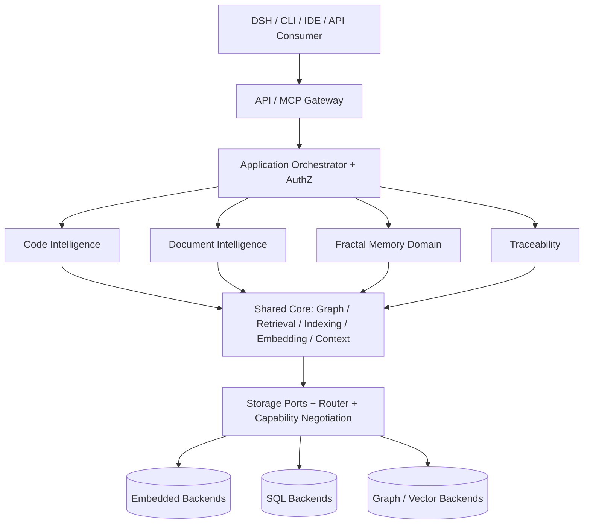

# UKMA

**Supercharge Claude Code, Cursor, Windsurf, Codex, Cline, GitHub Copilot (VS Code / CLI), Gemini CLI, opencode, Kiro, Hermes Agent, and Antigravity with Semantic Code Intelligence**

**預建的 code · 文件 · 記憶 · 追溯知識圖譜 —— 單一本地 Rust 二進位**

[](#license) [](LICENSE) [](#get-started)

[](#get-started) [](#get-started) [](#get-started)

**UKMA 平台**：125 個註冊操作、5 種 surface（MCP / CLI / HTTP / VS Code / GitHub Action）、3 種可替換儲存 Profile，全部走同一個 gateway。

### [權威規格（Full Spec v1.2.3）→](docs/UKMA_v1.2.3_Full_Spec.md)

### Contents

- [1. 系統介紹](#1-系統介紹)
- [2. 系統架構](#2-系統架構)
- [3. 系統功能](#3-系統功能)
- [目前狀態](#目前狀態)
- [環境要求](#環境要求)
- [Get Started（安裝、接線、初始化、卸載）](#get-started)
- [共享 daemon](#5-共享-daemon)
- [快速開始](#快速開始)
- [啟動與執行](#啟動與執行)
- [Language Support](#language-support)
- [CLI 旗標與 profile](#cli-旗標與-profile)
- [CodeGraph 對照（parity）](#codegraph-對照-parity)
- [儲存 Profile](#儲存-profile)
- [合約與代碼生成](#合約與代碼生成)
- [驗收命令](#驗收命令)
- [文檔地圖](#文檔地圖)
- [不變式](#不變式)
- [誠實邊界](#誠實邊界)
- [License](#license)

---

## 1. 系統介紹

UKMA（**U**nified **K**nowledge & **M**emory **A**rchitecture）是一個**統一 Intelligence Runtime**：在單一 Rust 進程上，為 AI coding agent 同時提供四種知識域的預建圖譜與上下文組裝能力——

- **Code Intelligence**：38 語言 tree-sitter 結構抽取 → 符號／呼叫／依賴圖，16 個 CodeGraph parity 操作 ＋ 29 個 CodeGraph Pro 相容操作；
- **Document Intelligence**：Markdown / PDF（文本層）/ DOCX 抽取、文件關係與來源版本，17 個操作（含 `generate_architecture_doc`，由代碼事實渲染架構文件）；
- **Fractal Memory（WM / EM / SM / PM）**：working / episodic / semantic / procedural 四層記憶，FSRS 間隔重複、TTL 衰減、三級折疊、RL 驅逐、context budget 與分頁、agent fractal 隔離、跨語言檢索，28 個操作；
- **Traceability Engine**：Requirement → Component → Symbol → TestCase → Evidence 狀態機，結果必然帶來源版本與可信度，13 個操作。

當 agent 需要理解代碼時，通常得用 grep、glob、Read 一個檔案一個檔案地爬，手工重建呼叫路徑與依賴。UKMA 把這些結構預先建好：**agent 問一個問題，一次呼叫就拿到需要的源碼、符號間的呼叫路徑與跨域關聯**（`get_ai_context` / `get_edit_context` / `get_curated_context` / `pr_context` …）。

設計原則（spec §1 / §6 / §14）：

1. **契約優先**：`contracts/`（operation registry、error / scope / event registry、JSON Schema）是唯一事實來源；wire schema 由 Rust 類型生成（ADR-058），漂移由 `ukma-contract-check` 在 Rust 中驗證；
2. **Database-agnostic**：domain 不依賴任何具體資料庫；Graph / Vector / Full-text / Metadata / Artifacts / Outbox 全部經可替換 Storage Ports（ADR-021～024），vendor SDK 只允許出現在 `adapters/*`；
3. **100% 本地**：本體是單一 Rust 二進位，**不需要 Node.js、也不需要 Python**（選用的 `npx` 啟動器只負責下載並 exec 同一個二進位）；
4. **多 surface、同一 gateway**：MCP server、CLI、HTTP server、VS Code 擴充、GitHub Action 全部走同一個 gateway；scope／授權／冪等／錯誤碼都由 registry 派生；
5. **安全與隔離**：租戶／項目隔離、單一 Writer Owner（fencing）、樂觀並發（etag CAS）、冪等鍵、outbox 語義、37 個封閉錯誤碼。

**定位（誠實聲明）**：UKMA 是依 [`docs/UKMA_v1.2.3_Full_Spec.md`](docs/UKMA_v1.2.3_Full_Spec.md) 以 Rust 實作的正式工作區，是 Phase 6 的**延伸**，**不是**「已完成」的 CodeGraph 遷移——遷移狀態見 `docs/migration/ledger/`（MIG-01 已依 ADR-063 永久決策）。Full Spec 是唯一自足的規範契約：實作不需要取得或閱讀任何 Fractal Memory Architecture 文件、先前 UKMA 版本或舊規格附錄。

**非目標**（spec §1.2）：

- 不宣稱任意自然語言文件可完全、無誤抽取正式規格；LLM 抽取須有驗證狀態；
- 不要求所有 backend 支援同一原生查詢語言、全域 ACID 或相同效能；
- 不要求 CodeGraph 內部 API / 檔案結構與上游一致；僅保留須保留的外部行為與演算法語義；
- 不將 agent 記憶衰減規則用來刪除權威代碼／文件；不允許未授權自行執行文件中的指令。

## 2. 系統架構

全域架構與依賴方向（spec §3）：



依賴方向規則（spec §3）：

- 內層 `ukma-types`、`ukma-contracts` **不得**依賴 domain crates 或 vendor SDK；
- `code-intelligence` / `document-intelligence` / `memory-domain` / `traceability` 只能透過 Shared Core Ports 做跨域資料存取；
- vendor SDK 僅允許在 `adapters/*`；API Gateway 不得繞過 ACL 或直接查底層資料庫；
- Graph DB native query 僅透過具語意等效保證的 adapter 執行。

### Workspace 分層（30 個 members）

| 層 | Crate |
|---|---|
| 合約 | `ukma-contracts`（wire 類型 + 生成的 OPERATIONS）、`ukma-types` |
| 域引擎 | `code-intelligence`（38 語言註冊表 + parser 端口）、`document-intelligence`（MD / PDF 文本層 / DOCX，17 操作）、`memory-domain`（Fractal Memory：FSRS/TTL、折疊、驅逐、分頁，MAPI-01..28）、`traceability-engine`（TraceLink 狀態機，13 操作） |
| 共享核心 | `graph-engine`（GraphStore + Traversal Planner）、`retrieval-engine`（HNSW + vector port）、`embedding-engine`（+ RerankerPort）、`indexing-engine`、`context-engine`（預算/驅逐/折疊/分頁）、`intelligence-core` |
| 儲存 | `storage-ports`、`storage-router`、`adapters/{filesystem,embedded,sqlite,postgres,qdrant,neo4j}` |
| 運行時 | `ukma-code-runtime`（dev-only file adapter + outbox 整合測試）、`ukma-security` |
| 表面 | `ukma-mcp`（gateway＋MCP stdio 伺服器＋`@cwd` 工作目錄索引）、`ukma-cli`（單一 `ukma` 二進位）、`apps/ukma-server`、`vscode-extension/`、`github-action/` |
| 驗證與工具 | `ukma-integration`（gate：coverage_matrix、claim_level、port_parity、release_evidence…）、`ukma-contract-check`、`ukma-bench`、`ukma-wire-schema`、`ukma-release-evidence` |

`code-intelligence` 特性：`parser-rust`（預設）、`parser-s2-batch1/2/4`（預設，共 37 個 tree-sitter 語法）、`schema`（schemars 輸出）。8 個偏差語言的 pinned crate 見 ADR-063。

### Storage Ports 與 Adapters

`storage-ports` 定義 6 個端口：`MetadataPort`、`FullTextPort`、`VectorPort`、`ArtifactPort`、`OutboxPort`，外加 `SchemaVersionPort` / `Migration` / `CapabilityProbe`；`GraphStore` 在 `graph-engine`。6 個 adapter（`crates/adapters/`）：`filesystem`（內容位址 artifact）、`embedded`（文件支撐 metadata + durable outbox）、`sqlite`、`postgres`、`qdrant`（REST）、`neo4j`（HTTP 交易 API）。缺少可工作的 adapter 時 MUST `UNAVAILABLE_ADAPTER`，不得假裝可用。

### 資料流（快照 → 解析 → 索引 → 組裝 → 服務）

1. **快照**：`ukma init` / `ukma sync` 把整棵樹的快照寫進 `.ukma/index.db`（SQLite、WAL）：每個檔案一列 `(size, mtime_ns, sha256, content)` + revision metadata；增量 sync 預篩只讀 `(size, mtime)` 變了的檔，parse 結果以**內容雜湊**為鍵持久化（`--verify` 逐檔比對內容雜湊，抓同尺寸＋時間戳被還原的編輯）。
2. **解析**：38 語言註冊表 + 37 個 tree-sitter 語法的宣告式 spec（每語言一個 spec、一個通用引擎——新增語言是資料變更，不是新邏輯）；8 個偏差語言以 pinned 非 baseline crate 實作（ADR-063，golden fixture 量測）。
3. **索引**：圖＋混合索引——static-embedding（詞元統計向量）＋ BM25 全文＋ HNSW 近鄰（`retrieval-engine`），不依賴外部 embedding 模型或 ONNX 執行時；`--watch` / daemon 的 watcher 偵測變更後增量重建。
4. **組裝**：`context-engine` 負責 context budget、三級折疊、RL 驅逐與分頁，把 agent 需要的上下文一次組裝出來；memory 層遵循同一套 budget 契約（spec §22.1 唯一計算式）。
5. **服務**：gateway 從 registry 派生 scope / 授權 / 冪等 / 錯誤碼；租戶與項目由請求頭強制（`x-ukma-tenant-id`、`x-ukma-project-id`、`x-ukma-principal-id`、`x-ukma-scopes`、`x-ukma-trace-id`）；單一 Writer Owner（同一 `(tenant, project, domain, entity_id)` 同時恰有一個受 fencing 保護的權威 Writer）。

## 3. 系統功能

- **125 個註冊操作**（code 33 / document 17 / memory 28 / traceability 13 / system 5 / pro 29），全部註冊於 `contracts/api/operation-registry.yaml`；每個操作的 request / response schema、scope、preconditions、狀態機、consistency modes、冪等、並發、錯誤碼、事件、storage ports、測試 ID 都由 registry 定義並代碼生成。
- **Code Intelligence（code 33 ＋ pro 29）**：
  - 38 語言註冊表（37 個 tree-sitter 語法；8 個偏差語言 pinned 並以 golden fixture 量測，ADR-063）；
  - **16 個 CodeGraph parity 操作**：複雜度熱點、循環依賴、熱路徑、死 import、模組摘要、模式 / 錯誤訊息搜尋、依簽名搜尋、進入點、相關測試聯結、增量檔案索引、PR 差異上下文、AI / 編輯 / 策展上下文組裝、文件來源清單、架構文件渲染；
  - **29 個 CodeGraph Pro 相容操作**（10 結構分析＋19 安全分析；重新實作而非原始碼移植；安全為啟發式偵測、標記候選模式，不取代 SAST/DAST/依賴掃瞄；`--online` 走 OSV 遠端依賴查詢，transport 失敗 degrade 為 manifest-only）。
- **Document Intelligence（document 17）**：Markdown / PDF（文本層）/ DOCX 抽取、文件關係與來源版本追蹤、`list_doc_sources`、`generate_architecture_doc`。
- **Fractal Memory（memory 28，MAPI-01..28）**：WM / EM / SM / PM 四層；FSRS 間隔重複＋TTL 衰減；三級折疊（**領域知識不受記憶 TTL / 折疊影響**）；RL 驅逐策略；context budget 與分頁；agent fractal 隔離；跨語言檢索；整合 pipeline（consolidation）與 trust 分級。
- **Traceability（traceability 13）**：TraceLink 狀態機；Requirement → Component → Symbol → TestCase → Evidence 全鏈可追溯；結果帶來源版本與可信度；`document.ingest.accepted` / `code.revision.stale` 等事件以 36 個封閉 payload schema 發出。
- **混合搜尋**：static-embedding（詞元統計向量）＋ BM25 全文＋ HNSW 近鄰，離線可用；`--embedding-model` 可選 `static-256`（預設、無外部權重）/ `bge-small`（384d）/ `jina-code-v2`（768d）/ `granite-97m`（384d）/ `qwen3-embedding-0.6b-int8`（1024d、INT8）/ `bge-m3-int8`（1024d、INT8）。ONNX 為**真實 runtime**（feature `onnx`，`ort` `load-dynamic` 於運行時載入 ONNX Runtime 並推論），但 UKMA 不自帶 ONNX Runtime 庫與模型權重（由部署側提供）；不可用時語意通道 degrade 至 static fallback。
- **5 種 surface、同一個 gateway**：
  - **MCP server**：`ukma --mcp`（stdio）；125 個工具的 scope / 授權 / 冪等 / 錯誤碼全由 registry 派生；`--profile` 過濾工具表面（`all` / `core` / `graph` / `memory` / `security`）。
  - **CLI**：單一 `ukma` 二進位（`health` / `manifest` / `capabilities` / `routes` / `tools` / `install` / `upgrade` / `init` / `sync` / `status` / `daemon` / `uninit` / `uninstall`）。
  - **HTTP server**：Profile A 開發預設——無 async runtime、單執行緒、`Connection: close`；REST 面 `POST /api/v1/{domain}/{operation}`（讀取也是 POST）＋ `GET /api/v1/health`、`GET /api/v1/jobs/{job_id}`。
  - **VS Code 擴充** 與 **GitHub Action**（另見 `jetbrains/` 完整、可建置結構；Gradle / IntelliJ build 未納入本倉庫驗收 gate）。
- **12 個 agent 接線目標**：`claude-code`、`cursor`、`windsurf`、`codex`、`cline`、`copilot-vscode`、`copilot-cli`、`gemini-cli`、`opencode`、`kiro`、`hermes`、`antigravity`——merge 寫入、重跑 no-op。
- **共享 daemon**：每專案一份 warm index，跨 session 共用；只委派 `tools/call`（stdio 仍由各自 session 擁有），失敗必回退、身份驗證（loopback＋bearer token）、事件偵測（Windows `ReadDirectoryChangesW`、其他平台 poll）。
- **契約閉合**：37 個封閉錯誤碼、24 個 scope、36 個事件；`ukma-contract-check` 在 Rust 中驗證（目前 9404 checks / 0 failed）；wire schema 由 Rust 類型生成並 `--check` 驗證。
- **可重現效能量測**：`ukma-bench`（FM-010）走公開 API 存 episodes、做查詢；報告明寫量測了什麼（RSS、磁碟、1M episodes benchmark）**與沒有**量測什麼（VRAM、第二個後端、embedding 模型）。
- **發布鏈**：GitHub Release（SHA-256 驗證資產）＋ npm `ukma-cli`（trusted publishing / OIDC，附 provenance）；SBOM（CycloneDX）以 Ed25519 簽章固定。

## 目前狀態（2026-10-27，全部可機器驗證）

| 項目 | 狀態 | 驗證方式 |
|---|---|---|
| 125 個操作（code 33 / document 17 / memory 28 / traceability 13 / system 5 / pro 29） | 全部實作並註冊於 registry | `contracts/api/operation-registry.yaml`、`ukma --operations` |
| 37 個錯誤碼（封閉集） | registry 與實作一致 | `cargo run -p ukma-contract-check`（9404 checks / 0 failed） |
| §17.1 29 類＋§29.4 40 項行為 ID（共 69） | `coverage_matrix` gate 全綠 | `cargo test -p ukma-integration --test coverage_matrix` |
| 聲明層級 | `implementation_compliant` 與 `production_ready` 由證據**推導**為 true | `claim_level` gate、`docs/implementation-status.yaml` |
| 儲存端口 | 6 個 trait + GraphStore；Profile A/B 已實作，Profile C adapter 真實且配置驅動 | `crates/storage-ports`、`crates/adapters/*`、ADR-057/061/062 |
| 測試 | 1236 passed / 2 failed（2 個＝`release_evidence` 的 SBOM digest 與簽名過期；發布簽章金鑰不在本倉庫，需以金鑰重新簽章） | `cargo test --workspace --all-targets --no-fail-fast` |

## 環境要求

- Rust stable（[rustup](https://rustup.rs)）＋ C/C++ 编译器與 linker。
- **Windows**：MSVC 工具鏈，必要時安裝 Visual Studio C++ Build Tools；若 PowerShell 腳本執行被管理員政策限制，可改由 CMD 或 VS Code task 直接執行 `cargo.exe`（無需啟用 PowerShell 腳本）。
- **Linux/macOS**：rustup 安裝 Rust stable，確認 C/C++ 編譯器與 linker 已安裝。
- 建構與運行 Rust **不需要 Python**；`scripts/gen_contracts.py` 僅 CI 的 codegen-reproducibility 步驟需要 python3。

## Get Started（安裝、接線、初始化、卸載，CodeGraph 四步對照）

與 CodeGraph 相同的四步，全部由同一個 `ukma` 二進位提供；**本體不需要 Node.js，也不需要 Python**（只有選用的 `npx` 啟動器需要 Node ≥ 18，而它只是下載並 exec 同一個二進位）。

### 1. 安裝 CLI

```powershell
# Windows (PowerShell)：一行安裝（等同 CodeGraph 的 `irm … | iex`）
irm https://raw.githubusercontent.com/jacoblight-chen/UKMA/main/scripts/install.ps1 | iex

# 或者從 checkout 跑（可帶旗標）
.\scripts\install.ps1                                        # 由 release 下載
.\scripts\install.ps1 -FromFile .\target\release\ukma.exe    # 離線／自行編譯
.\scripts\install.ps1 -Uninstall                             # 反安裝
```

```shell
# Linux / macOS：一行安裝
curl -fsSL https://raw.githubusercontent.com/jacoblight-chen/UKMA/main/scripts/install.sh | sh

# 或者從 checkout 跑（可帶旗標）
sh scripts/install.sh
sh scripts/install.sh --from-file target/release/ukma
sh scripts/install.sh --uninstall
```

```shell
# 已經有 Node？用 npx（等同 CodeGraph 的 `npx @colbymchenry/codegraph`）
npx ukma-cli                   # 下載平台二進位後直接跑 `ukma install`
npx ukma-cli init              # 其他子命令一樣轉發
```

用管線執行時**不能帶旗標**（`iex` 與 `sh` 都不傳參數）；需要 `-FromFile`／`--dir`／`-WhatIf` 等就從 checkout 跑。安裝目錄預設 Windows `%LOCALAPPDATA%\UKMA\bin`、其他 `~/.local/bin`（`-Dir` / `--dir` 可覆寫），並加入使用者 PATH（`-NoPath` / `--no-path` 可略過）。下載路徑會驗證 release 發佈的 SHA-256；**下載失敗不會在 PATH 或磁碟留下任何東西**（安裝目錄若由本次建立且仍為空會一併移除），目標位置若有損壞的舊檔會被視為「未安裝」而不是讓安裝器崩潰。

`npx` 啟動器（[npm/](F:/UKMA/npm)）**只有下載與 exec**，沒有任何 code-graph 邏輯：`$UKMA_BIN` 可直接指定現成二進位（不下載），`$UKMA_BIN_DIR`（預設 `~/.ukma/bin`）放快取；SHA-256 不符或下載失敗會清掉半成品並回報。npm 發佈由 release workflow 以 trusted publishing（OIDC，附 provenance）執行，設定了 `NPM_TOKEN` 時退回 token 路徑；細節見 [docs/publishing.md](docs/publishing.md)。

升級：`ukma upgrade`（`--check` 只看有無新版；`--from <file> [--sha256 <hex>]` 離線更換；`--dry-run` 只顯示）。固定版本：`ukma upgrade --manifest https://github.com/jacoblight-chen/UKMA/releases/download/v0.2.0/latest.json`。下載走**進程內 HTTP 客戶端**（`ureq`，10s 連線／300s 總逾時），**不需要系統 `curl`**。release 版面契約：`ukma-<triple>.zip`（內含 `ukma` / `ukma.exe`）＋ `ukma-<triple>.zip.sha256`、裸二進位 `ukma-<triple>[.exe]` ＋ `.sha256`（給 `npx` 用），以及 `latest.json`（`{"version": "...", "assets": {"<triple>": {"url": ..., "sha256": ...}}}`），`ukma upgrade` 讀取後者；`.github/workflows/release.yml` 在推送 `v*` tag 時產出這些資產。

### 2. 接線 agent（自動偵測、merge 寫入）

```shell
ukma install                   # 只接偵測到的 agent
ukma install --target cursor   # 指定 agent（可重複；`--target all` 全部支援項）
ukma install --dry-run         # 只顯示會改什麼，不寫檔
ukma install --no-rules        # 只寫 MCP 設定，不寫規則檔
```

每個設定檔都是 **merge**：其他 server、其他金鑰原樣保留；重跑為 no-op。支援 12 個目標：`claude-code`、`cursor`、`windsurf`、`codex`、`cline`、`copilot-vscode`、`copilot-cli`、`gemini-cli`、`opencode`、`kiro`、`hermes`、`antigravity`。

- **Hermes Agent**：寫 `$HERMES_HOME/config.yaml`（預設 `~/.hermes/config.yaml`）的 `mcp_servers:` 區塊，其他 server 與鍵原樣保留；`mcp_servers:` 若寫成單行 mapping 會**拒絕修改**並說明原因，而不是把使用者的檔案重排。項目自帶 `command`／`args` 以外的鍵（timeout、env、`enabled`）時視為使用者所有，只回報不覆寫。
- **Antigravity IDE**：寫 Antigravity 的 MCP 設定，且**不加 `type` 欄位**（Antigravity 會拒絕帶 `type` 的項目）。偏好 `~/.gemini/config/mcp_config.json`（已遷移：有 `~/.gemini/config/.migrated` 或該檔存在），否則寫舊路徑 `~/.gemini/antigravity/mcp_config.json`；`ukma uninstall` **兩條路徑都掃**，避免舊位置留下接線。
- `jetbrains` 是 REST client 而非 MCP client，會被標記為 skipped 並說明原因。

Hermes 與 Antigravity 沒有 UKMA 專屬規則檔（Hermes 的行為來自 `$HERMES_HOME` 設定；Antigravity 與 Gemini CLI 共用 `~/.gemini/GEMINI.md`，那是我方不該覆寫的使用者檔案），因此這兩個目標只寫 MCP 設定。

### 3. 初始化專案

```shell
cd your-project
ukma init                      # 建 .ukma/project.json + .ukma/index.db（並回報 revision）
ukma sync                      # 增量刷新：只讀 (size, mtime) 變了的檔
ukma sync --verify             # 逐檔比對內容雜湊（抓同尺寸＋時間戳被還原的編輯）
ukma status                    # 唯讀：目前 revision ＋ 尚未同步的檔案 ＋ daemon 狀態
ukma sync --force              # 丟掉快取、整棵樹重掃
ukma daemon start              # 選用：讓多個 session 共用一份 warm index
```

`ukma init`／`ukma sync` 把整棵樹的快照寫進 `.ukma/index.db`（SQLite、WAL）：每個檔案一列 `(size, mtime_ns, sha256, content)`，另加 snapshot metadata（revision、檔案數、掃描範圍）。`ukma status` 顯示 revision、scope、parse 條目數、`### Pending sync:`、daemon 狀態；daemon 端的 pending 以 `ukma daemon status` 的 revision／syncs 呈現，不逐檔列出。

**MCP 回應 banner**：`tools/call` 回應會附上 pending 檔案的 banner（**只 stat 回應中提到的路徑**，比對快照記錄的 `(size, mtime)`，不做逐次全樹掃描）。這是 **additive** 的 MCP 內容變更（多一個文字區塊），已取得 owner 核准；信封與 125 操作 registry／schema 未改動。取捨與盲點：

- 回應沒提到的 pending 檔案不會被列出（換取每次呼叫零全樹掃描）；要完整清單請用 `ukma status` 的 `### Pending sync:`（`--verify` 可連 stat 沒動的檔案一起驗）。
- stat 判斷本身的盲點（同尺寸＋時間戳被還原）由 `ukma sync --verify`／`ukma status --verify` 補上：它**讀每個檔案**比對內容雜湊。
- 快取新鮮度：預設靠 `(size, mtime_ns)` 判斷（與 `git status` 相同的取捨）；`.ukma/index.db` 只是快取，可隨時刪除（`ukma sync --force` 即重建，parse 條目一併清掉）；**不要提交進版本庫**。

### 4. 卸載

```shell
ukma uninstall --yes            # 解除所有 agent 接線 ＋ 刪掉 ukma 本體（CodeGraph 語意）
ukma uninstall --yes --keep-cli # 只解除接線，保留 CLI
ukma uninstall --dry-run        # 只顯示會刪什麼、改什麼
ukma uninit --yes               # 移除某個專案的 .ukma/（會先停掉該專案的 daemon）
```

`--remove-cli` 仍被接受（等同預設行為的顯式寫法）。刪不到自己的情況有明確處理：Windows 上正在執行的映像不能刪，但可以改名——安裝路徑照樣被清空（留下一個 `.old`，下次安裝／卸載會清掉），報告會寫出實情而不是假裝成功。手動改過的規則檔不會被刪；專案目錄一律留給你用 `ukma uninit` 決定。

### 5. 共享 daemon（多個 session 共用一份 warm index）

每個 `ukma --mcp` 都是一個**獨立進程**：各自載入快取、各自建 gateway。多開幾個 session 就等於多份 in-memory index。共享 daemon 把「已建好的 index」放進**一個**常駐進程，其他 session 只把 `tools/call` 委派過去：

```shell
ukma daemon start               # 背景啟動（挑一個 loopback port，寫 .ukma/daemon.json）
ukma daemon status              # pid / port / revision / watcher / sync 次數 / 請求數
ukma daemon stop                # 關閉並刪掉 handle
UKMA_DAEMON_IDLE_SECS=300 ukma daemon start   # 閒置多久自動結束（10s–24h，預設 1800）
UKMA_DAEMON_POLL_SECS=5 ukma daemon start     # 沒有原生 watcher 時的輪詢間隔（預設 2s）
```

啟動後，在專案內執行的 `ukma --mcp` 會自動委派，stderr 印 `ukma: delegating tool calls to the project daemon`；**沒有 daemon 時行為完全不變**。

- **變更偵測**：Windows 上用 `ReadDirectoryChangesW`（真事件，閒置零成本）；其他平台用 `UKMA_DAEMON_POLL_SECS`（預設 2 秒）的 stat 輪詢。事件有 300ms debounce（編譯器連寫上千檔只觸發一次 refresh），另外 30 秒一次安全輪詢補漏。樹一變就增量 `sync` 並換掉 gateway（不重開 session）。
- **並行**：一個連線一個 thread，慢查詢或沉默的客戶端不會擋住其他 session（warm state 仍由 `Mutex` 序列化，保證同一份 index 不被並改）。
- **誰可以委派**：只有「所有索引／搜尋選項都是預設值」的 session（沒 `--exclude`／`--max-files`／`--index-cwd`／`--workspace`／`--embedding-model`／`--graph-only`／`--no-cache`／`--watch`／`--online`）。否則各自建 gateway——**委派不得改變答案**。
- **失敗一定回退**：daemon 連不上、token 不對、回應壞掉 → 該次呼叫改用 session 自己的 gateway（結果仍然正確，只是沒有加速），stderr 不會靜默。
- **身分驗證**：只綁 `127.0.0.1` 的臨時埠，且每個請求都要帶 `.ukma/daemon.json` 裡的 bearer token（Unix 上檔案權限 `0600`）；token 不對回 `unauthorized`。
- **生命週期**：handle 檔在 `.ukma/daemon.json`；程序被 `kill -9`、重開機留下的**過期 handle 會在下次偵測時自動刪除並可重啟**。`ukma uninit` 會先停掉 daemon（它也持有 `index.db`），再刪 `.ukma/`。daemon 的 stderr 寫在 `.ukma/daemon.log`。閒置判斷只在**沒有請求在飛**時生效。

設計選擇（刻意如此，不是缺口）：

- **不是 MCP transport proxy**：stdio 仍由各自的 session 擁有（`initialize`／`tools/list`／profile 過濾都在本地），只有 `tools/call` 會過 daemon。把整條協議搬進共享進程等於讓一個客戶端的協議狀態影響其他客戶端——與 per-project 隔離的目標相反。
- **per-project**：一個專案一個 daemon，不跨專案共用（tenant／project 隔離優先）。

## 快速開始

```shell
git clone https://github.com/jacoblight-chen/UKMA.git && cd UKMA
cargo check --workspace --all-targets   # 確認編譯
cargo run -p ukma-server -- --health    # 健康負載
cargo run -p ukma-cli -- tools          # 列出 125 個操作
```

### 範例與工具

```shell
cargo run -p ukma-code-runtime --example quickstart   # JsonFileAdapter 最小閉環
cargo run -p code-intelligence --example parsed       # 解析範例（另有 cst / nodes）
cargo run -p ukma-bench -- --episodes 2000 --queries 500 --out bench.json
cargo run -p ukma-wire-schema -- --check             # wire.schema.json 與 Rust 類型對齊
cargo run -p ukma-release-evidence -- --check        # SBOM/inventory 派生文件對齊
```

`ukma-bench` 是可重現的效能 harness（FM-010）：走公開 API 存 episodes、做查詢，報告明寫量測了什麼、**沒有**量測什麼（RSS/VRAM、第二個後端、embedding 模型）。

## 啟動與執行

### 1. HTTP 伺服器（Profile A，開發預設）

無 async runtime：單執行緒、每連線一個請求、`Connection: close`。

```shell
cargo run -p ukma-server                        # 監聽 127.0.0.1:8080
cargo run -p ukma-server -- serve --addr 0.0.0.0:9090
cargo run -p ukma-server -- --manifest          # 輸出 tool-manifest.json
cargo run -p ukma-server -- --operations        # 列出暴露的操作 id
cargo run -p ukma-server -- --help
```

REST 面（spec §31.2）：

- 所有 domain 操作都是 `POST /api/v1/{domain}/{operation}`（讀取也是 POST）
- `GET /api/v1/health`、`GET /api/v1/jobs/{job_id}`
- 請求頭：`x-ukma-tenant-id`、`x-ukma-project-id`、`x-ukma-principal-id`、`x-ukma-scopes`（逗號分隔）、`x-ukma-trace-id`
- 完整的真實路由以 `cargo run -p ukma-cli -- routes` 輸出為準；每個操作的路徑、方法、scope 都由 registry 派生，伺服器不另行聲明

示例（`memory.store_episode`，MAPI-06；完整欄位契約以 `contracts/schema/v1/wire.schema.json` 為準）：

```shell
curl -s -X POST http://127.0.0.1:8080/api/v1/memory/store_episode \
  -H "x-ukma-tenant-id: tenant-dev" -H "x-ukma-project-id: project-dev" \
  -H "x-ukma-principal-id: principal-dev" \
  -H "content-type: application/json" \
  -d '{"input":{"session_id":"s-1","agent_id":"agent-dev","agent_depth":0,
       "episode_type":"ConversationTurn","summary":"hello ukma",
       "full_text_ref":null,"key_facts":["ukma is rust-first"],
       "outcome":"Success","source_refs":[],"importance_score":0.8,
       "language":"en","evidence":[]}}'
```

### 2. CLI（與伺服器走同一個 gateway）

CLI 已合併為單一 `ukma` 二進位（`cargo build -p ukma-cli --release` → `target/release/ukma`），與 `ukma-server` 走同一個 gateway：

```shell
cargo run -p ukma-cli -- health               # 健康負載
cargo run -p ukma-cli -- manifest            # tool manifest
cargo run -p ukma-cli -- capabilities        # system.capabilities
cargo run -p ukma-cli -- routes              # 真實 REST 路由
cargo run -p ukma-cli -- tools               # 125 個操作
cargo run -p ukma-cli -- --mcp               # MCP stdio 伺服器
```

## Language Support

38 個語言進入同一個註冊表、同一個通用 tree-sitter 抽取引擎，**不需要逐語言設定**：Rust、Python、Go、Java、JavaScript / TypeScript、C、C++、C#、PHP、Ruby、Scala、Swift、Kotlin、Clojure、CSS、Elixir、Elm、Erlang、Fortran、Bash、Solidity 等。每語言一個宣告式 spec（節點 kind → 符號／呼叫／定義抽取規則），新增語言是資料變更、不是新邏輯。8 個語法偏差語言（7 個 pinned 非 baseline crate ＋ kotlin ng fork）以 golden fixture 量測（ADR-063）。

## CLI 旗標與 profile

**索引選項**（`ukma --mcp`／`ukma init`／`ukma sync` 共用）：

- `--workspace <dir>`：可重複多根；合併多根、path 去重（第一個根勝出）。
- `--exclude <glob>`：可重複，附加在內建排除集（~47 目錄＋二進位/機密 glob）之上。
- `--max-files <n>`：索引檔案數上限（在內建 skip 之後截斷）。
- `--watch`：以 mtime 輪詢（2s）偵測變更並重新索引。**兩種語意**：（a）`--mcp --watch`（含根目錄）→ 建立**可熱切換** gateway，把重新索引**熱切換**到活著的 stdio MCP session（CodeGraph `--watch` parity，已升級為 live hot-swap）；（b）`--watch`（非 MCP，含根目錄）→ 一次指令跑完後輪詢重索引（落盤、非熱切換）。

**Tier 2+ 搜尋/嵌入策略**（CodeGraph `--split-identifiers` / `--full-body-embedding` / `--graph-only` 對齊，僅對索引後的樹生效）：

- `--split-identifiers` / `--no-split-identifiers`：camelCase 識別字切分（`getUserById` → `get user by id`）；**預設切分**（維持既有 tokeniser）。
- `--full-body-embedding` / `--no-full-body-embedding`：把符號的**原始碼函式體**納入語料庫再嵌入（依 `definition` 行範圍自索引來源擷取）；**預設關**（維持既有 name/qualified/signature 語料庫；與 CodeGraph 預設 `true` 不同，為保留既有行為）。
- `--graph-only`：僅結構（keyword/BM25）排序，略過 static-semantic 通道；**預設關**。

**`--profile` 工具表面過濾**（CodeGraph `--profile` 對齊，搭配 `--mcp` 過濾曝露的 MCP 工具；不是 exclude 預設集）：

- `all`（預設）：全部 125 個工具。
- `core`：8 個搜尋/上下文工具（`find_symbols`、`get_symbol`、`get_ai_context`、`get_edit_context`、`get_curated_context`、`search_by_pattern`、`search_by_error`、`find_by_signature`）。
- `graph`：17 個結構/圖/impact/PR 工具（callers/callees/deps/impact/compare/circular/hot/dead/entry/related/complexity/module/index_files/pr_context/analyze_repository/get_analysis_job/find_references）。
- `memory`：28 個 `memory.*` ＋ 17 個 `document.*` 工具。
- `security`：社群版**空**（UKMA 不實作 CodeGraph Pro 的 security 工具）。
- 不在 profile 內的工具：`tools/list` 不列出、`tools/call` 以 `-32602 not in active profile` 拒絕。

**`--embedding-model` 與 memory gate（CodeGraph 對齊）**：CLI 接受 `static-256`（預設、無外部權重、離線）、`bge-small`（384d）、`jina-code-v2`（768d）、`granite-97m`（384d）、`qwen3-embedding-0.6b-int8`（1024d、INT8 量化）、`bge-m3-int8`（1024d、INT8 量化）。ONNX 為**真實 runtime**（feature `onnx`，`ort` `load-dynamic` 於運行時載入 ONNX Runtime 並推論），但 UKMA 不自帶 ONNX Runtime 庫與模型權重（由部署側提供）；ONNX 不可用時語意通道 degrade 至 static fallback。`CODEGRAPH_SKIP_MEMORY_CHECK` 為 ONNX ~1.5GB RAM gate 開關：未設定時啟動前探測可用記憶體，不足時 degrade 至 `GraphOnly`；設定後略過 gate（用於已知記憶體充足的部署）。

**AI agent 規則檔**（CodeGraph 對齊）：`agent-rules/` 提供 Claude、Cursor、Windsurf、Codex、Cline 五份專屬規則檔，加上 `agent-rules/common/UKMA.md`（供 Copilot CLI、Gemini CLI、opencode、Kiro 使用）；`ukma install` 會把它們寫到各 agent 的規則位置（`--no-rules` 可略過），手動 `cp agent-rules/<agent>/UKMA.md` 仍然可用。用法與 intent→tool 對照表見 `agent-rules/README.md`。

## CodeGraph 對照（parity）

UKMA 實作了 CodeGraph 的核心執行路徑（Tier 0–3）、16 個 CodeGraph parity 操作與 **29 個 CodeGraph Pro 相容 operations**（10 結構分析＋19 安全分析，相容而非移植），使 CodeGraph 的常用人格能在 UKMA 上運行。

**已覆蓋（16 個 parity 操作）**：

| 域 | 操作 | 對應 CodeGraph 能力 |
|---|---|---|
| code | `analyze_complexity` | 複雜度報告（圈複雜度熱點） |
| code | `find_circular_deps` | 循環依賴偵測 |
| code | `find_hot_paths` | 熱路徑（高扇入/扇出） |
| code | `find_dead_imports` | 死 import 偵測 |
| code | `get_module_summary` | 模組摘要 |
| code | `search_by_pattern` / `search_by_error` | 模式 / 錯誤訊息搜尋 |
| code | `find_by_signature` | 依簽名（參數數/回傳型別）搜尋 |
| code | `find_entry_points` | 進入點偵測 |
| code | `find_related_tests` | 相關測試聯結 |
| code | `index_files` | 增量檔案索引 |
| code | `pr_context` | PR 差異上下文（base→head） |
| code | `get_ai_context` / `get_edit_context` | AI/編輯上下文組裝 |
| code | `get_curated_context` | 策展上下文 |
| document | `list_doc_sources` | 文件來源清單 |
| document | `generate_architecture_doc` | 由代碼事實渲染架構文件 |

搜尋以**混合**方式實作：static-embedding（詞元統計向量）＋ BM25 全文 ＋ HNSW 近鄰（`retrieval-engine`），不依賴外部 embedding 模型或 ONNX 執行時。

**CLI 旗標 parity**（CodeGraph CLI 對齊，均已實作＋Rust 測試）：

| 旗標 | CodeGraph 語意 | UKMA 實作 |
|---|---|---|
| `--workspace` | 可重複多根 | 合併多根、path 去重（第一個根勝出）；快取／`status`／banner 同樣支援多根 |
| `--exclude` | 可重複 glob | 附加在內建排除集之上 |
| `--max-files` | 檔案上限（預設 5000） | 索引上限（多根時每個 root 各自計算） |
| `--watch` | mtime 輪詢重索引 | 2s 輪詢、重索引；`--mcp --watch`（含根）→ 從快照快取起跑並 live hot-swap |
| `--profile` | **工具表面過濾**（all/core/graph/memory/security） | 同一語意：過濾 MCP 工具表面（core=8、graph=17、memory=45、security=空） |
| `--split-identifiers` | camelCase 切分（預設 on） | `tokenize`（切分）vs `tokenize_raw`（不切分） |
| `--full-body-embedding` | 函式體嵌入（CodeGraph 預設 on） | 依 `definition` 行範圍自來源擷取函式體納入語料庫（UKMA 預設 off，保留既有行為） |
| `--graph-only` | 僅結構、無嵌入 | 僅 keyword/BM25 通道排序 |
| 內建排除集 | ~47 目錄 ＋ 二進位/機密 glob | 同集 |

**Setup 命令 parity**（CodeGraph `install` / `init` / `uninstall` / `uninit` / `upgrade` 對齊，均已實作＋Rust 測試）：

| CodeGraph | UKMA | 差異（誠實邊界） |
|---|---|---|
| `install.sh` / `install.ps1` / npm | `scripts/install.sh` / `scripts/install.ps1`（含 SHA-256 驗證、`--from-file` 離線安裝、PATH 設定）＋ `npm/`（`npx ukma-cli`） | 一行安裝與 `npx` 啟動器都有；`npx` 只是下載＋exec 同一個二進位，npm 發佈走 trusted publishing（OIDC，`NPM_TOKEN` 為 fallback，見 `docs/publishing.md`） |
| `codegraph upgrade` | `ukma upgrade [--check] [--from <file>] [--sha256 <hex>]` | 下載在進程內完成（`ureq`），**不需要 `curl`**；`--from` 供完全離線的環境 |
| `codegraph install`（自動偵測 9+ agent） | `ukma install [--target <id>\|all] [--dry-run] [--no-rules]` | 12 個可設定目標（含 `hermes`、`antigravity`）；`jetbrains` 標記 skipped（REST client） |
| `codegraph init`（建 `.codegraph/` 並建圖） | `ukma init [dir] [--workspace/--exclude/--max-files]` | 建 `.ukma/` manifest ＋ `.ukma/index.db` 快照；索引仍標記為 dirty snapshot |
| `codegraph sync`（增量、只重解析變更檔） | `ukma sync [--force] [--verify]`（stat 預篩 ＋ content hash，只讀變更檔；parse 結果以內容雜湊為鍵持久化） | 多根專案同樣走快取；`--verify` 逐檔驗內容；`ukma status` 顯示 pending |
| `codegraph status`（節點/邊/檔案數、pending） | `ukma status [--verify]`（revision、scope、parse 條目數、`### Pending sync:`、daemon 狀態） | daemon 端的 pending 以 `ukma daemon status` 的 revision／syncs 呈現，不逐檔列出 |
| `codegraph daemon`（長駐、跨 session 共用、`CODEGRAPH_NO_DAEMON=1` 關閉） | `ukma daemon start\|stop\|status` ＋ `UKMA_DAEMON_IDLE_SECS`／`UKMA_DAEMON_POLL_SECS` | 只委派 `tools/call`（stdio 仍由各 session 擁有）；環境變數式關閉不需要——沒 daemon 時自動回退 |
| `codegraph uninstall` / `uninit` | `ukma uninstall --yes [--keep-cli\|--remove-cli]` / `ukma uninit --yes` | 預設同時刪 CLI（與 CodeGraph 相同），`--keep-cli` 保留；手改規則檔不會被刪；`uninit` 先停 daemon 再刪 `.ukma/` |

**CodeGraph Pro 相容 operations（27 個，相容而非移植）**：

UKMA 以 `pro` domain 提供 29 個 read-only 的 CodeGraph Pro 相容 operations（`code:read` scope、`immutable_snapshot` 並發、`PRO-01...PRO-27` 測試集；S10 追加 `pro.security_orchestrated_scan` 與 `pro.security_codeql_warmup`）。`--profile security` 暴露 19 個安全分析器；`ukma_system_capabilities` 回報 `pro: 29`。

| 類別 | 操作（registry `domain.operation`） |
|---|---|
| 結構分析（10） | `pro.analyze_coupling`、`pro.find_unused_code`、`pro.find_duplicates`、`pro.find_similar`、`pro.cluster_symbols`、`pro.compare_symbols`、`pro.cross_project_search`、`pro.mine_git_history`、`pro.mine_git_history_for_file`、`pro.search_git_history` |
| 安全分析（19） | `pro.scan_security`、`pro.security_control_flow`、`pro.security_trace_data_flow`、`pro.security_generate_sbom`、`pro.security_audit_deps`、`pro.security_check_unchecked_returns`、`pro.security_check_resource_leaks`、`pro.security_check_misconfig`、`pro.security_check_input_validation`、`pro.security_check_error_exposure`、`pro.security_scan_iac`、`pro.security_check_licenses`、`pro.security_check_secrets_entropy`、`pro.security_detect_injection`、`pro.security_check_search_path`、`pro.security_check_crypto`、`pro.security_export_sarif`、`pro.security_orchestrated_scan`、`pro.security_codeql_warmup` |

**限制（外部依賴或刻意選擇，不是待辦）**：

- **CodeGraph Pro**：UKMA 提供 Pro **相容 operations（重新實作，非原始碼移植）**。安全分析為**啟發式偵測**（模式覆蓋較廣，標記候選模式、**不證明**漏洞存在），亦不取代 SAST/DAST/依賴掃瞄；`--online`（feature `osv`）執行 OSV/依賴遠端查詢（網路操作，不在離線範圍），transport 失敗時 degrade 為 manifest-only。UKMA 不實作 CodeGraph Pro 的商業訂閱能力。
- **ONNX embedding 模型**：**真實 runtime**（feature `onnx`，`ort` `load-dynamic`）已實作，但 UKMA **不自帶** ONNX Runtime 庫、模型權重與 model-matching tokenizer——皆由部署側提供；不可用時 degrade 至 static fallback。
- **JetBrains 外掛**：提供**完整、可建置結構**（startup activity、tool window、action、薄 REST client，皆註冊於 `plugin.xml`）；Gradle/IntelliJ build **未在本倉庫驗收 gate 執行**（需 IntelliJ SDK 下載），不宣稱可分發 .zip 已完成。
- **不需要新增 crate**：本倉庫的 SBOM 以 Ed25519 簽章固定，私鑰不入庫，因此不能為了「更漂亮的實作」新增套件（例如跨平台 watcher crate）。這正是 daemon 用 Win32 `ReadDirectoryChangesW`（Windows）＋可調輪詢（其他平台）而不是 `notify` 的原因；HTTP 下載則重用已在 workspace 內的 `ureq`。
- **`--watch`（非 MCP）**：沒有活著的 session 可熱切換，因此就是落盤重索引；`--mcp --watch` 才是熱切換，且現在**從快照快取起跑**。
- **耐久性/跨進程**：in-memory 索引是當前樹的 dirty snapshot（無耐久性聲明）；持久化走 Profile B（SQLite）或 Profile C（PostgreSQL＋Qdrant＋Neo4j）。

## 儲存 Profile

| Profile | 後端 | 用途 |
|---|---|---|
| A（開發） | in-memory + `JsonFileAdapter`（僅開發） | 本地開發、測試預設 |
| B | SQLite（`rusqlite` bundled、WAL、真 SQL 交易，ADR-057） | 無需伺服器的單機持久化 |
| C | PostgreSQL + Qdrant + Neo4j（真實、配置驅動，ADR-061） | 生產混合部署 |

**JsonFileAdapter 僅供開發**：無跨進程安全/耐久性保證；持久化用 Profile B（SQLite）或 Profile C（PostgreSQL + Qdrant + Neo4j）。**Profile C 三方等價**建立在 ADR-062 一次運行的已檢入證據上（本機無 Docker/psql/Qdrant/Neo4j）。

## 合約與代碼生成

- `contracts/api/operation-registry.yaml` 是唯一事實來源；`scripts/gen_contracts.py` 由 CI（`contract-closure`）執行並 diff 生成物（`sdk/typescript/ukma-operations.ts` 等）。
- `wire.schema.json` 由 Rust 類型生成（ADR-058）：`cargo run -p ukma-wire-schema` 重新生成，`--check` 驗證。
- SBOM / 第三方 inventory 是**派生**文件（ADR-059）：`ukma-release-evidence` 重寫、`--check` 驗證、`sign`/`verify` 處理 Ed25519 摘要（金鑰在倉庫外）。

## 驗收命令（與 CI `contract-closure.yml` 同款）

```shell
cargo fmt --all -- --check
cargo clippy --workspace --all-targets -- -D warnings
cargo test --workspace --all-targets            # 2026-10-27：1236 passed / 2 failed（SBOM 簽章過期，見「目前狀態」）
cargo run -p ukma-contract-check              # 9404 checks / 0 failed
cargo test -p ukma-integration --test coverage_matrix --test claim_level
cargo test -p code-intelligence --test s2_coverage
```

`scripts/verify_rust.ps1` / `verify_rust.sh` 是上述 cargo gate 的包裝腳本。

## 文檔地圖

- `docs/UKMA_v1.2.3_Full_Spec.md` — 權威規格
- `docs/UKMA_v1.2.3_IMPLEMENTATION_PLAN.md` — 計畫、缺口分析與 Gate 對照
- `docs/PHASE6R_IMPLEMENTATION_PLAN.md` / `PHASE7_CODEGRAPH_MIGRATION_PLAN.md` / `PHASE8_GAP_CLOSURE_PLAN.md` / `PHASE_6_REPORT.md` — 階段計畫與報告
- `docs/implementation-status.yaml` — 聲明層級與 gate（由 `claim_level` gate 機器校驗）
- `docs/adr/`（ADR-001…063）、`docs/testing/`（覆蓋矩陣）、`docs/performance/`（基線）、`docs/migration/`（S2 ledger + 狀態）
- `docs/publishing.md` — 發佈 runbook（npm `ukma-cli` + GitHub Release、trusted publishing、回滾、版本升級與 tag）
- `.github/copilot-instructions.md` — 項目級 Copilot 指引；`.vscode/` — tasks、debugger、擴充建議
- VS Code：開啟 `UKMA-Phase6R.code-workspace`（或 **File → Open Folder** 開工作區根），**Terminal → Run Task → Cargo: Check / Cargo: Test / Cargo: Run Example**

## 不變式（每個新行為都必須維持）

租戶/項目隔離、樂觀並發（etag CAS）、冪等鍵、outbox 語義、錯誤碼封閉集、domain 不依賴 backend SDK（ADR-021）、domain 知識不受記憶 TTL/折疊影響、每個新行為需附 Rust 正/負/授權/版本/失敗路徑測試。

## 誠實邊界

- **JsonFileAdapter 僅供開發**：無跨進程安全/耐久性保證；持久化用 Profile B（SQLite）或 Profile C（PostgreSQL + Qdrant + Neo4j）。
- **Profile C 三方等價**建立在 ADR-062 一次運行的已檢入證據上（本機無 Docker/psql/Qdrant/Neo4j）。
- **8 種語言語法偏差**（7 個 pinned 非 baseline crate + kotlin ng fork）以 golden fixture 量測，非對照上游行為（ADR-063）。
- **PDF 不含 OCR**（ADR-048：明確 partial）；**VRAM 未量測**（已量測 RSS 與磁碟）。
- **SBOM 簽章**：SBOM digest 與 Ed25519 簽名在 2026-10-27 過期（`release_evidence` 2 個測試因此失敗）；簽章金鑰不在本倉庫，需以金鑰重新簽章後恢復 0 failed。

## License

Apache-2.0（見 [LICENSE](LICENSE) 與 [NOTICE](NOTICE)）；SBOM（CycloneDX）以 Ed25519 簽章固定於 release evidence。
