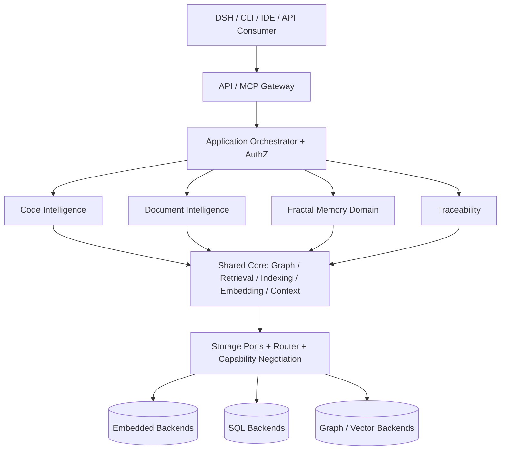
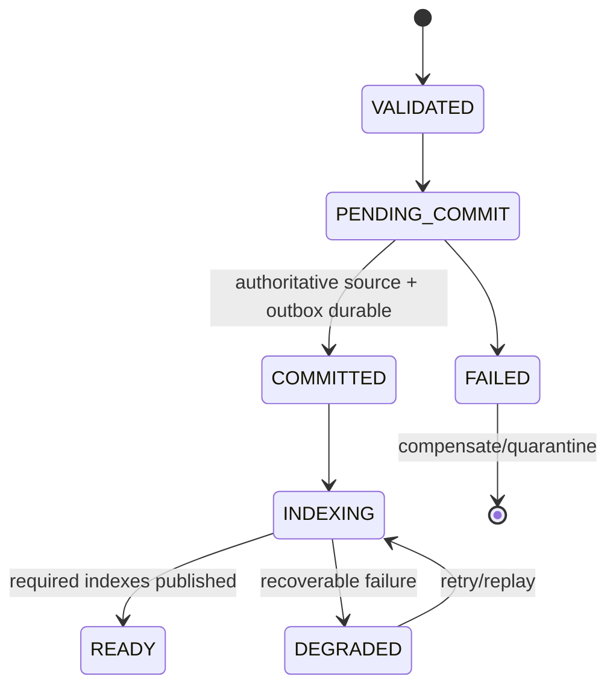
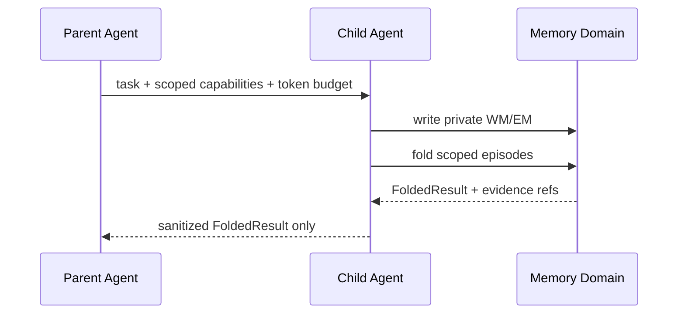
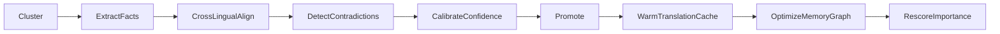
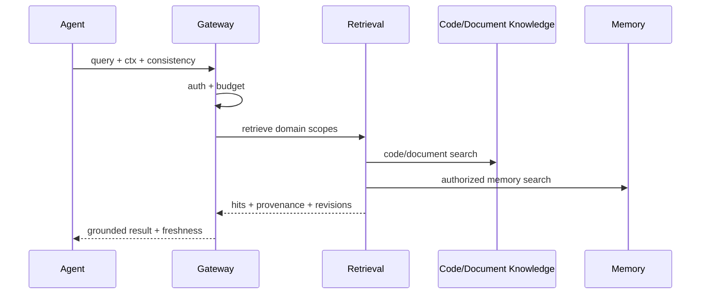
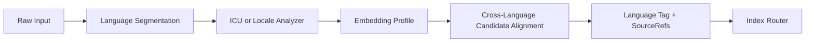

# Unified Knowledge & Memory Architecture (UKMA)
## Interface & Runtime Contract Specification v1.2.3 — Full Memory Coverage / Standalone / Contract-First Native Refactoring Edition

**文件狀態**：Normative Architecture & Implementation Specification  
**版本**：1.2.3  
**日期**：2026-10-25  
**預期使用者**：系統架構師、Rust 開發者、AI Coding Agent、測試與維運工程師  
**獨立性聲明**：本文件是 UKMA 唯一自足的架構及執行契約。實作本文件所定義的功能**不需要**取得或閱讀任何 Fractal Memory Architecture（FMA）文件、先前 UKMA 版本，或舊規格的附錄。原始 FMA 概念已成為本文件內的 **UKMA Memory Domain** 規範，其規範值、行為、例外、驗收條件均在本文重新定義。CodeGraph 原始碼與授權文件則是**被移植程式碼的外部原始資產**，不是 UKMA Runtime 契約的外部依賴。

---

# 0. 規範詞、版本與治理

- **MUST / MUST NOT**：不可違反之要求；**SHOULD / SHOULD NOT**：除非有正式 ADR 說明，否則必須遵守；**MAY**：可選。
- **契約優先序**：安全與授權 > 資料擁有權與不變條件 > Domain/Port Contract > Runtime State Machine > 部署設定 > 範例。文字與範例牴觸時，以規範文字為準。
- 本文件的所有 API 片段均為 *contract-defining pseudotypes*；對外 wire schema 以 JSON Schema / Protobuf 正式生成物為準；Rust 介面由相同 IDL 產生或人工對照。
- UKMA API 使用 SemVer：新增可忽略 optional 欄位為 minor；改變既有欄位語義、必填性、刪除或狀態機行為為 major。Unknown enum 必須拒絕或映射正式 `UNKNOWN`，不能自行推測。
- 日期時間：UTC RFC3339；ID 永不直接等於資料庫 primary key；雜湊演算法與正規化版本必須寫入 manifest。
- 規格為**目標實作契約**，不表示任何新 Crate、Adapter 或 GitHub Repo 已建立或通過測試。

# 1. 系統目標、範圍與非目標

## 1.1 目標

UKMA 是支援程式碼、文件、Agent 記憶與跨領域可追溯分析的統一 Intelligence Runtime。MUST：

1. 從 CodeGraph 原始碼逐模組移植並同步重構，最大限度重用已驗證演算法，保留來源與測試映射。
2. 原始碼與文件有一致的 Knowledge Entity / Relation / Evidence 模型；Parser、Extractor 保留領域專用實作。
3. Agent 記憶具備 WM、EM、SM、Procedural Memory、folding、consolidation、隔離、跨語言檢索。
4. Graph、Vector、Full-text、Metadata、Artifacts、Outbox 經由可替換 Storage Ports；**不得綁定 RocksDB**。
5. 跨域 Requirement → Component → Symbol → TestCase → Evidence 可追溯，結果必須帶來源版本與可信度。
6. DSH 以 Plugin/MCP 接入，不以變更 DSH Core 為必要條件；其他 Host 使用同一公開接口。
7. 保證 ACL 隔離、來源追溯、可恢復提交、索引新鮮度、可觀測性、可驗收性。

## 1.2 非目標

- 不宣稱任意自然語言文件可完全、無誤抽取正式規格；LLM 抽取須有驗證狀態。
- 不要求所有 Backend 支援同一原生查詢語言、全域 ACID 或相同效能。
- 不要求 CodeGraph 內部 API/檔案結構與上游一致；僅指定須保留的外部行為與演算法語義。
- 不將 Agent 記憶衰減規則用來刪除權威原始碼／文件；不允許未授權自行執行文件中的指令。

# 2. 核心術語與權責

| 術語 | 定義 | 唯一 Authority |
|---|---|---|
| Source Artifact | Immutable source bytes 與 content hash | Artifact Manager |
| Source Revision | Git SHA / 文件版本 / 外部來源快照 | Source Registry |
| Knowledge Entity/Relation | 從特定來源版本取得之結構化語義 | Knowledge Registry |
| Derived Index | 可重建 Vector/FTS/Graph Projection | Indexing Engine |
| WM | 單一 Agent 回合的活躍 Context Blocks | Memory Domain |
| EM | 任務或對話 Episode，可衰減與回收 | Memory Domain |
| SM | 經證據支持的長期記憶事實 | Memory Domain |
| PM | 經驗驗證形成的可重用程序／技能 | Memory Domain |
| Traceability Edge | 跨 Code/Document/Test/Memory 的關聯聲明 | Traceability Engine |
| Evidence | 帶位置、hash、版本、抽取方法的佐證 | Evidence Registry |
| Snapshot | 一組原始版本及其已發佈索引世代 | Revision Manager |

**單一 Writer Owner**：同一 `(tenant, project, domain, entity_id)` 同時間恰有一個受 fencing 保護的權威 Writer。知識層與記憶層可以在相同實體 DB 存放，但不能互相作為權威寫入者。

# 3. 全域架構與依賴方向



- 內層 `ukma-types`, `ukma-contracts` MUST NOT 依賴 Domain Crates 或 Vendor SDK。
- `code-intelligence`, `document-intelligence`, `memory-domain`, `traceability` 只能透過 Shared Core Ports 進行跨域資料存取。
- Vendor SDK 僅允許於 `adapters/*`；API Gateway 不得繞過 ACL 或直接查底層資料庫。
- Graph Engine 具有跨域 Schema Registry、Traversal Planner；Graph DB Native Query 僅透過具語意等效保證之 Adapter 執行。

## 3.1 建議 Rust Workspace（目標，不是上游路徑）

```text
ukma/
  Cargo.toml  Cargo.lock  LICENSE  NOTICE  THIRD_PARTY_LICENSES.md
  crates/
    ukma-types/  ukma-contracts/  ukma-security/
    intelligence-core/  graph-engine/  retrieval-engine/
    indexing-engine/  embedding-engine/  context-engine/
    code-intelligence/  document-intelligence/
    memory-domain/  traceability-engine/
    storage-ports/  storage-router/
    adapters/{rocksdb,sqlite,postgres,pgvector,qdrant,neo4j,filesystem}/
    ukma-mcp/  ukma-cli/
  apps/ukma-server/
  tests/{contracts,golden,integration,e2e,chaos,security}/
  fixtures/{code,documents,multilingual,expected_graphs}/
  docs/{adr,upstream,migration,schemas,runbooks}/
```

新 Backend Crate 只是**候選目標**；缺少可工作的 Adapter 時 MUST `UNAVAILABLE_ADAPTER`，不得假裝可直接使用。可先以 Modular Monolith 部署，再按量測結果拆服務。

# 4. 雙 Repository 與來源移植契約 — ADR-025（ACCEPTED）

## 4.1 兩套獨立 Git 管理

- `codegraph-upstream.git` MUST 為不可修改的上游 Mirror，保存歷史、refs、tags；另設 `codegraph-reference` checkout 用於原版編譯、Golden Fixtures。
- `ukma` MUST `git init` 為全新 Repository，沒有強制共享 upstream Git History；每個移植的檔案保存 `upstream SHA + original path + license + change notes`。
- Mirroring 是開發流程必要資產，不代表必須在最終發行包內附完整 upstream Repo；出貨依法保留適用授權／NOTICE／Copyright。
- 必須鎖定具體 Commit SHA、Rust toolchain、Cargo.lock、feature flags、模型與測試 fixture；不得用浮動 `main` 當可重現 Baseline。

## 4.2 從保留基準直接重構

**唯一批准策略**：`Mirror → Locked Golden Baseline → UKMA Contract → Migrate+Refactor Vertical Slice → Tests → Merge`。不要求 UKMA 先建立完整 Legacy Replica；也不允許缺失測試的大爆炸式重寫。

每個 Slice 必須擁有：`slice_id`, `source_sha`, `source_paths`, `target_crates`, `behavior_contracts`, `approved_differences`, `license_audit`, `golden_tests`, `contract_tests`, `rollback_plan`。

| Slice | 上游資產類型（依鎖定 SHA 審計） | 目標責任 | Gate |
|---|---|---|---|
| S0 | Repo / Cargo workspace / licenses | 上游唯讀參考、Golden Fixtures | SHA、Build、Tests、License |
| S1 | Graph / Storage abstraction | Graph Engine + Ports | ID/edge/traversal golden + 2-adapter tests |
| S2 | Parser API / language parsers | Code Intelligence | AST / symbol parity |
| S3 | Retrieval / BM25 / vector | Retrieval + Indexing | Recall/latency/ACL correctness |
| S4 | Markdown / documentation handling | Document Intelligence | Sections/source span parity |
| S5 | CodeGraph memory functionality | Memory Domain adapter/migration | 唯一記憶權威 + no-loss migration |
| S6 | MCP / CLI / server | Unified Gateway | Public tools regression |
| S7 | New UKMA Document & Trace functions | DIE + Traceability | Cross-domain E2E |

實際來源路徑 **MUST 由已鎖定 Repo Manifest 產生**，不能把上表泛用名稱當作已核對原始碼映射。

## 4.3 Migration Ledger 格式

```yaml
slice_id: S2-rust-parser
upstream:
  repository: https://github.com/codegraph-ai/CodeGraph
  commit: "<verified-full-sha>"
  paths: ["<verified-relative-file-path>"]
target:
  repository: ukma
  crate: code-intelligence
  files: ["<target-file-path>"]
license: {identified: false, notices_preserved: false}
changes: ["extract ParserPort", "remove Vendor Storage dependency"]
behavior:
  preserved: ["symbol identity", "source spans"]
  intentional_breaking: []
tests: {golden: pending, contract: pending, integration: pending}
review: {owner: "<reviewer>", status: pending}
```

`license.identified=false` 或 `notices_preserved=false` 時 MUST 阻擋 Merge。

## 4.4 保留與裁減原則

- MUST 保留可證明的演算法行為（符號解析、Traversal、BM25 排序/Tokenization、Vector metric、MCP 輸出語義）；允許經 ADR 批准的改進。
- MUST NOT 為符合新目錄而無證據重寫演算法。
- 原上游不適合之 Schema 與 RocksDB 存取可直接抽離；原 Backend 只在 Adapter 中保留。
- Backward incompatible Public API MUST 版本化，並提供 migration guide；Private API 不保證相容。
- CI 必須掃描 Domain crate 的 Vendor SDK import、循環相依與未登錄上游來源。

# 5. Canonical 資料模型與 Wire 契約

```typescript
export type Domain = 'code' | 'document' | 'memory' | 'trace';
export type Verification = 'verified' | 'inferred' | 'unverified' | 'contradicted' | 'stale';
export type RelationState = 'proposed' | 'validated' | 'accepted' | 'rejected' | 'stale' | 'revoked';
export type Consistency = 'eventual' | 'at_least_revision' | 'snapshot';
export interface ResourceRef {
  urn: string; domain: Domain; entity_id: string; revision_id: string;
  revision_policy: 'exact' | 'latest_compatible';
}
export interface SourceSpan {
  source_uri: string; revision_id: string; content_sha256: string;
  line_start?: number; line_end?: number; byte_start?: number; byte_end?: number;
  page_start?: number; page_end?: number; heading_path?: string[];
}
export interface Evidence {
  evidence_id: string; source: SourceSpan; extractor: string;
  extractor_version: string; collected_at: string;
  verification: Verification; confidence?: number;
}
export interface Entity {
  ref: ResourceRef; kind: string; label: string; language: string;
  attributes: Record<string, unknown>; evidence_ids: string[];
  acl_scope: string; valid_from: string; valid_to?: string;
}
export interface Relation {
  relation_id: string; type: string; from: ResourceRef; to: ResourceRef;
  state: RelationState; evidence_ids: string[]; confidence?: number;
  asserted_by: string; schema_version: string;
}
export interface RequestContext {
  request_id: string; tenant_id: string; project_id: string;
  principal_id: string; scopes: string[]; trace_id: string;
  agent_id?: string; session_id?: string; agent_depth?: number;
  deadline_at?: string; consistency: Consistency; idempotency_key?: string;
}
export interface ApiResult<T> {
  status: 'ok' | 'partial' | 'error'; data?: T; warnings: string[];
  error?: { code: string; message: string; retryable: boolean };
  snapshot_id?: string; index_generation?: string;
  freshness?: 'current' | 'stale' | 'rebuilding' | 'unknown';
}
```

規則：

1. `ResourceRef` 跨 DB 穩定，`revision_id` 必須是真實來源版本且不可虛構；未確認版本應標 `UNRESOLVED_SOURCE_REVISION`。
2. `SourceSpan` 的 page/line/byte/heading 路徑按媒體提供；偏移量必須以固定字元編碼與基準定義，不可猜測。
3. `confidence`（模型判斷）、`verification`（證據核驗）、`trust`（來源可靠）、`authority`（權威等級）必須分離；推論結果不可因被索引多次而自動驗證。
4. `source_uri` 可為 `repo://`, `file://`, `artifact://`，禁止在傳回結果時外洩內部資料庫連線字串。
5. `KnowledgeRef` 是 `(ResourceRef, scope, last_verified_revision)`；禁止將 KnowledgeRef 當作複製源內容的藉口。
6. ID 生成器定義 domain-aware namespace；同一路徑不同 commit、或同一需求不同文件 revision，必須可以查分歧歷史。

## 5.1 Schema Registry

Core node types：`Repository, File, Module, Class, Function, Method, Interface, Parameter, Document, Section, Requirement, Decision, Component, API, TestCase, Episode, SemanticFact, Procedure, Evidence`。

Core edge types：`CONTAINS, DEFINES, CALLS, IMPORTS, DEPENDS_ON, SPECIFIES, IMPLEMENTS, VERIFIES, REFERENCES, SUPERSEDES, CONTRADICTS, DERIVED_FROM, LEARNED_FROM, CROSS_LINGUAL_EQUIVALENT`。

- Each edge type MUST declare `(allowed_source_kinds, allowed_target_kinds, multiplicity, direction, version_semantics, required_evidence, required_acl)`；不合法 edge 在 ingest 即拒絕。
- `CONTRADICTS` 不是刪除；必須保留雙方 source/evidence 與判斷版本。
- Trace edges 必須攜帶 `state`、證據與來源 revision；`proposed` 不能當作已實作或驗證。

# 6. Database-Agnostic & Pluggable Persistence — ADR-021~024（ACCEPTED）

## 6.1 絕對限制

- Domain Crates MUST NOT 依賴 RocksDB、PostgreSQL、Neo4j、Qdrant、SQLite 特有 SQL/Schema、key format 或 SDK。
- 所有持久化必須透過 `GraphStorePort`, `VectorStorePort`, `FullTextStorePort`, `MetadataStorePort`, `ArtifactStorePort`, `OutboxPort`。
- 同一 Adapter MAY 實作多個 Port；不保證每個 Backend 能實作所有 Port。
- Backend 專屬查詢可在 Adapter 內轉譯；必須保證契約語義等效並經測試。
- 系統 MUST 能在有效配置下**完全不載入 RocksDB runtime** 並完成 E2E，才能宣稱 DB-portable production-ready。

## 6.2 必要 Port 行為

| Port | 必要操作 | 關鍵語意 |
|---|---|---|
| Graph | upsert/get/delete node/edge; bounded traverse | ACL per hop, stable logical IDs, revision |
| Vector | upsert/delete/search/filter | model profile+dimension+metric+index generation |
| FullText | index/delete/fielded search | analyzer/language, revision, stable ordering |
| Metadata | CAS/get/list, manifests, ownership | authoritative revision, scoped transaction |
| Artifact | put immutable/get/hash/retention | tamper detection, ACL, content address |
| Outbox | enqueue/ack/replay/dead-letter | durable at-least-once, idempotent consumers |

## 6.3 Adapter Capability Negotiation

啟動時必填：`adapter_id`, `adapter_version`, `backend_kind`, `logical_contract_version`, `adapter_schema_version`, `supported_ports`, `transaction_scope`, `atomic_batch`, `compare_and_swap`, `snapshot_reads`, `acl_filtering`, `stable_cursor`, `native_graph_traversal`, `vector_filters`, `fulltext_analyzers`, `durable_outbox`, `backup_restore`, `max_batch_size`。

啟動檢查 MUST 對需求與能力逐項比對。不支援必要能力 MUST fail-fast；任何降級必須在明確可接受的 Operation Policy 中聲明，且 Response 返回 `partial`、`freshness` 和警告。

## 6.4 一致性與交易



- 先寫 canonical data、revision manifest、durable outbox（同一權威事務或可靠 coordinator）；Index Consumer 再製作派生資料。
- 派生索引不屬於唯一事實來源，可被重建；`READY` 必須指向實際已同步的 revision / generation。
- Event delivery 至少一次；所有 consumers 去重與可重播。不得將多 DB 操作暗示為全域 ACID。
- Read MUST 提供 freshness/status/index_generation；若要求 snapshot 而無法滿足則拒絕，不能暗降為 eventual。
- Reader MUST 先經授權檢查，包括 Graph 的每一跳、Vector Search 的 candidate filtering、FTS snippet rendering。

## 6.5 Backup、Migration 與 Cutover

`PLANNED → SNAPSHOT → EXPORT → IMPORT → VERIFY → SHADOW_READ → CUTOVER → MONITOR → COMPLETE`；錯誤入 `FAILED`。Cutover 前可 rollback；之後需依 write replay + fencing 策略執行。

- Logical IDs、Revision、ACL、Provenance、Relation semantics 必須跨 backend 不變。
- 發佈前比對 count、hash、edges、sampled/full query equivalence、ACL、source references；重要資料若無 full parity 不得切換。
- 使用單 writer fencing token 防止 split-brain；保存 source / target backup 與 restore runbook。
- `logical_contract_version`、`adapter_schema_version`、`index_generation` 永遠分開演進。

## 6.6 部署 Profile

```yaml
ukma:
  version: "1.2.0"
  storage:
    consistency: snapshot
    capability_policy: fail_on_missing_required
    backends:
      graph: {adapter: graph_postgres, connection_ref: 'secret://pg'}
      vector: {adapter: vector_pgvector, connection_ref: 'secret://pg'}
      fulltext: {adapter: fts_postgres, connection_ref: 'secret://pg'}
      metadata: {adapter: metadata_postgres, connection_ref: 'secret://pg'}
      artifacts: {adapter: artifacts_filesystem, root: './data/artifacts'}
      outbox: {adapter: outbox_postgres, connection_ref: 'secret://pg'}
  indexing: {publish_policy: generation_atomic}
```

`graph_postgres` 等為預期 Adapter 命名，**不是已實作聲明**。Embedded 模式可以使用 RocksDB/SQLite/HNSW；Hybrid 模式可以使用 Neo4j/Qdrant/PostgreSQL；但兩者必須各自通過相同 Port Contract Tests。

# 7. Shared Intelligence Core Contracts

## 7.1 ParserPort

`supports(media_type, extension) → support_level`、`parse(artifact_ref, revision, options, ctx) → ParsedContent`。`ParsedContent` MUST 包含 `blocks`, `symbols/sections`, `source_spans`, `diagnostics`, `parser_version`, `content_hash`，不得把解析失敗吞成空文件。

## 7.2 GraphPort

`upsert_batch`, `get_entity`, `get_relation`, `traverse_bounded`, `find_paths`, `query_relations`；所有 query 必須限制最大 depth、節點/邊數、timeout、tenant scope；Graph 返回 `visited_count` 只能揭露已授權資料。

## 7.3 RetrievalPort

`retrieve(query, scopes, domain_filter, language, budget, filters, consistency)`。Must 支援由 planner 選擇 `vector | bm25 | graph | temporal | cross_language` 路徑；某路徑未實作時要回 capabilities，不能空結果冒充完整檢索。每一 hit 需有 `ResourceRef`, scores per channel, citation/evidence, freshness。

RRF：`score(d) = Σ_m 1/(k+rank_m(d))`，預設 `k=60`；排序後可經 importance、recency、trust、language、novelty 加權與 cross-encoder 重排。不同領域的權重 MUST 可配置、可量測；不得直接拿原始 BM25 與 cosine 分數相加。

## 7.4 Embedding / Reranker Port

`embed(texts, profile_id, language, ctx)`, `rerank(query, candidates, profile_id, ctx)`；模型 registry 保留 `model_id`, digest, tokenizer, dims, metric, normalization, language_support, privacy_policy。BGE-M3 1024d 可作為多語言文件候選預設；Code embedding 能否共用須按 Recall@K / MRR / multilingual tests 決定。不同 profile 不直接跨 space cosine 比較。

## 7.5 IndexingPort

`submit_ingestion`, `get_job`, `cancel`, `reindex`, `publish_generation`。支持 `QUEUED → PARSING → EXTRACTING → RESOLVING → STAGING → COMMITTING → INDEXING → READY`、`FAILED`, `CANCELLED`, `STALE`。來源變更必須只把新版本的合法 generation 發佈給讀者，舊 generation 依 retention 管理。

## 7.6 ContextAssemblyPort

`assemble(query, hits, budget, agent_policy)`：實施 token reserve、source diversity、deduplication、evidence preservation、minimum citation tokens。Context 產物須標明 truncation/folding 與缺失證據，不可把摘要假裝成 source verbatim。

# 8. Code Intelligence Domain

## 8.1 責任與資料流

`Git Revision → File Discovery → Tree-sitter Parse → Symbol Resolution → Call/Import/Dependency Extraction → Graph Commit → Index Publication`。

- AST、Symbol、CallGraph、DependencyGraph 的演算法由已審計的 CodeGraph 原始碼移植；原有語言支援以鎖定 baseline 實際測試通過的語言為準。
- Symbol identity 包含 workspace/repo, path, qualified name, signature, source revision；跨版本 rename/move 配對為候選，不得直接重用 ID 偽裝相同實體。
- 解析不完整時保留 diagnostics；不可依 LLM 推測補入 verified call edges。
- Query APIs：`find_symbol`, `find_references`, `callers`, `callees`, `dependencies`, `impact_analysis`, `get_edit_context`。

## 8.2 Change Impact Contract

輸入 `changed_resource_refs` + revision + max_depth + edge kinds；輸出 impacted entities、edge paths、scores、evidence、source revision、uncertainty、test candidates。方向、循環去重、dynamic dispatch 未解決事項均需明示。確定與推論關係分級；不可保證完整 runtime call graph。

# 9. Document Intelligence Domain

## 9.1 Formats 與解析

- 第一級：Markdown（heading tree, fenced code, tables, links, anchor, source span）。
- 第二級：PDF 與 DOCX（page/paragraph/table/heading/list/layout offsets，含圖片情況需可選 OCR/多模態 adapter；未能解析時標記缺失，不臆測）。
- Optional：HTML、AsciiDoc、OpenAPI、YAML、Text、Mermaid（依專用 parser 註冊）。
- 區分 `extraction_source`、`section_structure`、`normalized_content`；禁止失去原位置信息。

## 9.2 Requirements / Design Entity

`Document → Section → Requirement / Decision / InterfaceContract / Component / Constraint`。Extractor 返回 `candidate_entities`, `candidate_edges`, `evidence`, `confidence`, `verification_state`；默認 `proposed`，需規則或經授權審核才能變 `accepted`。

## 9.3 Cross-document Consistency

比對必須保留文件版本、規範效力、互相矛盾的完整證據。不同語言譯文可連結 `CROSS_LINGUAL_EQUIVALENT`，但需求文本中的 SHALL/MUST/MAY 語義不能因翻譯合併而消失。

# 10. Fractal Memory Domain — 本文件完整內建規範

**本章為 UKMA 原生 Memory Domain 唯一權威，不引用任何外部 FMA 規格作為執行必要條件。**

## 10.1 分層與識別

| Layer | 內容 | 存放與時效 | Writer |
|---|---|---|---|
| WM / Working | 當前任務、工具輸出、Context、FoldedResult | 回合內／session；in-context + page cache | Memory Runtime |
| EM / Episodic | Conversation/Tool/Reflection/Task Episode | TTL + FSRS + versioned archive | Memory Runtime |
| SM / Semantic | 經鞏固並附證據的事實、偏好、架構經驗 | 長期、可更正與撤銷 | Memory Runtime |
| PM / Procedural | 應用方法、技能模式、驗證結果與成功率 | 長期、版本化、可停用 | Memory Runtime |

每個 Agent Instance 擁有獨立 `(agent_id, session_id, depth)` WM/EM Namespace，並透過 ACL scope 受限存取被授權共享的 SM/PM。**共享檢索後端不等於共享 Agent Context 或隱含授權。**

## 10.2 Context Budget（§22.1 的規範性摘要）

設 `W_model` 為實際模型最大 context token 數；`R_system` 包含 system prompt、tool schema 與 safety reserve，`R_output` 為最大輸出保留，`R_runtime` 為其他不可借用的 runtime reserve。所有 reserve 均以實際 tokenizer 計量且非負。`C_usable = W_model - R_system - R_output - R_runtime`。`C_usable <= 0` 時拒絕建立 Agent，錯誤為 `INSUFFICIENT_CONTEXT_BUDGET`。

預設 `B_base = min(C_usable, 131072)`、`B_floor = 4096`。深度 `d>=0` 的 Agent 輸入配置：

`B_eff(d) = min(C_usable, max(B_floor, floor(B_base / 4^d)))`。

若 `C_usable < B_floor`，不得強行配置 4096；啟動或 spawn 回傳 `INSUFFICIENT_CONTEXT_BUDGET`。`B_eff` 是可分配輸入總額，依 §22.1 表格配置 WM / Core / Ring；token 使用率超過門檻依 §22.1 壓縮。父子 Agent 的 Context 互相隔離，預算不保證同時物理保留相加，部署須限制並行資源。對已分配額度的單次操作超限回傳 `CONTEXT_BUDGET_EXCEEDED`。所有其它章節引用 `B_eff(d)`，不得另行計算或假設主代理 WM 固定 4K。

## 10.3 Memory API（能力概觀；唯一公開 Operation Registry 見 §34.2）

`store` ⇒ `memory.store_episode`（EM）或 `memory.upsert_working_block`（WM）；`update` ⇒ `memory.update_revision`；`forget` ⇒ `memory.forget`；`fold` ⇒ `memory.fold`；`consolidate` ⇒ `memory.consolidate`；`page_in` ⇒ `memory.page_in`。`promote` **不是公開 API**；事實提升由 `memory.consolidate` 的 Promotion Gate 完成，或經 `memory.propose_fact` → `memory.verify_fact` 產生已驗證候選後走相同 Gate。不得公開未經授權的 `memory.promote` alias。上述簡稱僅為描述，SDK/MCP 必須使用 §34.2 的 OperationId。

寫操作必須 idempotency + optimistic concurrency；`forget` 為受政策授權的真正刪除請求，要求 deletion ledger + vector/fts/graph/cache 清理，並報告備份生命週期限制。

### MemoryBlock

```json
{
  "block_id": "wm:t1:p1:a7:session-3:uuid",
  "kind": "task_state",
  "content": "目前正在核對 Workflow API",
  "language": "zh-Hant",
  "token_count": 32,
  "priority": 0.92,
  "source_agent_depth": 1,
  "created_at": "2026-10-25T00:00:00Z",
  "expires_after_turns": 2,
  "trust_score": 0.8,
  "knowledge_refs": []
}
```

### Episode

```json
{
  "episode_id": "em:t1:p1:a7:uuid",
  "agent_id": "a7",
  "session_id": "session-3",
  "depth": 1,
  "kind": "tool_execution",
  "timestamp": "2026-10-25T00:00:00Z",
  "summary": "完成 Symbol 搜尋",
  "outcome": "success",
  "importance": 0.75,
  "language": "zh-Hant",
  "fold_level": 0,
  "parent_episode_id": null,
  "knowledge_refs": [],
  "acl_scope": "tenant:t1/project:p1/agent:a7",
  "trust_score": 0.8,
  "state": "ACTIVE"
}
```

### SemanticFact 與 Procedure

`SemanticFact`: `fact_id, subject, predicate, object, language, translations[], confidence, verification, evidence_refs[], contradicted_by[], version, last_verified_at, trust, acl_scope, source_agent`。

`Procedure`: `procedure_id, name, steps[], preconditions[], success_criteria[], evidence_refs[], calls, successes, failures, confidence, state, version, permissions, last_verified_at`。

SM 的事實不得由同一 Episode 的重複索引偽造成多個獨立證據；PM 不可自動升格為可執行權限或跳過技能審查。

## 10.4 Episodic Retention & FSRS

- 預設 active EM TTL：`T_active(d) = max(1 hour, 72 hours / 2^d)`；**可追問窗口**（預設 24h）與**受控封存**（預設 7d）是獨立政策，不可誤認均為 active TTL。
- 超過 Active TTL 時：若仍在合法追問窗口或 pending verification，轉 `ARCHIVED/COMPRESSED`，不再一般檢索；否則依 retention、legal hold、deletion policy 清理。
- EM lifecycle：`ACTIVE → COMPRESSED | ARCHIVED → EXPIRED → DELETED`；具 hold 則 `HELD`，不得直接刪除。
- FSRS-like retrievability：`R(t)=(1+(19/9)*(t/S))^-1`，`S` 初始 2 天，`D` 初始 5；成功檢索可增加 `S`，失敗可降低；這是**記憶排程的啟發式分數，不是來源事實是否正確的概率**。
- `R<0.3` 僅可將**符合 retention、無保護關聯、無 legal hold 的 EM** 列入刪除候選，不得立即刪除權威 Knowledge 或未過期任務結果。
- `0.3≤R<0.7` 可列壓縮候選；`R≥0.7` 一般保留。真正刪除一律通過政策閘門。

## 10.5 Folding（三級策略與不可刪失規則）

- `PRESERVE`：高重要性（預設 >0.7），保留原始內容或來源完整 reference。
- `SUMMARIZE`：中重要性（預設 0.3~0.7），摘要並保留 key facts、references、uncertainty。
- `FOLD`：低重要性（預設 ≤0.3），將執行過程映射為 `FoldedResult`，保留 evidence/ref pointers。
- MLP score 可作建議（例如 22 特徵、約 20K 參數的模型），**訓練與效能數字不是規格保證**；初版可使用 deterministic rules + feature logging。
- 以下 MUST 強制 PRESERVE 或以不可變 EvidenceRef 保留完整原件：使用者明確指令、未完成任務狀態、診斷錯誤與必要重現資訊、權限/安全規則、明確 pinned 內容、多語言關鍵橋接、驗證關鍵證據。
- FoldedResult schema：`task_id, summary, key_facts[], outcome, evidence_refs[], knowledge_refs[], trust, fold_level, token_cost, language, omitted_details, agent_id`。
- Fold 不得改寫來源 Artifact、Code/Document Graph；對 WM/EM 的壓縮不代表有權刪除 Source Evidence。
- 每次 Fold 記錄 `fold_version`, `source_episode_refs`, `preservation_policy`。Trust heuristic 可用 `T_fold = T_orig*exp(-0.15*fold_level)`，但不可取代實際驗證狀態。

## 10.6 Agent Fractal Isolation

每個 agent depth 的 WM 與 EM 物理或邏輯隔離；父 agent 只接收受授權的 `FoldedResult`，不得自動取得子代理私有 WM、EM、未摺疊工具呼叫；跨界輸出須 ACL+Redaction+Budget Gate。



隔離不禁止合法的 shared Knowledge Search；資料範圍須由 Delegation Token 控制，禁止透過 Graph Traversal 從共享節點探查其他代理私有記憶。

## 10.7 Memory Consolidation Pipeline — 明確且可執行

保留九個具名稱的步驟及其歷史運作次序，但**修正資料依賴使邏輯自洽**。採用以下 DAG 與資料物件契約：

1. `Cluster`：相似 Episode 分群（含多語系候選），輸出 candidate groups。
2. `ExtractFacts`：自群組產生 candidate facts + evidence，不寫 SM。
3. `CrossLingualAlign`：標記同義與翻譯候選，不自動合併不等價規範。
4. `DetectContradictions`：產出 conflicted / nonconflicted groups，不丟棄雙方證據。
5. `CalibrateConfidence`：依獨立來源、譯文忠實度、人工驗證更新 confidence；不把重複引用當獨立證據。
6. `Promote`：只可從非衝突、通過 gate 的候選寫入 SM。
7. `WarmTranslationCache`：對已 promotion 的 facts 預熱；不能改寫原始語言文本。
8. `OptimizeMemoryGraph`：只處理 Memory-owned Graph Projection；不能修改 Code/Document Authority。
9. `RescoreImportance`：最後更新 importance / ranking hint。



**解釋與明確裁決**：先前記憶構想存在「先 Promote 後 Fact Extraction/Confidence Calibration」的執行順序，會讓 Promotion 在必需的 evidence 尚不存在前發生。UKMA v1.2.3 **刻意不承襲該不一致次序**；以上 9 步是本文件唯一具有規範效力的正式決策（ADR-027），不得在程式碼裡另行採用舊序。若需兼容歷史資料，使用 migration adapter，且 `pipeline_version` 必須標注。

Promotion gate：所有 candidate 至少具一份有效 Evidence；預設需要 `confidence≥0.65 AND independent_evidence_count≥3`（人工審核可例外，但需 `reviewer_id` 與理由），且必須 `conflict=false, authorization_ok=true, source_fresh=true`。高危政策/規格條款需要更嚴格的 domain review；可加權 importance，但不能越過硬性閘門。

鞏固所有階段需 checkpoint、job id、idempotency、versioned inputs 與 quarantine；執行失敗不得產生半提交已驗證 SM。

## 10.8 Memory Trust、Source Trust 與 Security

`trust_source` 可使用 Beta prior `α=2,β=2`，正負證據更新期望 `α/(α+β)`；可用 Kalman 型平滑作排序輔助，**不能把合成分數視為真實正確性概率**。Agent 深度衰減建議 `T(d)=T0*exp(-0.2*d)`，只降低未核驗的代理主張排序權重，不改變已確認 Evidence Verification。

來源可信度、證據可信、Agent 信任、Extractor confidence、Authorization 是獨立欄位。信任低不能使越權資料合法；信任高不能繞過人工審核。

## 10.9 Memory Retrieval / Language

- 多策略檢索：Vector (HNSW)、Graph (bounded/PPR)、Temporal、BM25、Cross-lingual；Planner 可按查詢選擇相關策略，非強制無條件扇出五路。
- 針對中英日混合文本必須有 locale-aware tokenizer/analyzer，可選 ICU + 中文／日文專用 tokenizer；保留原文與語言標籤。
- Cross-language facts 以 `CROSS_LINGUAL_EQUIVALENT` 連結，不直接覆蓋原文或刪除有衝突的不同表述。
- 若使用 BGE-M3 1024d，模型版本、embedding profile 與 multilingual 評測集需一併保存；512d 等截斷僅在 profile 規範與檢索測試確認支援時採用。
- Cross-encoder reranking 與 token budget 必須尊重 ACL 與出處；未授權候選不得送至第三方模型。

## 10.10 Procedural Memory Lifecycle

`LEARN → CONSOLIDATE → APPLY → REFINE | DISABLE`。初步技能候選須記錄來源 Episode、前置條件、工具權限與測試結果；初始建議 `calls>=3 AND success_rate>=0.65` 才有資格進入 consolidated 候選。後續若近 `calls>=5 AND success_rate<=0.50` 觸發 review/refine，不得自動授權執行危險工具。Procedures 為記憶，不等於外部 Skill Registry 已註冊／部署的可執行 Skill。

# 11. Traceability Domain

關聯類型 `SPECIFIES`, `IMPLEMENTS`, `VERIFIES`, `REFERENCES`, `CONTRADICTS`, `DERIVED_FROM`。關係生命週期：`PROPOSED → VALIDATED → ACCEPTED`，可變 `STALE / REJECTED / REVOKED`；不能跳過證據與政策校驗。跨版本更新必須 revalidate 或標 `STALE`，不得靜默繼承舊證據。

主要 API：`link`, `verify_link`, `query_coverage`, `trace_change_impact`, `find_design_gaps`, `compare_revisions`, `explain_with_evidence`。

Coverage denominator 只包含具權限、已明確範圍的 Requirements；Unknown source 或未索引章節必須報告 `coverage_incomplete`，不可輸出誤導的 100%。

# 12. Runtime Use Cases / Sequences

## 12.1 Code + Document + Memory Unified Query



## 12.2 Ingestion / Source Change

- 接收 source revision，保存 immutable artifact；保證同 `(repo,path,sha)` 冪等。
- 選 Parser → Extractor → Entity Resolver；權威提交 + outbox → derived index generation。
- Traceability 對受影響 source revisions 標記 stale，排程重驗；該期間查詢回 stale 而非虛構最新。
- 完成全部必要索引後 publish generation；失敗可重試／replay 而不產生重複節點。

## 12.3 Coding Subagent

Delegation: parent 提供 task、minimum capabilities、可見的 KnowledgeRefs、budget；child 私有 WM/EM 工作；完成後安全 folding；父代理取得 FoldedResult + EvidenceRefs；成功修正則重建 code knowledge、驗證 tests、可選產生 SM / Procedure candidate。

# 13. Public API / MCP

- MCP tool categories：`code.search_symbols`, `code.references`, `code.impact`, `document.index`, `document.search`, `document.requirements`, `trace.coverage`, `trace.impact`, `memory.search`, `memory.store`, `memory.fold`, `memory.forget`, `system.capabilities`, `index.status`。
- 每個 Tool MUST 定義 JSON Schema、Auth Scope、Cost/Timeout、Consistency、Output Citations、Error Code 與版本。
- 為相容 CodeGraph 原 MCP API，可額外提供 alias layer；MUST 為實際變更輸出 migration matrix，而不是宣稱所有原工具已兼容。
- DSH 只以可安裝 plugin/MCP 方式連接；DSH 内部 Work Mode 或 parent agent loop 不依賴對核心打補丁。
- 外部內容永遠當資料，不當工具執行指令；所有 tool invocation 由 Host 顯式授權。

# 14. Security、Tenant Isolation 與 Privacy

- `deny by default`；scope 維度包括 tenant/project/repo/workspace/agent/session/operation；禁止隱式跨租戶關聯。
- Access check 是每段 traversal、每個 vector candidate、每個 snippet、每筆 memory response 的必要條件。
- Subagent Delegation Token MUST 最小權限、時間限制、指定可用工具；不允許沿子代理深度擴權。
- Logs/Traces 不得包含秘密 token、未授權的 source text、PII 原文；保留 audit correlation IDs。
- 記憶刪除與知識來源清除採 policy-driven cascading tombstones；包含 Vector/FTS/Graph projection/cache，同時明示備份時限與 legal hold。
- Prompt injection 出自 repo、README、PDF、DOCX、工具輸出者都不可提升指令優先序。
- Model Provider 若會將機密來源送至網路，必須受 egress policy、資料分類與使用者授權控制。

# 15. Error Contract 與 Failure Modes

| Code | 情況 | Retry | 必要處置 |
|---|---|---|---|
| INVALID_SCHEMA | 缺欄位/版本不合 | no | 回 typed validation details |
| UNAUTHORIZED / FORBIDDEN | 無權限 | no | 不回傳資源是否存在 |
| SOURCE_REVISION_MISMATCH | 並行更改 | conditional | 取得最新版本重新提交 |
| INDEX_STALE | 索引落後於要求 | yes | 回 observed generation |
| CAPABILITY_UNAVAILABLE | Adapter/Model 不支援 | no | 停止或受政策降級 |
| CONSISTENCY_UNSUPPORTED | Snapshot 不可滿足 | no | 拒絕，不靜默降級 |
| CONTEXT_BUDGET_EXCEEDED | 超 Token 限制 | conditional | Reduce/query narrower |
| SOURCE_PARSE_FAILED | 解析失敗 | conditional | 檢查 diagnostics/quarantine |
| CONFLICTING_EVIDENCE | 證據矛盾 | conditional | 保留雙方與待覆核狀態 |
| STORAGE_COMMIT_UNKNOWN | commit 結果不確定 | yes | idempotency lookup / replay |
| MIGRATION_VERIFY_FAILED | 遷移校驗失敗 | no | abort cutover |
| UPSTREAM_LICENSE_UNVERIFIED | 原始碼來源授權未確認 | no | 禁止 merge/distribute |

所有錯誤回應含 `request_id, trace_id, error.code, retryable, safe_message`；不得在 exception text 外洩 Backend Credentials。

# 16. Observability 與非功能要求

Metrics：`ingest_latency`, `parse_failures`, `index_lag`, `vector_recall_at_k`, `bm25_mrr`, `graph_traversal_depth`, `trace_edge_accuracy`, `memory_promotion_precision`, `memory_leakage_violations`, `adapter_capability_failures`, `outbox_backlog`, `token_budget_usage`, `migration_parity_failures`。

所有數值目標須由 deployment performance profile 和硬體 Benchmark 固定；不得將歷史設計估計（如查詢 15ms 或向量 50ms）當通用 SLA。最基本 SLO：零跨租戶資料外洩、零已知未記錄的版本歧義、零無 trace 的 confirmed writes；其他延遲與規模須經基準測試決策。

# 17. Contract Tests、Golden Tests 與 Release Gates

## 17.1 強制測試矩陣

| ID | 類別 | Pass 條件 |
|---|---|---|
| REP-001 | Repo | Mirror 完整可讀，已鎖 SHA；新 Repo Git History 獨立 |
| REP-002 | Provenance | 每個移植 Slice 的來源 SHA/路徑/授權/變更與測試可追 |
| REP-003 | Licensing | LICENSE/NOTICE/第三方資產審計完整 |
| ARC-001 | Dependency | 無非法 Vendor SDK import、無 Crate 循環依賴 |
| ARC-002 | Domain ownership | 不存在兩個 authoritative writers |
| DB-001 | Abstraction | Domain 不依賴 RocksDB 或其他 Backend-specific Schema |
| DB-002 | Portability | 兩種獨立 Backend Adapter 跑相同 GraphPort 測試 |
| DB-003 | Logical Identity | DB 切換後 IDs/ACL/Provenance/Revision 不變 |
| DB-004 | Vector Profiles | 不同模型維度/metric 混用遭拒 |
| DB-005 | Retention | Memory TTL/FSRS 不可刪 Code/Document Authority |
| DB-006 | Recovery | Outbox 重放與冪等，索引可恢復 |
| DB-007 | Capabilities | 必要能力缺失啟動失敗 |
| DB-008 | Vendor Independence | 無 RocksDB Backend 的配置完成 E2E |
| DB-009 | ACL | 所有 Adapter 查詢／寫入防跨租戶滲漏 |
| DB-010 | Cutover | Single writer fencing、rollback/replay 通過 |
| CODE-001 | Golden | 代表語言 symbols/references/call edges 同 baseline 或已核准差異 |
| CODE-002 | Impact | 遍歷上界/循環/不確定性正確 |
| DOC-001 | Parsing | MD heading/span，PDF/DOCX 支援範圍有樣本驗收 |
| DOC-002 | Evidence | 抽取內容可回到 source location/hash |
| TRACE-001 | Cross-domain | Requirement→Code→Test 關係有正反例、版本失效 |
| MEM-001 | Isolation | Parent 不可取得 Child private WM/EM |
| MEM-002 | Budget | 所有 Agent Depth 的總 Context 絕不超窗口 |
| MEM-003 | Folding | Protected blocks/evidence 永不遺失 |
| MEM-004 | EM lifecycle | TTL/FSRS/archive/hold/forget 邏輯一致 |
| MEM-005 | Consolidation | 九步 DAG 順序、promotion gate、checkpoint/retry 通過 |
| MEM-006 | Multilingual | 中文/英文/日文查詢與同義、矛盾正確區分 |
| MCP-001 | API | Tool schema、Auth、Errors、Compat Matrix 通過 |
| SEC-001 | Threat | Prompt injection、cross-tenant graph traversal、secret logs 不成功 |
| OPS-001 | Restore | Backup/restore、re-index、roll back 演練通過 |

## 17.2 必需 E2E 案例

**E2E-A**：規格需求更新 → DIE 更新 revision → Trace stale → CIE 影響分析 → Test candidates → user-facing citations。

**E2E-B**：Source code 更新 → parser/index generation → requirement link revalidate → 版本化檢索不混舊新。

**E2E-C**：Parent 分派多層 subagent → 私有記憶 → FoldedResult → 父代理只接收摘要/證據 refs。

**E2E-D**：PostgreSQL ↔ alternative Adapter 遷移 → identity/ACL/evidence parity → fenced cutover → restore。

**E2E-E**：輸入中英日混合需求 → 跨語言檢索 → 需保留原文及互相矛盾的聲明。

**E2E-F**：崩潰於 canonical commit 後／index publication 前 → outbox replay → 唯一 READY generation，無幽靈記錄。

## 17.3 發行 Gate

- **G0 Specification**：contracts、schema、ADRs、fixtures 完備。
- **G1 Upstream baseline**：可重現編譯、測試及 source lock。
- **G2 Core**：Graph/Storage Ports + Capability Negotiation + 2 adapters contract。
- **G3 Code**：Symbol/CallGraph/Retrieval parity。
- **G4 Document**：MD + PDF/DOCX 指定範圍 + evidence parity。
- **G5 Memory**：WM/EM/SM/PM、Folding、Consolidation、ACL。
- **G6 Integration**：Traceability/MCP/DSH plugin-only/E2E。
- **G7 Production**：Security、Perf Benchmarks、disaster recovery、license audit 全通過。

標示 `implementation-ready` 僅代表規格足以開始實作；標示 `production-ready` 必須有可追溯 CI/驗收證據，不得因規格完成而宣稱產品完成。

# 18. ADR 決策總表

| ADR | 決策 | 狀態 |
|---|---|---|
| ADR-021 | Database-Agnostic & Pluggable Persistence 是必須，不是選配 | ACCEPTED |
| ADR-022 | 六種 Storage Ports 與能力協商 | ACCEPTED |
| ADR-023 | Logical IDs / Provenance 與 DB Schema 解耦 | ACCEPTED |
| ADR-024 | Authoritative writes + durable outbox + generation publication | ACCEPTED |
| ADR-025 | 雙 Repository + 每 Slice 同步重構 + Contract Tests | ACCEPTED |
| ADR-026 | UKMA v1.2.3 為獨立規格，Memory Domain 定義內建 | ACCEPTED |
| ADR-027 | Memory Consolidation 採證據先於提升的九步 DAG | ACCEPTED—明確修正歷史資料依賴矛盾 |
| ADR-028 | Knowledge Authority 與 Memory Authority 互不代管刪除權 | ACCEPTED |
| ADR-029 | Public API 版本化；Private CodeGraph API 可重構 | ACCEPTED |
| ADR-030 | 初版 Modular Monolith，分散部署按實測決策 | ACCEPTED |

需要在實作前分環境定案的 `OPEN`: 上游鎖定 SHA、實際 crate mapping、首發語言集合、首發 PDF/OCR 覆蓋率、第一組 DB Adapter、embedding profile 與 SLA；未定事項不影響上述不變條件。

# 19. 完整性、自足性與變更控制

1. 任何 Code/DIE/Memory/Traceability API、資料模型、狀態機、保留政策、授權規則和驗收條件，均以本文為唯一規範，不使用「參照 FMA §x」或「參照 UKMA v1.1.1」作為必要依賴。
2. 本文提到 CodeGraph 只是**可審計的 source upstream**；原始碼專案、授權全文與 Cargo manifests 須在 Repo 鎖定時實際複製／校驗，它們不是 UKMA 功能規格的後備章節。
3. 專案進行中要改寫 ADR-021～030，必須新增 Superseding ADR、資料遷移與相容性影響，不能直接無記錄修改強制契約。
4. 若上游功能與本文要求牴觸，先由 `Contract-first` 重構／Adapter 解決；若暫無法達到，明確標 `NOT_IMPLEMENTED` 並阻擋相應發行 Gate。
5. 所有新實作、文件、Schema 與 CLI/MCP 工具應能從本規格推導；測試結果是實作符合性的最終判準。

---

**UKMA v1.2.3 狀態：獨立完整設計規格；未聲稱原始碼已移植、Repository 已建立或資料庫 Adapter 已完成。**


---

# 20. 全量記憶能力規範增補（v1.2.3，Normative）

## 20.1 效力、完整性、實作範圍

本章以及 §21–§29 與前文共同構成**唯一、自足**的 UKMA v1.2.3 規格。無須讀取任何外部 FMA 文件；此處所有算法、參數、資料契約與驗收要求均具有規範效力。前文若與本增補衝突，適用 §0 的安全、資料權威、狀態機優先序；同一優先層級中以**本增補較具體的規則**為準，明列 `SUPERSEDED` 的舊行為不可執行。

**實作等級**：`REQUIRED`＝正式版本不可缺少；`REQUIRED-CONFIGURABLE`＝介面、降級與測試必須實作，但生產部署可關閉特定策略；`EXPERIMENTAL`＝可插拔演算法，預設不得影響權威寫入。不得將「演算法可選」解釋為「功能可不存在」；例如 RL Policy 可停用，但可運作的確定性 Eviction Policy 必須存在。

**範疇標記**：`SOURCE_KNOWLEDGE`（原始碼/文件/測試證據，來源版本決定生命週期）、`DERIVED_KNOWLEDGE`（可重算投影）、`EPISODIC`（任務情節）、`SEMANTIC_MEMORY`（長期獲得的記憶）、`PROCEDURAL_MEMORY`（技能與流程經驗）、`WORKING`（Prompt 上下文）。`SOURCE_KNOWLEDGE` 絕不可由 FSRS、TTL、Memory Folding 或 RL Eviction 刪除。任何回收行為都必須先驗證 retention、ACL、hold、reference-protection、active-job 及 snapshot pin。

## 20.2 記憶權威與九模組關係

| 模組 | 唯一寫入權威 | 可重用的共享能力 | 禁止事項 |
|---|---|---|---|
| Code Intelligence | Code Entity 與 Symbol 原始解析結果 | Graph、Index、Search、Provenance | 不可作為 EM 消退管理器 |
| Document Intelligence | Document Revision 與 Requirement 解析結果 | Graph、Index、Semantic Relations | 不可對記憶進行 Promotion |
| Memory Domain | WM、EM、SM、PM 及摺疊結果 | Graph、Retrieval、Embedding、Outbox | 不可改寫 Code/Document 來源真值 |
| Traceability | 跨域關係及審核狀態 | Graph、Versioning、Evidence | 不可將低可信候選當作已驗證實作 |
| Shared Intelligence Core | 查詢與投影執行，不具有領域事實所有權 | Storage Ports、Ranking、Index | 不可自行創立來源事實 |

每次 Memory/Knowledge Read MUST 回傳：`tenant_id`, `scope_id`, `entity_id`, `revision`, `evidence_refs`, `source_kind`, `verification_state`, `visibility`, `retrieved_at`, `index_generation`, `staleness`, `policy_decision_id`；無 evidence 的純推論需標記 `INFERRED_UNVERIFIED`。同一實體因版本變更須重算 `staleness`，不能因記憶被多次檢索而升格證據等級。

## 20.3 Config、Policy 與模型規格治理

- 所有設定以 `config_schema_version=1.2.3` 記錄來源（deployment > project > agent profile 僅在授權範圍內可覆蓋）；配置快照與算法/模型版本隨輸出保存。
- `MUST NOT` 用低安全等級覆蓋 retention、ACL、hold、hard token limit、evidence preservation 與 promotion gate。
- 模型權重、訓練資料、GPU 環境不在本文件宣稱已提供；未經訓練的 Learning Policy `MUST` fallback 到 deterministic reference policy。
- SLA、語言品質與延遲屬**目標**而非已驗證事實，需在版本化 benchmark 中測得。

# 21. 記憶型別與狀態：Canonical Wire Contracts

## 21.1 通用 Envelope（所有記憶物件必備）

```json
{
  "schema_version":"1.2.3",
  "id":"mem:tenant:project:uuid",
  "tenant_id":"tenant-a",
  "project_id":"project-b",
  "agent_id":"agent-main",
  "task_id":"task-123",
  "source_agent_depth":0,
  "memory_kind":"WORKING|EPISODIC|SEMANTIC|PROCEDURAL",
  "state":"ACTIVE",
  "language":"zh-Hant",
  "source_language":"zh-Hant",
  "acl_scope":"project",
  "created_at":"2026-10-25T00:00:00Z",
  "updated_at":"2026-10-25T00:00:00Z",
  "revision":1,
  "record_etag":"sha256:...",
  "provenance_refs":["evidence:..."],
  "knowledge_refs":[],
  "trust":{"source":0.5,"agent":0.5,"extraction":0.5},
  "verification_state":"UNVERIFIED",
  "retention_policy_id":"policy:default",
  "hold_refs":[],
  "index_generation":17
}
```

Wire 的 `trust` 不是權限。`language` 採 BCP-47（如 `zh-Hant`），外部語言分類器可另存 ISO 639-3；不得將兩者混用成同一語法域。`revision` 僅單調增加；更新需 optimistic concurrency (`if_match_etag`)；先 tombstone 後重建索引，避免遺留可檢索的已撤銷資料。

## 21.2 Working Memory / MemoryBlock

`MemoryBlock`：`block_id`, `agent_id`, `task_id`, `kind={task_state,tool_output,recent_message,active_context,folded_result}`, `content_or_ref`, `token_count`, `priority`, `language`, `created_at`, `expires_after_turns`, `dependencies[]`, `source_agent_depth`, `trust`, `preservation_flags[]`, `evidence_refs[]`, `visibility`, `policy_decision_id`。每回合最多新增 **5 個自動記憶候選塊**（非「最多五則合法回應/訊息」）。未完成操作或安全指令必須 pin；Block Paging 不得刪除權威證據。

WM 狀態：`STAGED → ACTIVE → (PAGED|FOLDED|EVICTED)`；`PAGED → ACTIVE` 僅透過 `page_in` 且必須重新授權，`FOLDED` 可提供 `fold_manifest` 及 `source_refs`；`EVICTED` 若有可追溯原件應仍可依 ACL 搜尋原件。過時引用不可默默解參考，回傳 `STALE_REFERENCE`。

## 21.3 Episodic Memory

`Episode` 至少包含 `episode_id`, `session_id`, `task_id`, `agent_id`, `depth`, `timestamp`, `type={conversation_turn,tool_execution,reflection,folded_subagent}`, `summary`, `full_text_ref`, `key_entities[]`, `key_facts[]`, `outcome={success,partial,failure}`, `importance_score`, `fold_level`, `parent_episode_id`, `cross_lingual_links[]`, `source_refs[]`, `graph_links[]`, `trust`, `state`, `active_until`, `archive_until`, `purge_after`, `fsrs_state`, `legal_hold`。`full_text_ref` 指向受政策管控的加密 Artifact，不得在無授權情況下回傳全文。

EM 有效狀態轉移：`ACTIVE → COMPRESSED → ARCHIVED → EXPIRED → TOMBSTONED → PURGED`；可自 `ACTIVE|COMPRESSED|ARCHIVED` 進入 `HELD`，hold 解除後重新評估原期限。`EXPIRED` 不等於物理已刪；索引必須立即停止一般查詢並推送 tombstone；外部搜尋副本亦須執行撤銷。

## 21.4 Semantic Memory、Procedural Memory

`SemanticFact`：`fact_id, subject, predicate, object, qualifier, language, translations[], confidence, evidence_refs[], independent_source_groups[], contradicted_by[], version, created_at, last_verified_at, staleness_threshold_days, verification_state, trust, provenance, validity_window, review_state, graph_refs[]`。

`Procedure`：`procedure_id, name, language, steps[], preconditions[], postconditions[], success_criteria[], tool_scope[], skill_refs[], evidence_refs[], calls, successes, failures, confidence, learned_from_episode_ids[], state, version, last_verified_at, owner, acl, approval_ref`。`Procedure` 即使 `ACTIVE` 也**不授予任何工具權限**；工具能力只能由 host capability grant 與 runtime policy 提供。

## 21.5 FoldResult / Paging / Reconsolidation / Model Profiles

```text
FoldedResult:
  task_id, summary{primary,translations[]}, key_facts[], outcome,
  evidence_refs[], knowledge_refs[], source_episode_refs[], fold_level,
  trust, original_token_count, output_token_count, omitted_details,
  preservation_flags[], fold_model_version, algorithm_version,
  acl_scope, agent_id, provenance, created_at

PageRecord:
  page_id, block_id, memory_revision, payload_ref, summary_ref,
  cache_key, checksum, encryption_key_ref, expires_at, index_generation

ReconsolidationWindow:
  memory_id, opened_at, labile_until, basis_revision, retrieved_in_task,
  authorized_editor, evidence_refs[], policy_decision_id

EmbeddingProfile:
  profile_id, model_id, model_revision, dimension, normalization,
  tokenizer_revision, quantization, metric, modality, calibration_version
```

所有版本識別必須在 Payload、Index 與 Event 中一致；向量維度、metric 或模型版本變更須建新 Index Generation 並原子切換查詢 Alias（具正式 rollback 標記）。

# 22. Context Budget、Folding 與淘汰控制

## 22.1 唯一 Context Budget 計算（§10.2 引用本節）

`W_model`、`R_system`、`R_output`、`R_runtime`、`C_usable`、`B_base`、`B_floor` 及 `B_eff(d)` 完全按 §10.2 定義；唯一公式：

`C_usable = W_model - R_system - R_output - R_runtime`

`B_eff(d) = min(C_usable, max(4096, floor(min(C_usable,131072)/4^d)))`

其中要求 `C_usable >= 4096`，否則拒絕並回 `INSUFFICIENT_CONTEXT_BUDGET`。`W_model` 不得小於 reserve 與所需 input 總額；不得把範本 128K 當作實際模型 context。`R_system` 已包含所有 system、tool、security tokens，**不得重複扣除**。

| 深度 | 示意配額（C_usable >= 131072 時） | WM | Core Knowledge | Message Ring | 壓縮序列（%） |
|---|---:|---:|---:|---:|---|
| 0 | 131072 | 60% | 25% | 15% | 80/85/90/93/95 |
| 1 | 32768 | 56% | 25% | 19% | 75/82/88/92/95 |
| 2 | 8192 | 56% | 25% | 19% | 70/78/85/90/95 |
| ≥3 | max(4096, floor(131072/4^d)) | 55% | 25% | 20% | 65/75/82/88/95 |

各配額 `floor(B_eff * share)`，餘數給 Message Ring，使三者和恰等於 `B_eff`；分區額度不得借用到突破總額。安全保留節點只能縮減為具 ACL 的 Reference，不能移除來源證據。壓縮序列：① ring 安全置換；② EM 全文→摘要；③ 摘要→事實；④ 低權重區塊折疊；⑤ 通過政策 Gate 的淘汰。使用實際模型 tokenizer 最後檢查，不得憑字元近似通過 Gate。

## 22.2 三級 Folding 與 MLP 特徵契約

`score` 限 [0,1]：`PRESERVE` 當 `s>0.7`；`SUMMARIZE` 當 `0.3<s≤0.7`；`FOLD` 當 `s≤0.3`。先執行安全規則，再執行模型建議，再進入 Policy Gate：安全保留始終勝出。

22 維輸入特徵（順序固定、標準化參數版本化，缺值另帶 mask，不得混成有效 0）：

| Index | Feature | 分組 |
|---|---|---|
| 0–4 | message_length, token_count, tfidf_rarity, semantic_density, query_cosine | 語義 5 |
| 5–10 | role_type, session_position, contains_code, tool_call_count, file_path_count, url_count | 結構 6 |
| 11–15 | timestamp_age, elapsed_since_session_start, inter_message_gap, expected_session_length, remaining_turns | 時間 5 |
| 16–21 | previously_referenced, reference_count, sentiment_polarity, has_question, has_instruction_keyword, error_indicator | 互動 6 |

Reference MLP：`22 → 128 → 128 → 1`，hidden ReLU、輸出 sigmoid，參數量 `22*128+128 + 128*128+128 +128+1=19585`；Adam lr=0.001、batch=32、epochs=50 為**建議訓練 profile，不是預先存在的權重**。訓練標記 `y=1` 代表後續被引用，但不能代替保留安全/證據的硬規則。當模型不存在、分布漂移、NaN、低信心或版本不相容時 MUST 回退到 deterministic policy，不可因模型缺失導致資料無規則淘汰。

六條不可犧牲內容規則：R1 使用者明確指令；R2 錯誤與診斷證據；R3 安全/權限/系統規則；R4 正在執行的任務狀態；R5 跨語言橋接關鍵關係；R6 使用者明確 pin；UKMA 額外增加 R7 權威測試/程式碼/規格引用證據、R8 legal hold。以上規則強制 `PRESERVE_OR_LOSSLESS_REF`。

折疊深度 `fold_level` 每次遞增，排序用折損係數 `T_fold = T_orig * exp(-0.15*fold_level)`；僅是來源間接程度提示，不能直接降低或提高已驗證 Code/Doc Evidence 的合法性。多語言折疊保存原文 language 與關鍵翻譯對；對跨語言同一事件的譯文添加 `translation_evidence_refs`，不得融合不同規格命題。

## 22.3 RL Eviction Strategy（能力必須保留）

策略介面 `EvictionPolicy::rank_candidates(context_state, candidates) -> RankedEvictions` 為 `REQUIRED`；兩種 implementation：

1. **DeterministicPolicy（正式可用基準）**：以 pin、安全、證據、引用與 task status 做 hard filter；對剩餘內容根據 relevance、recency、importance、size 排序，若不足則 `CONTEXT_OVERFLOW_SAFE_FAILURE`；不能偷偷截斷關鍵資訊。
2. **RLEvictionPolicy（REQUIRED-CONFIGURABLE）**：具 offline-trained/online-learning 介面，預設 shadow mode；狀態包含 token 使用率、剩餘預算、block 年齡、importance、依賴度、block kind；動作是候選 block；獎勵為下游成功信號 + token 節省；提案模型約 500K params、REINFORCE with baseline、每 50 回合更新。只有通過 A/B 安全指標與政策 Gate 才能從 shadow 轉 active。不得在線以未經匿名化的敏感內容訓練。

接口必須提供 `train`, `infer`, `explain`, `policy_version`, `fallback`, `disable`; 每次決策留 `candidate_set_hash`, `decision_reason`, `was_shadow`，以便審計。RL 輸出不允許繞過安全篩選器。

## 22.4 Paging、KV Cache 和安全復原

`page_out(block)` MUST 原子記錄 PageRecord + 校驗碼 + 引用計數並輸出可重演事件；`page_in(page_id, caller_scope)` MUST 二次 ACL 驗證、校驗資料 hash、確認源修訂仍可見。只有相同模型、tokenizer、position、prompt prefix、權限範圍及兼容 runtime 才能重用 KV Cache；否則載入受權限保護的摘要或完整 Episode。KV cache Q4/safetensors 為**可選優化**，並非所有推論 Host 可移植的位元格式，任何 cache miss 不得造成資料遺失。

Page-cache 採 LRU+TTL；`paging_trigger=0.85` 為示意門檻，若深度壓縮閾值更低，以較早觸發者為準。敏感記憶不能寫入未加密的磁碟暫存。Page-out 後 `source_refs` 仍可透過 ACL 查詢；引用失效應回傳明確錯誤。

# 23. FSRS、TTL、Entropy 與再鞏固

## 23.1 記憶取回性模型

`R(t) = [1+(19/9)*(t/S)]^(-1)`，`S0=2.0 days`、`D0=5.0 (1..10)`；成功檢索後：

`S_new=min(S*[1+0.5*(11-D)*(exp(1.5*(1-R))-1)],3650)`；失敗復習事件：`S_new=max(S_min,S*0.5)`。其中 `S_min>0`（profile 預設 0.1 day），防止除零。`t` 必須按 UTC elapsed days 且 `t>=0`，未來時間戳要隔離檢查；`request_retention=0.9` 僅供排程參考。R 是**檢索可提取性啟發式**，不是事實可信度。

Retention Gate 永遠先於 FSRS 候選動作：`R<0.3` 產生刪除候選；`0.3≤R<0.7` 產生壓縮候選；`R≥0.7` 通常保留。除非 retention 期限已到、無 active job、hold、pinned evidence、pending review、protected refs 且法規允許，否則不得 purge；可轉 archival。**硬性 Privacy Delete** 是獨立最高優先政策，須同步撤銷索引、快取並發布 tombstone，不得被 FSRS 阻擋。

## 23.2 Active TTL 與保留期唯一語義

`T_active(d)=max(1hour,72hours/2^d)`，d=0 為 72hr、d=1 為 36hr、d=2 為 18hr、d=3 為 9hr（不再把「子代理皆為 1hr」解讀為同一 TTL）。子代理任務完成後 `quick_followup_window=1hour`、`archive_after=24hours`、`purge_eligible_after=7days` 是**相對於任務結束的保留 policy**；其與 active TTL 不同，遵循 `effective_active_until=min(creation+T_active,completion+followup_window)`，但未完成任務不得因超時自動銷毀必要狀態。到期後可維持受控封存直到 policy 允許清理，不允許 TTL 單獨越過受保護條件。

## 23.3 熵觸發整理

對非空內容計算 `gzip_ratio = gzip_size(raw_bytes)/raw_bytes_len`；`raw_bytes_len=0` 時跳過並記錄 `SKIPPED_EMPTY`。當 `0.3≤R<0.7` 且 `gzip_ratio<0.4`，加入「冗餘且適合摘要」候選；此比值不是自然語意品質的證明，仍需摘要品質驗證（事實保留、引用可回溯、跨語言命題不變）。若壓縮後 token 反而增加或關鍵內容缺失則 rollback。熵清理只套用 EPISODIC / 允許改寫的記憶投影。

## 23.4 Reconsolidation Window（完整狀態機）

- 檢索 EM/SM 後經策略批准，開啟 `labile_until = retrieval_time + 4h`（設定可在 1–12h 範圍）；不是任何匿名 search 都能取得寫入權。
- `retrieve → WINDOW_OPEN` 產生版本化 window record；`update_during_window` 需 `if_match_etag`、source evidence、ACL、policy，成功後 `revision++`；逾時進入 `WINDOW_CLOSED`，新資訊應建立新 revision proposal 或相互連結的新事實，不可覆寫歷史原文。
- 衝突資訊保留雙方並執行 contradiction resolution；更新產生 `SUPPORTS/CONTRADICTS/SUPERSEDES` 邊，強制索引世代刷新、cache invalidation、audit event。
- `strength_decay=0.8` 只影響記憶取回優先級的暫時強度，**不得修改驗證等級、來源修訂或信用權限**。
- 原 FMA 範例將 content in-place 修改的寫法在 UKMA 改成不可變 `MemoryRevision` + logical head pointer，確保 audit/rollback。

# 24. 多策略檢索、語意圖譜及數學定義

## 24.1 查詢規劃與嚴格過濾

查詢管線：`AuthZ → Scope / Version Filter → Language Detection → Candidate Strategy Plan → Independent Search → Candidate ACL Recheck → RRF → Domain Boost → Rerank → Progressive Detail → Context Budget → Response`。先過 ACL 才 embedding 或外送 reranker；向量/圖遍歷所有 hop 亦須 scope filter，禁止透過結果數量、錯誤訊息或 traversal 洩露其他租戶資料。

五個策略 Port：① Vector HNSW；② Graph bounded traversal/PPR；③ Temporal scan；④ BM25/FTS；⑤ Cross-lingual lookup。Query Planner 可跳過無意義策略，但結果要回報 `executed_strategies`, `skipped_reasons`, `partial`；不准把策略失敗偽裝為零結果。

## 24.2 演算法與正式計分

**Vector**：`score_vec(m,q)=cos(embed(m),embed(q))`，必須同一 embedding profile 才能比較，異模型經 profile-specific calibration 或獨立排名後 RRF 融合。

**BM25**：`sum IDF(q_i) * [f_i*(k1+1)/(f_i+k1*(1-b+b*|D|/avgdl))]`，`k1=1.5,b=0.75`；BM25 IDF 和分詞按指定 analyzer/version，混合 CJK/英文必測。

**PPR**：`r_j^(t+1)=(1-a)*v_j+a*Σ_i r_i^(t)P_ij+a*S^(t)*v_j`，`a=0.6`、最多 200 次，無出邊質量回注入 `v`；收斂準則 `L1_delta<1e-6`（新增規範），達上限回報 `not_converged=true`。Graph ranking 參考 `score_graph=0.1*ppr+1.0*cosine`，未校準不得與其它原始分數直接相加；高連接 hub 邊權抑制 `min(1,50/max(1,degree))`。Seed `v_j ∝ max(cosine,0)^2` 再 normalize；避免原始文件的 `sin^2(n,q)` 歧義被誤作三角函數。

**RRF**：`RRF(d)=Σ_(strategy with d) 1/(60+rank_strategy(d))`，rank 從 1 起算，缺席不計分。若 profile 自訂 weighted RRF，權重需 >=0、版本化且測試確定性。

**Recency**：非絕對識別符精確命中時 `exp(-0.05*Δdays)`，必須使用 `Δdays=max(0,now-created_at)`；程式碼現行版本及正式需求不得因年代久遠被降為無效。原 FMA 使用 `BM25_raw>2` 作 recency 例外，本版改以 query-class exact identifier flag 判斷（避免 backend raw score 不可比較），屬正式替代。

**Final ranking（Memory Domain）**：

`score = RRF * importance^1.0 * recency^0.5 * trust_rank^0.8 * novelty_bonus^0.2 * lang_match^0.6`

上述乘數全部必須為有界非負量；避免 `0^0`、NaN、負信任值，缺失量採有記錄的預設值或拒絕，而不是默默當成 1。`trust_rank` 是排序信號，不可當授權。若融合了 Code/Doc 的 Knowledge，改以 domain policy 排序，不能將 FSRS recency 抑制套到來源知識。

**Cross-language**：語言一致直接 cosine；不同語言可使用 `cosine * omega_align(La,Lb)`，`omega_align=min(1,align_score/0.85)`（來源設計），`lang_match=1.0` 同語、`0.85` 已校驗跨語譯文、`0.425` 否則。跨語 BM25 可取 `(original + authorized translations)` 的最高分，但各語料需要校準，不能直接比較跨不同語料的分數。

## 24.3 Progressive Retrieval 細節輸出

| 匹配/驗證後相關度 | 輸出候選 | Token 目標 | 必要證據 |
|---|---|---:|---|
| 高：>0.90 | 允許全文/元資料 | 500–2000 | SourceRevision、引用位置 |
| 中：0.70–0.90 | 摘要與 Key Facts | 100–300 | EvidenceRef |
| 低：0.50–0.70 | 主要事實 | 30–80 | 可驗證 reference |
| 邊緣：<0.50 | 標題、日期 | 10–20 | identification |

上表的「匹配強度」必須使用經過 calibration 的 `[0,1]` `relevance_score`，**不是 RRF raw score**。策略無校準結果時不可套用這些閾值，須採 rank + budget tier 作降級。所有 token 數為目標，不得使 Hard Budget 超標。`k_topic=10,k_episode=10,k_fact=30` 為粗到細檢索預設。

# 25. 多語言原生記憶與跨語言一致性

## 25.1 Ingestion 與 Analyzer



混合腳本需對**片段**辨識語言，不只對整份文件套單一語種。預設 ICU 為通用 Analyzer，可插入 jieba（中文）、Kuromoji（日本語）、Snowball（適用的詞幹語言）；Python 元件只是可能的部署工具，Rust Runtime 的 API 契約不得依賴 Python。中文/日文 tokenizer 的「切詞行為」必須保留版本，因其可能影響索引相容性。原始輸入字元與 offsets 不得因規範化、翻譯或 stopword 清除而失去可回溯位置。

## 25.2 BGE-M3 / Matryoshka Profile

參考模型 `BGE-M3` 1024 維，規劃 `SM=1024`, `EM=512`, `WM=256`。**截斷可用性須經模型文件與本地品質測試核准**；當特定模型不具良好截斷性，必須用原維度或專用 projection 模型建立不同 profile。`embedding_profile_id` 至少包含 model, revision, dimension, normalization, metric, tokenizer, language-pair calibration；不允許在同一向量空間中混入不同維度或模型而未標記。

## 25.3 多語言 HNSW 路由

本功能 REQUIRED，但具體實體分片數不是不變條件。Reference profile：`language_shard_count=4`、`M=16`, `ef_construction=200`, `ef_search=64`；**按語言 metadata 邏輯路由**，可採 per-language index 或單 index filtered ANN，依 Backend Capability 決定。跨語搜尋必須提供 fallback 到共享多語言索引；不可因語言識別錯誤而完全漏掉候選。Graph 同義邊與向量語種 shard 不須共享物理 backend。

## 25.4 Cross-Lingual Facts

跨語語意合併 gate：`entity_match=true AND calibrated_similarity≥theta_align(0.85) AND polarity/negation/unit/time qualifiers compatible AND provenance valid`。若只是語言不同但規範義務、版本、否定或數值互斥，建立 `CONTRADICTS` 而非 `EQUIVALENT`。預設 `theta_cross=0.75` 僅供候選召回，不表示接受等價。正規化採 canonical concept id + original utterances + translations[]，原文永不被翻譯覆蓋。

Translation Cache：`cache_ttl=24h`、key 包含 `text_hash, source_lang, target_lang, translator_version, acl_scope, source_revision`，跨租戶必須隔離或使用有權限的去識別公共詞彙；快取失效不會阻止原文精確檢索。初始語言偏好以 Laplace prior `alpha=1.0` 估計；使用者明確設定優先於隱含學習。

## 25.5 Multilingual Folding 與跨語信任

策略：單語折疊保留語言；同事件多語折疊主語言摘要與次要關鍵事實；翻譯/跨語橋接節點觸發 R5。`omega_lang_src=0.95`、`omega_trans=0.90` 作未核驗轉換鏈排序折扣，不能將兩者當作真實準確率或讓未核驗事實自動提升。

# 26. Memory Trust、Poisoning、安全隔離

## 26.1 Bayesian + Kalman Trust（完整數學）

來源 Beta 先驗 `alpha0=2,beta0=2`，成功/失敗來源 evidence 次數更新：`alpha=alpha0+positive`, `beta=beta0+negative`，`E[T]=alpha/(alpha+beta)`。重複轉述不構成獨立成功次數。

卡爾曼型平滑：`U_pred=U`, `P_pred=P+Q`，`K=P_pred/(P_pred+R_noise)`，`U_new=U_pred+K*(measurement-U_pred)`，`P_new=(1-K)*P_pred`，`Q=0.05,R_noise=0.1`。排序建議 `T_rank=0.7*BetaMean +0.3*KalmanMean`，限制於 [0,1]；若未初始化 Kalman，使用 BetaMean 並記錄 fallback。Agent 深度折扣 `exp(-0.2*depth)`、折疊深度折扣 `exp(-0.15*fold_level)` 用在**間接代理主張排序**；不得改變 Source Verification 真值、ACL 或擁有者授權。

## 26.2 Trust 與 Evidence 必須分離

四欄：`source_reliability`、`claim_confidence`、`extractor_confidence`、`verification_state`；第五個 `authz_decision` 是布林/決策物件，不是分數。經人工驗證的證據仍需檢查是否過期；低信任只是提示覆核，不可直接刪除真實歷史事件。

## 26.3 Poisoning Defense

檢查來源突變、異常高頻寫入、矛盾群暴增、`trust_delta_z<-2`、跨語譯文夾帶指令等，標記 `QUARANTINED` 並凍結 Promotion；未授權文件中的文字視為**資料**而非 system instruction。離線審核可恢復但要保存審核者、理由與快照。針對 Code/Doc/Memory 全域採 `tenant/project/agent/scope` 的安全篩選；任何 Graph traversal、Embedding request、Translation Cache 都必須具可驗證 caller scope。

## 26.4 子代理碎形隔離

各 Agent 層級有自己的 `WM, EM, FoldPolicy, TrustContext`；是否共用 SM/PM 由授權 delegation 明定，預設子代理不得寫父代理 SM。父子傳遞只有 `FoldedResult`（可包含授權 evidence 引用），中間思考與工具 trace 禁止混入父 agent prompt。Depth 不得超過 `max_depth=3`，同時子代理 `max_concurrent=10`，排隊超時須明確 `RESOURCE_EXHAUSTED` 或 `PARTIAL`; `subagent_timeout=300s` 預設，超時需撤銷 delegation token。

狀態：`STARTING → RUNNING ↔ WAITING → (COMPLETED|PARTIAL|FAILED|CANCELLED|TIMED_OUT)`；結束後進 `FOLDING → SEALED → CLEANUP_ELIGIBLE`，失敗若不能產出 FoldedResult 需回傳可稽核的有限錯誤摘要，不得洩漏任務完整紀錄。Depth isolation 的單位必須是 `agent_instance_id + task_id + tenant_id`，不能只用 depth 數字隔離。

# 27. Consolidation、Reconsolidation 與程序技能生命週期

## 27.1 九階段 Consolidation 對象與階段契約

UKMA 保留原八種能力（Clustering、Extraction、Alignment、Contradiction、Promotion、Calibration、Cache、Graph Optimization、Importance），將 Alignment 獨立列為階段形成九階段 DAG；執行順序以 §10.7 唯一規範 `Cluster → ExtractFacts → Align → DetectContradictions → Calibrate → Promote → WarmCache → OptimizeGraph → Rescore`。原 FMA 歷史圖中的非拓撲順序不沿用，但**每一項能力保留**。

| Step | Input | Output | Gate / Side effect |
|---|---|---|---|
| Cluster | versioned EM candidate refs | cluster candidates + provenance | 禁止直接新增 SM |
| ExtractFacts | clusters + evidence | typed claim proposals | 必須可指向原事件 |
| Align | claim proposals | equivalence/translation proposals | 保留否定、單位、時態 |
| DetectContradictions | aligned claims | conflict sets | 衝突保留雙向佐證 |
| Calibrate | conflict+independent source groups | calibrated claims | 未核驗不得虛構機率 |
| Promote | nonconflicted verified candidates | SM proposal/new revision | Gate 獨立證據≥3、confidence≥0.65 |
| WarmCache | committed SM translations | caches | 失敗不得 rollback 已 commit SM |
| OptimizeGraph | memory projection revision | normalized projection | 不寫 Code/Doc authority |
| Rescore | read statistics/feedback | importance updates | 不改來源核驗級別 |

每步有 `job_id, pipeline_version, stage, input_hash, output_hash, attempt, status, checkpoint_uri, audit_ref`；Promote 是版本化 commit point，對所需權威 Storage 同一事務提交，派發 Outbox 事件更新其它索引。任何重試必須 idempotent；已提交 SM 不得因 Cache Warm 失敗被反向刪掉；後續階段可另行重試或標記 `DEGRADED`。Pipeline 狀態 `PENDING→RUNNING→(COMMITTED|FAILED_RETRYABLE|QUARANTINED|FAILED_FINAL)`。

### Promotion 的可稽核例外

人工覆核可對未達 `independent_source_groups>=3` 的候選發出 `manual_approval_ref`，但必須具已驗證實際來源、非衝突/合法採集/未過期，並記錄理由；人工覆核**不能豁免安全、ACL、Hold、缺少 Evidence、不可解決的衝突**。兩份文件互引或一個 Agent 多次重複同一句話，仍只計一個 source group。

## 27.2 技能生命週期四階段

預設策略採 `LEARN → CONSOLIDATE → APPLY → REFINE`，另有 `DISABLE/REVOKE` 安全處置；與 §10.10 的狀態定義一致，以此處表格明訂轉移條件（`APPLY` 可在 Consolidation 後重複執行）。

| Phase | 觸發 | 執行契約 | 結果 |
|---|---|---|---|
| LEARN | successful episode / verified pattern | 抽取 candidate recipe，保存前置條件、evidence、工具權限需求 | `CANDIDATE` |
| CONSOLIDATE | calls>=3、success_rate>=0.65（預設） | 去重、策略審查、測試回放、風險等級分類 | `APPROVED_PROCEDURE` 或 `REVIEW_REQUIRED` |
| APPLY | task 匹配 & runtime tool grant | 查詢版本化 Procedure，先驗前置條件/授權，再執行 | `ProcedureRun` + outcome |
| REFINE | calls>=5、success_rate<=0.50 或政策/測試變更 | 重驗證、比較舊新版、部分啟用或停用 | 新 revision / `DISABLED` |

具體 `confidence` 建議採 Beta posterior 的有界估計並記錄樣本大小，避免 1 次成功便宣稱 100% 技能正確。Procedural Memory 只保存抽象程序；可執行 Skill/Workflow 的註冊由 Capability Registry 決定；編譯 Skill → Workflow 需綁定原技能版本、compiler version、依賴工具 schema hash。Procedure 的成功只表示曾成功，不表示未來所有版本均可重放。

## 27.3 顯式背景維護工作

Jobs: `ttl_sweep`, `fsrs_refresh`, `entropy_candidate_scan`, `consolidation`, `reconsolidation_close`, `translation_cache_warm`, `index_rebuild`, `stale_knowledge_ref_scan`, `procedure_review`。每個 Job 需 idempotency key、tenant partition、retry/backoff、dead-letter queue、lease/fencing、metrics；可在內建 Scheduler 週期執行，預設 FSRS sweep 每 1h；停機重啟須能續跑，後端切換仍須能依 checkpoint 恢復。

# 28. Runtime Ports / API 行為、故障復原與可觀測性

## 28.1 MemoryPort 完整行為集合

```rust
// Contract pseudocode, not compiled implementation.
trait MemoryPort {
    async fn store_episode(&self, ctx: AuthContext, e: Episode, key: IdempotencyKey) -> Result<Revision, MemoryError>;
    async fn search(&self, ctx: AuthContext, q: MemoryQuery) -> Result<MemorySearchResult, MemoryError>;
    async fn retrieve(&self, ctx: AuthContext, id: MemoryId, detail: DetailTier) -> Result<MemoryView, MemoryError>;
    async fn update_revision(&self, ctx: AuthContext, patch: MemoryPatch, if_match: ETag) -> Result<Revision, MemoryError>;
    async fn forget(&self, ctx: AuthContext, id: MemoryId, reason: DeletionReason) -> Result<DeletionReceipt, MemoryError>;
    async fn fold(&self, ctx: AuthContext, input: FoldInput) -> Result<FoldedResult, MemoryError>;
    async fn page_out(&self, ctx: AuthContext, block_id: BlockId) -> Result<PageRecord, MemoryError>;
    async fn page_in(&self, ctx: AuthContext, page_id: PageId) -> Result<MemoryBlock, MemoryError>;
    async fn begin_reconsolidation(&self, ctx: AuthContext, id: MemoryId) -> Result<ReconsolidationWindow, MemoryError>;
    async fn consolidate(&self, ctx: AuthContext, request: ConsolidationRequest) -> Result<JobHandle, MemoryError>;
    async fn register_procedure_candidate(&self, ctx: AuthContext, draft: ProcedureDraft) -> Result<ProcedureId, MemoryError>;
    async fn record_procedure_outcome(&self, ctx: AuthContext, run: ProcedureRunResult) -> Result<Revision, MemoryError>;
}
```

行為要求：`store` 成功回傳前，Canonical Authority 必須持久化且 Outbox 同事務成功；Search Index 可尚未就緒，但回傳 `index_generation/lag`; strict read MUST block 到指定 generation 或 timeout `INDEX_NOT_READY`。`forget` 要求提供包含 tombstone、索引撤銷及快取失效狀態的 DeletionReceipt；不可只在主 DB 物理刪除後宣稱完成。子代理所有操作需要 delegation token；讀取 Source Artifact 需重做 AuthZ。

## 28.2 Storage Capability Matrix 與 Profile

所有 Adapter 必須宣告 `transactions, atomic_batch, conditional_update, snapshots, graph_traversal, vector_search, fulltext_search, scoped_query, monotonic_generation, durable_outbox`；Router 只能將 Workload 安排至相容 Ports，不支援的 capability 不可宣稱成功。`GraphStore`, `VectorStore`, `MetadataStore`, `FullTextStore`, `ArtifactStore`, `EventStore` 各自具 Contract Tests。

- `embedded`：如 RocksDB + SQLite + embedded HNSW，無跨引擎 ACID，採單一 authoritative writer + outbox projection。
- `sql`：如 PostgreSQL + pgvector，若滿足需要的 Graph Traversal 能力可承載單 DB 權威儲存，仍經 Ports。
- `hybrid`：如 PostgreSQL + Neo4j + Qdrant，權威先提交並 Outbox 更新，Query 返回 `projection_lag`。

不可假設 Neo4j / Qdrant 本身提供所有 Metadata/Artifact 能力。跨資料庫錯誤採 `PENDING_PROJECTION`, `RETRY_SCHEDULED`, `DEGRADED_QUERY`, `FAILED_FINAL`，且可從事件重播恢復；不使用虛構的跨 vendor global atomic transaction。

## 28.3 Fault Table

| Fault | 必要行為 | 測試 |
|---|---|---|
| Embedding Service 不可用 | 降級 BM25/Graph 並標 `partial` | 多語 query 保留 source refs |
| Reranker 不可用 | deterministic RRF 排序 | 查詢不能無聲失敗 |
| Vector Index 落後 | strict query timeout；eventual 回 lag | 切換版本不混亂 |
| Graph backend 故障 | 有權限範圍的 keyword fallback | 不得暴露其他 tenant |
| TTL Sweep 中斷 | 由 checkpoint 與 tombstone 恢復 | 不重複刪除 |
| Folding 失敗 | 返回未壓縮安全摘錄或 budget error | 不丟失 evidence |
| RL 模型失配 | DeterministicPolicy fallback | 永不移除 pin |
| Reconsolidation CAS 衝突 | 產生新 proposal 或 RETRY | 不覆蓋他人修改 |
| 多語對齊不確定 | 保留兩個候選、標 `REVIEW_REQUIRED` | 不錯合併否定命題 |
| Promotion 部分失敗 | 不發布已驗證 SM；可 retry | idempotent commit |
| Legacy CodeGraph Schema | 只在 Migration Adapter 使用 | CIE/DIE/FMA 無 vendor import |

## 28.4 Metrics 與性能驗證

必要指標：`memory_search_latency_ms{strategy,tenant_class}`, `candidate_count`, `rrf_inputs`, `graph_ppr_iterations`, `reranker_timeout_rate`, `recall_at_k`, `mrr`, `cross_language_recall_at_k`, `fold_original_tokens`, `fold_output_tokens`, `fold_critical_fact_preservation`, `fsrs_candidate_count`, `ttl_sweep_lag`, `page_in_cache_hit`, `index_projection_lag`, `reconsolidation_conflict_rate`, `promotion_accept_rate`, `procedure_success_rate`, `policy_override_count`, `privacy_purge_lag`, `unauthorized_access_attempts`。

參考期望：原 FMA 對 1M EM、HNSW/FTS/PPR 及 GPU embedding 提供了一系列毫秒級推估，均為設計估算**非上線 SLA**。Release MUST 在指定資料規模、語言、Backend Profile、Hardware、Embedding Version 記錄 P50/P95/P99、RAM/VRAM、索引大小、吞吐、失敗率；無測量不能宣稱達成性能需求。

# 29. FMA 全能力覆蓋與驗收矩陣（本文件內建、無外部依賴）

## 29.1 覆蓋分類原則

`PRESERVED`＝保留算法與行為；`UNIFIED`＝相同能力在 Shared Core；`REVISED`＝保留功能但改正狀態/公式/契約；`SUPERSEDED`＝以更安全且可執行的規則正式替代。以下 `Origin` 僅為歷史來源定位資訊，不是對外部文件的依賴；所有具效力的演算法、契約均在 §0–§29 內重新定義。

| Origin | 原有能力 | UKMA 規範章節 | 分類 | 驗收標識 |
|---|---|---|---|---|
| §1 | Fractal 隔離原則與多代理階層 | 10.6, 26.4 | PRESERVED | FM-001 |
| §2.1 | WM/EM/SM + Graph/Vector/Rel | 3, 20–21 | UNIFIED | FM-002 |
| §2.2 | 多語攝取與對齊 | 25.1–25.4 | REVISED | ML-001 |
| §2.3 | Memory Runtime 任務資料流 | 10, 28.1 | UNIFIED | FM-003 |
| §3 | 三層記憶及轉換閘門 | 10.1–10.4, 21, 23 | REVISED | FM-004 |
| §4.1–4.2 | 三級 Folding | 22.2 | PRESERVED | FO-001 |
| §4.3 | 22-dim MLP | 22.2 | PRESERVED | FO-002 |
| §4.4 | 六種安全 Preserves | 22.2 | PRESERVED | FO-003 |
| §4.5–4.6 | 遞迴摺疊/Trust 折扣 | 22.2, 26 | REVISED | FO-004 |
| §4.7 | 多語 Folding | 25.5 | PRESERVED | FO-005 |
| §5.1 | 五策略 Retrieval Fanout | 24.1 | UNIFIED | RE-001 |
| §5.2–5.4 | HNSW/PPR/BM25/RRF/Boost | 24.2 | REVISED | RE-002 |
| §5.5 | Progressive Detail | 24.3 | REVISED | RE-003 |
| §6.1 | Token Budget | 22.1 | REVISED | CT-001 |
| §6.2 | 分層壓縮閾值 | 22.1 | PRESERVED | CT-002 |
| §6.3 | RL Eviction | 22.3 | REVISED | CT-003 |
| §6.4 | Paging / KV | 22.4 | REVISED | CT-004 |
| §7.1–7.3 | Agent Isolation / FoldedResult | 10.6, 26.4 | PRESERVED | AG-001 |
| §7.4 | 子代理保留 | 23.2 | REVISED | AG-002 |
| §7.5 | Depth Trust | 26.1 | PRESERVED | AG-003 |
| §8.1–8.3 | Bayesian / Kalman Trust | 26.1 | REVISED | TR-001 |
| §8.4–8.6 | Poison Defense/Provenance/Translation Trust | 20, 26 | REVISED | TR-002 |
| §9.1 | Consolidation 各階段能力 | 10.7, 27.1 | REVISED | CO-001 |
| §9.2 | FSRS Stability/Retrievability | 23.1 | PRESERVED | LC-001 |
| §9.3 | Entropy Trigger | 23.3 | PRESERVED | LC-002 |
| §9.4 | Reconsolidation | 23.4 | REVISED | LC-003 |
| §9.5 | Skills/Procedure Learn/Consolidate/Apply/Refine | 27.2 | PRESERVED | PM-001 |
| §10.1–10.2 | Language-native/tokenizer | 25.1 | PRESERVED | ML-002 |
| §10.3–10.4 | Embedding/Matryoshka/HNSW | 25.2–25.3 | REVISED | ML-003 |
| §10.5–10.6 | Fact merge/Language preference | 25.4–25.5 | PRESERVED | ML-004 |
| §11 | 全流程與記憶生命週期 | 21, 23, 27, 28 | UNIFIED | FM-005 |
| §12 | Typed Structures & Example implementation | 21, 22, 28 | REVISED | FM-006 |
| §13 | Math formulas | 22–26 | REVISED | FM-007 |
| §14 | Configuration defaults | 22–27, 29.2 | REVISED | FM-008 |
| §15 | Bounds/failure/recovery | 28.3 | UNIFIED | FM-009 |
| §16 | Latency/storage/RAM/GPU estimates | 28.4 | REVISED | FM-010 |
| §17 | Algorithm selection/rejected alternates | 24, 29.3 | REVISED | FM-011 |
| §18 | Implementation/monitoring/deployment | 4, 6, 17, 28 | UNIFIED | FM-012 |

## 29.2 統一參數註冊表（Profile Defaults；由章節中的安全限制約束）

| Group | Parameters / Defaults |
|---|---|
| Folding | `high=.7`, `low=.3`, `kappa=.15`, MLP `22/128/128/1`, `lr=.001`, `batch=32`, `epochs=50` |
| Retrieval | `RRF_k=60`, `BM25_k1=1.5`, `BM25_b=.75`, `PPR_a=.6`, `PPR_max_iter=200`, `hub_limit=50`, `recency_lambda=.05/day` |
| HNSW | `M=16`, `ef_construction=200`, `ef_search=64` |
| Ranking | `importance=1.0`, `recency=.5`, `trust=.8`, `novelty=.2`, `language=.6` exponents |
| Coarse/Fine | `topic_k=10`, `episode_k=10`, `fact_k=30` |
| Context | `base_total=131072`, `depth_factor=4`, `wm_share=[.60,.56,.56,.55]`, `max_blocks_per_turn=5` |
| FSRS | `S0=2 days`, `D0=5`, `min_S=.1day`, `target_R=.9`, `compression_R=[.3,.7)` |
| Entropy | `gzip_ratio_threshold=.4`, `fsrs_sweep_interval=1h` |
| Reconsolidation | `window=4h`, `strength_decay=.8` |
| Trust | `Beta=(2,2)`, `Kalman_Q=.05`, `Kalman_R=.1`, `depth_tau=.2`, `fold_kappa=.15`, `poison_z=-2` |
| Multilingual | `theta_align=.85`, `theta_cross=.75`, `lambda_lang=.85`, `omega_source=.95`, `omega_trans=.90`, `translation_cache_TTL=24h`, `language_prior=1.0` |
| Embedding | `BGE-M3 example dimensions SM=1024/EM=512/WM=256 subject to tested profiles` |
| Subagents | `max_depth=3`, `max_concurrent=10`, `timeout=300s`, `quick_followup=1h`, `archive_after=24h`, `purge_eligible_after=7days` |
| Procedures | `consolidate_calls>=3`, `min_success_rate=.65`, `refine_calls>=5`, `refine_at_success_rate<=.5` |

**參數覆蓋優先序**：安全政策硬界限 → project policy（符合 tenant）→ deployment profile → 上表預設。若同一參數跨章以不同別名出現，唯一 canonical 名稱以上表為準；legacy 設定須透過 versioned config adapter，禁止偷偷套用。

## 29.3 演算法取捨與正式替代清單

- `SUPERSEDED`：採用「PPR cosine seed」消除既有 `sin²` 語意歧義；重排 Consolidation DAG 避免 Promotion 先於 Extraction/Confidence；統一 TTL Active/Archive 的不同時間概念；統一 Context 總預算及模型保留量；使用 versioned revision 取代 in-place Reconsolidation。
- `UNIFIED`：Memory Graph 及 Code/Doc Graph 共用 Port，保持存取範圍與 writer ownership；BM25/RRF/Vector/Embedding 共用同一 Retrieval Framework 而非跨類別盲目比較原始分數。
- `REVISED`：RL 從直接在線淘汰改為 shadow-first + deterministic fallback；模型截斷維度需實測；原始延遲、MLP Recall 與 token 節省數字不得作驗收保證；記憶毒化檢查與代理 trust-score 不得影響權威來源證據。
- 這些裁決都保留原本預期的外部能力：即時上下文、情節回想、長期事實、程序學習、跨語檢索、摺疊、Paged Context、子代理隔離、自動背景整理及防護。

## 29.4 強制 Contract Tests（新增 40 項）

| ID | 必須驗證的行為 |
|---|---|
| FM-001 | 親子 agent 不互讀私有 WM/EM |
| FM-002 | 共用 Graph Port 仍有不同 writer ownership |
| FM-003 | read/store/fold/forget API 不跨 scope |
| FM-004 | EM/SM/WM transition 不越權亦可恢復 |
| FM-005 | main-task end-to-end Memory Data Flow |
| FM-006 | Canonical Schema 的版本與 migration |
| FM-007 | 数值公式與邊界 zero/NaN/overflow 驗證 |
| FM-008 | Profile 改動不越過安全閘門 |
| FM-009 | Backend failure 後可從 Outbox 回復 |
| FM-010 | 1M episode benchmark 有可重現配置與報告（不預設通過固定 SLA） |
| FO-001 | 摺疊三級邊界 0.3/0.7 精確分支 |
| FO-002 | 22 特徵 shape/order/missing mask/weight-version |
| FO-003 | 六種 FMA Preserve 規則及額外證據規則生效 |
| FO-004 | depth/fold 採折扣但不改 Authority Verification |
| FO-005 | 多語 Fold 保留關鍵跨語命題/原文 |
| RE-001 | 五策略可被單獨、部分、合併執行且報 partial |
| RE-002 | RRF/PPR/HNSW/BM25 數學及 cross-backend 語意一致 |
| RE-003 | 分層 Retrieval 不把 raw RRF 當校準 similarity |
| CT-001 | Context 小於保留量時 fail-closed |
| CT-002 | 各 depth 使用五級 threshold 不丟 pin |
| CT-003 | RL proposal 無法繞過 deterministic protected gate |
| CT-004 | Paging ACL/cache hash/revision check |
| AG-001 | FoldedResult-only child→parent gate |
| AG-002 | active TTL / followup / archive / purge 非混淆 |
| AG-003 | trust depth 不會使 verified source 權限改變 |
| TR-001 | Bayesian+Kalman 邊界、cold-start、重複來源去重 |
| TR-002 | Poison/injection/translation ACL/quarantine |
| CO-001 | 九階段 DAG 順序、冪等與 checkpoint |
| LC-001 | FSRS 成功、失敗、zero-stability、time-skew |
| LC-002 | gzip empty case、保留引用、摘要回滾 |
| LC-003 | 四小時 Reconsolidation 版本 CAS 與逾時處置 |
| PM-001 | LEARN/CONSOLIDATE/APPLY/REFINE/DISABLE 授權與反例 |
| ML-001 | ingest mixed scripts + cross-language candidate routing |
| ML-002 | ICU/CJK Analyzer 同版本可重現 |
| ML-003 | truncated embedding incompatibility 切換索引 generation |
| ML-004 | multilingual fact 不合併否定/數值/版本相反命題 |
| SR-001 | Code/Doc Source 不能被 Memory TTL/RL 刪除 |
| SR-002 | KnowledgeRef stale revalidation 正確 |
| SR-003 | 雙 Repository 與來源 manifest 實際生成且可追溯 |
| SR-004 | RocksDB/SQL Adapter 同組基本 Graph/Memory Contract Tests |

## 29.5 Release Gate

Release MUST：`coverage_matrix=100% disposition`、40 項新增 FM/FO/RE/CT/AG/TR/CO/LC/PM/ML/SR 測試及 §17 原測試全綠、沒有重大安全越權、pinned/evidence 遺失為零、Backend portability 測試通過、失敗重播可一致恢復、`model_profile` 與 `config_schema_version` 鎖定；若任一項失敗，禁止標記 `UKMA v1.2.3 compliant`。

## 29.6 參考部署與資源估算模型

對 `N` 筆 Episode、每筆平均原文 `L` bytes、平均索引資料 `I` bytes、向量 `d` 維、每元素 `b` bytes，粗估 `Disk≈N*(L+I+d*b)*replication_factor + graph_overhead + index_overhead`。例如 `N=1,000,000`、`d=512`, `b=4`，**僅向量 raw float32 就約 2.048 GB**（十進制，不含 HNSW、metadata、WAL、snapshot、backups），因此不得宣稱固定記憶體/磁碟容量而不指定壓縮率與索引倍數。PPR/ANN 延遲與 Graph 分布有關；需由 benchmark 測量。

操作複雜度參考：BM25 inverted index 查詢依 posting lengths，HNSW ANN 平均較全掃描快但非 worst-case O(log N) 的無條件保證，PPR 每迭代近似 `O(E_active)`，RRF 合併 `O(sum top_k)`，Consolidation 受聚類候選量/LLM token 成本影響。報告必須包含各 strategy 的內存、磁碟、GPU/CPU 資源、P95/99、Recall@k、證據保留率及失敗率。

# 30. 文件自足性、變更治理與最終聲明

**UKMA v1.2.3 是單一正式規格**：CodeGraph 為可移植程式碼來源，不是執行時文件依賴；歷史 FMA 僅是功能來源記錄，**本文件內完整重新制定其記憶行為**。對外部署只需本文件、依其生成的可機器驗證 IDL/JSON Schema 和選定 commit 之原始碼；不需取得 FMA 原文件。所有宣告支援的功能均可由 §17 及 §29.4 Contract Test 驗證。實作是否符合規格，必須經 CI、證據、效能及安全測試確認，不能僅以文檔完整性作符合聲明。

**ADR-028 (ACCEPTED)**：Full Memory Domain Coverage in Standalone Specification。

**ADR-029 (ACCEPTED)**：Knowledge authority lifecycle 與 Memory learning lifecycle 嚴格分離。

**ADR-030 (ACCEPTED)**：Folding/RL/FSRS 有受保護的確定性 fallback，不可越過 Evidence/ACL/TTL hard gates。

**ADR-031 (ACCEPTED)**：Consolidation 採九階段依賴正確 DAG；歷史順序不再具有規範效力。

**ADR-032 (ACCEPTED)**：Database-Agnostic Storage（ADR-021–024）與雙 Repository 直接重構（ADR-025）維持最高優先核心原則。


---

# 31. v1.2.3 Complete Domain API & Runtime Contract Closure（Normative）

## 31.1 規格效力與契約閉合準則

本文件 v1.2.3 **在同一份獨立規格書中** 定義四個 Domain 的完整 API 目標契約，不依賴任何外部 FMA 設計文件。§1–§30 的架構、Folding、FSRS、多語言、九階段 Consolidation、Database-Agnostic 與雙 Repository 決策繼續生效。本版採用單一規範來源：§22.1 為唯一 Budget 規範，§10.2 僅是摘要且不得獨立演化，§34.2 為唯一公開 Memory API Registry；§31.3 為共用 wire types，§32–§35 為操作定義。若發現規範衝突，CI 須報錯並修改文件，不允許以「較後章節優先」掩蓋矛盾。

**達到 Fully Contract-Closed 的必要條件**：每個公開操作 MUST 定義 `(OperationId, Request, Response, AuthZ, preconditions, state changes, consistency, idempotency/concurrency, errors, limits, events, tests)`；每個 Request/Response MUST 可透過本文件的 Schema Registry 實際驗證；每個 Domain capability MUST 映射至至少一個 OperationId 與 Test ID；所有非同步操作 MUST 可查詢、取消（允許取消時）、重試及辨識最終提交狀態。單靠本文表格與 TypeScript 示意型別並**不構成 Fully Contract-Closed**；必須產生並驗證所有操作級封閉 JSON Schema、事件 Payload Schema、狀態矩陣及可執行測試後才允許宣稱 Schema-Closed；Contract Tests 實際通過後才允許宣稱 Implementation-Compliant。

**Design Authority**：本章定義 UKMA 的產品契約，並非聲稱所列操作已存在於上游 CodeGraph。所有舊 MCP Alias 需先取得上游鎖定 Commit 的真實 JSON schema 才能宣稱相容。上述優先序限於本文件內，不得覆蓋適用法律、權限或資安要求。

## 31.2 API 版本與線路協定

- Canonical operation URI：`ukma.<domain>.<operation>.v1`；例如 `ukma.code.find_symbols.v1`。將 API major 與專案 release version 分離；UKMA 1.2.3 發佈時採 Public API v1。
- 對外 MCP tool name：`ukma_<domain>_<operation>_v1`，MCP JSON Schema 與 canonical JSON request body **語意等效**。SDK 為 Ports 的 type-safe 包裝；REST（如提供）須使用 `/api/v1/{domain}/{operation}` POST，讀操作亦以 POST 保留複雜篩選，GET 僅供 Job/status 與 Health。
- 所有 wire dates：UTC RFC3339；所有 ID：不透明非空 UTF-8 字串、最多 256 bytes；長字串限制由 `LimitsProfile` 決定；Client 不得對 ID 做字串拆解以推論 Tenant 或 Backend。
- 一律使用 `RequestEnvelope<T>` 與 `ResponseEnvelope<T>`。內部 Rust Port 可以直接傳 `RequestContext`，不得讓外部自行宣稱的 `tenant_id` 越過認證層。
- Server MUST 拒絕未知 major，未知 enum 值、遺漏必填欄位；對 `extensions` 允許受限、namespaced 的未來欄位，但 MUST 禁止 extensions 覆蓋核心欄位。
- 所有回應 `request_id` 與 `trace_id` 保持不變；`partial` MUST 帶 `partial_reasons`、不完整的 domain/channel、 `freshness` 與可見性限制。

## 31.3 Shared wire contracts（TypeScript IDL；規範性邏輯型別）

以下 IDL 為 language-neutral JSON Contract 的可讀表示。字串 union 視作封閉 enum；`?` 代表 optional，其餘必填。`Ref` 必須持有穩定 logical resource identity 與實際 revision；`OpaqueCursor` 由伺服器簽署／綁定查詢、ACL hash、snapshot 和 expiration。

```typescript
export type ID = string;
export type ISODate = string;              // RFC3339 UTC
export type Hash = string;                 // alg:hex, e.g. sha256:...
export type Consistency = 'eventual'|'read_your_writes'|'snapshot'|'strict_generation';
export type Domain = 'code'|'document'|'memory'|'traceability';
export type Status = 'ok'|'partial'|'error';
export type ValidationState = 'unverified'|'candidate'|'verified'|'rejected'|'stale';
export type OperationStatus = 'queued'|'running'|'ready'|'partial'|'failed'|'cancelled';
export type ErrorCode =
  'INVALID_SCHEMA'|'INVALID_ARGUMENT'|'UNAUTHENTICATED'|'FORBIDDEN'|'NOT_FOUND'|
  'SOURCE_REVISION_MISMATCH'|'ETAG_MISMATCH'|'IDEMPOTENCY_CONFLICT'|'CURSOR_EXPIRED'|
  'CAPABILITY_UNAVAILABLE'|'CONSISTENCY_UNSUPPORTED'|'INDEX_STALE'|'INDEX_NOT_READY'|
  'SOURCE_PARSE_FAILED'|'UNSUPPORTED_MEDIA_TYPE'|'SOURCE_UNAVAILABLE'|'SOURCE_TOO_LARGE'|
  'RESOURCE_LIMIT'|'INSUFFICIENT_CONTEXT_BUDGET'|'CONTEXT_BUDGET_EXCEEDED'|'CONFLICTING_EVIDENCE'|'EVIDENCE_REQUIRED'|
  'LINK_STATE_CONFLICT'|'CROSS_SCOPE_DENIED'|'DELEGATION_EXPIRED'|'POLICY_DENIED'|
  'STORAGE_COMMIT_UNKNOWN'|'STORAGE_UNAVAILABLE'|'INDEX_PROJECTION_FAILED'|
  'JOB_NOT_CANCELLABLE'|'JOB_NOT_FOUND'|'ALREADY_DELETED'|'DELETION_BLOCKED'|
  'MODEL_PROFILE_MISMATCH'|'MODEL_UNAVAILABLE'|'TIMEOUT'|'INTERNAL';
export interface ScopeRef { tenant_id: ID; project_id: ID; repo_id?: ID; workspace_id?: ID;
  agent_id?: ID; session_id?: ID; }
export interface Ref { domain: Domain|'shared'; kind: string; id: ID;
  revision: ID; scope: ScopeRef; }
export interface Span { source: Ref; media_type: string; line_start?: number; line_end?: number;
  byte_start?: number; byte_end?: number; page_start?: number; page_end?: number;
  heading_path?: string[]; table_cell?: {row: number; column: number};
  coordinate_system?: 'utf8_byte_0_based'|'line_1_based'|'pdf_page_1_based'; }
export interface Evidence { evidence_id: ID; ref: Ref; span?: Span; content_hash: Hash;
  method: 'parser'|'static_analysis'|'test'|'human'|'model'|'imported';
  verification: ValidationState; confidence?: number; trust?: number;
  created_at: ISODate; valid_for_revision: ID; }
export interface RequestContext { request_id: ID; trace_id: ID; scope: ScopeRef;
  principal_id: ID; scopes: string[]; deadline_at?: ISODate; consistency: Consistency;
  required_generation?: ID; snapshot_id?: ID; idempotency_key?: ID;
  expected_etag?: string; delegation_token?: string; }
export interface RequestEnvelope<T> { api_version: '1'; operation: string;
  context: RequestContext; input: T; }
export interface ErrorDetail { code: ErrorCode; safe_message: string;
  retryable: boolean; retry_after_ms?: number; field_violations?: {path:string; reason:string}[];
  correlated_operation_id?: ID; }
export interface PartialReason { source: string; code: ErrorCode; detail: string; }
export interface ResponseEnvelope<T> { api_version: '1'; request_id: ID; trace_id: ID;
  status: Status; data?: T; error?: ErrorDetail; warnings: string[];
  partial_reasons: PartialReason[]; snapshot_id?: ID; index_generation?: ID;
  freshness: 'current'|'stale'|'rebuilding'|'unknown'; observed_revision?: ID; }
export interface PageRequest { limit: number; cursor?: string; }
export interface Page<T> { items: T[]; next_cursor?: string; has_more: boolean;
  total_count?: number; count_is_estimate?: boolean; }
export interface JobHandle { job_id: ID; job_kind: string; status: OperationStatus;
  submitted_at: ISODate; source_revision?: ID; target_generation?: ID; }
export interface JobView extends JobHandle { started_at?: ISODate; completed_at?: ISODate;
  progress?: {done:number; total?:number; stage:string}; result_ref?: Ref;
  error?: ErrorDetail; partial_reasons: PartialReason[]; cancellable: boolean; }
export interface LimitsProfile { max_page_size: number; max_batch_size: number;
  max_query_chars: number; max_graph_depth: number; max_graph_nodes: number;
  max_payload_bytes: number; max_deadline_ms: number; max_vector_k: number;
  max_context_tokens: number; }
export interface ChangeReceipt { ref: Ref; revision: ID; etag: string;
  canonical_committed: boolean; projected_generation?: ID; projection_status:
  'pending'|'ready'|'failed'; operation_id: ID; }
export interface SearchHit { ref: Ref; snippet?: string; score: number;
  channel_scores: Record<string, number>; evidence: Evidence[];
  validation: ValidationState; source_revision: ID; }
```

數值規則：所有 confidence、trust、score 中的 normalized confidence/trust MUST 落於 `[0,1]`；排名分數可為其他範圍並需標記 score kind。line/page 一律從 1 開始，byte offset 從 0 開始，End 為 exclusive（line_end 定義為 inclusive），不得在不同 Adapter 默默換算。`source_revision` 與 `Ref.revision` 必須一致或明確透過 historical relation 連結。

### 31.3.1 JSON Schema 發布阻擋門檻

上面的 IDL 為唯一邏輯型別來源。Repository MUST 在 `contracts/schema/v1/` 發佈每項 operation 的 machine-readable **JSON Schema Draft 2020-12**（包含閉合的 enums、欄位約束、`additionalProperties: false`、`extensions` 唯一例外、`$id`、`$defs`）；由單一 schema generator 從 canonical model 產生 TypeScript / Rust binding 或實施 drift 檢測；CI `schema-validate` 必須驗證示例 request/response 和正反例。僅有上列 TypeScript IDL 不構成「機器可驗證 schema 已交付」。

## 31.4 全域操作語意（適用所有四大 Domain）

| 項目 | 規範 |
|---|---|
| Authentication | Gateway 驗證 principal，服務端填入可信 Tenant/Project/Agent/Session；Client 自報僅能作為期望 Scope 驗證 |
| Authorization | deny-by-default；每次讀、寫、Graph 邊、Snippet、Evidence 都做 scope + object-level ACL；越權採不洩露存在性的錯誤 |
| Idempotency | 所有產生 side effects 的 API 必須提交 `idempotency_key`；同 key + 不同 payload/hash 回 `IDEMPOTENCY_CONFLICT` |
| Concurrency | 修改已存在資源必須 `expected_etag` 或 `expected_revision`；衝突 `ETAG_MISMATCH` |
| Consistency | `strict_generation` 必須確保 required generation 已可見；不支援者拒絕。`eventual` 可能 partial/stale，需回 lag/freshness |
| Transactions | canonical commit + outbox durable 為操作成功的權威界線；index/graph projections 最終一致；不可假設跨資料庫 ACID |
| Pagination | 確定排序 `(rank desc, logical-id asc)`；Cursor 綁定 query, scope, revision, snapshot, expiry；expired 回 `CURSOR_EXPIRED` |
| Limits | 大集合必分頁；大 ingestion / consolidation 使用 Job；超限制 `RESOURCE_LIMIT`，不能靜默截斷 |
| Timeout/cancel | cancellation 可能停止後續工作但不能撤銷已提交 canonical version；Cancel 回實際狀態與 commit receipt |
| Security | Parser/OCR/LLM 對不可信內容不可擅自執行程式或提高指令權限；Sandbox policy 狀態必須寫入診斷 |
| Provenance | 所有推斷的 entity/relation/hit 都需可溯源；不能以模型 confidence 偽裝 `verified` |
| Audit | Mutation、ACL denials、shared scope access、deletions、promotion、trace verification 必寫審計事件；敏感原文不得入 log |

## 31.5 標準 Error 與 Event Envelope

事件格式：`{event_id, event_type, event_version:'1', aggregate_ref, aggregate_revision, scope, occurred_at, correlation_id, causation_id, idempotency_key, payload_ref_or_redacted_payload}`。Payload 不得直接攜帶高敏原始碼或原始文件，使用 ArtifactRef。Outbox delivery MUST at-least-once；每個 projection consumer 以 `(event_id,consumer_id)` 去重。事件可亂序時，以 aggregate revision 校驗或緩衝，不得覆蓋較新狀態。

狀態變更操作公共事件：`*.accepted`, `*.committed`, `*.projection_ready`, `*.stale`, `*.failed`；事件型別須在 §36 的操作矩陣補充 Domain event。API 回 `error` 時 MAY 尚有已成功持久化提交；只有查詢 `operations.get` 與 idempotency receipt 能釐清 `STORAGE_COMMIT_UNKNOWN`，絕不可直接重送不同 key。

# 32. Code Intelligence API — Normative Catalog

## 32.1 Canonical Code Types

```typescript
export interface RepoRevision { repository: Ref; vcs: 'git'; commit_sha: string;
  tree_sha?: string; dirty_policy: 'reject'|'snapshot'; }
export interface CodeLocation { file: Ref; span: Span; qualified_name?: string; }
export interface Symbol { ref: Ref; name: string; qualified_name: string;
  symbol_kind: 'module'|'class'|'struct'|'trait'|'interface'|'function'|'method'|'field'|'variable'|'constant'|'enum'|'other';
  signature?: string; definition: CodeLocation; visibility?: string;
  language: string; resolution: 'resolved'|'partial'|'unresolved'; evidence: Evidence[]; }
export interface CodeEdge { source: Ref; target: Ref; kind:
  'calls'|'imports'|'depends_on'|'implements'|'references'|'defines';
  resolution: 'static_exact'|'static_possible'|'unresolved';
  evidence: Evidence[]; confidence?: number; }
export interface CodeDiagnostic { file?: Ref; span?: Span; severity:
  'info'|'warning'|'error'; code: string; message: string; }
export interface CodeAnalysisManifest { repository: Ref; commit_sha: string;
  parser_profile: string; indexed_files: number; skipped_files: number;
  diagnostics: CodeDiagnostic[]; snapshot_id: ID; graph_generation: ID;
  completeness: 'complete'|'partial'; }
export interface SymbolQuery { repository: Ref; revision: ID; query: string;
  kinds?: string[]; path_glob?: string; language?: string; page: PageRequest; }
export interface ReferenceQuery { symbol: Ref; include_declaration: boolean;
  relation_kinds?: string[]; page: PageRequest; }
export interface TraversalQuery { symbol: Ref; direction: 'in'|'out';
  edge_kinds: string[]; max_depth: number; max_nodes: number; page: PageRequest; }
export interface ImpactQuery { changed: Ref[]; revision: ID;
  edge_kinds: string[]; max_depth: number; max_nodes: number;
  include_test_candidates: boolean; }
export interface ImpactReport { impacted: Ref[]; paths: CodeEdge[][];
  test_candidates: Ref[]; unresolved_dynamic_calls: number;
  completeness: 'complete'|'partial'; evidence: Evidence[]; }
export interface EditContextQuery { intent: string; repository: Ref;
  revision: ID; target_refs: Ref[]; max_tokens: number; }
export interface EditContextResult { blocks: {ref:Ref; content:string;
  token_count:number; evidence:Evidence[]}[]; total_tokens:number;
  truncation: boolean; omitted_refs: Ref[]; }
```

CodeGraph baseline Parser 的行為保留，動態呼叫必須表達為 `static_possible/unresolved`，不可偽稱完整 call graph；分析輸出至少記錄 parser_version、repository commit 與 index generation。

## 32.2 Code Operations（輸入/輸出，逐項受 §31.4 約束）

| OperationId（均 v1） | Request `input` 必填欄位 | Response `data` | 特殊權限 / 前條件 | 主要失敗 | Event / Test |
|---|---|---|---|---|---|
| `code.analyze_repository` | `revision:RepoRevision, parser_profile, include_globs[], exclude_globs[], async:true` | `JobHandle` | `code:index`, commit 存在、Profile 可用 | SOURCE_UNAVAILABLE, CAPABILITY_UNAVAILABLE | `code.analysis.accepted`; CAPI-01 |
| `code.get_analysis_job` | `job_id` | `JobView`；完成時 `CodeAnalysisManifest` 由 result_ref 取得 | `code:read`，需能看 job source | JOB_NOT_FOUND | read-only; CAPI-02 |
| `code.cancel_analysis_job` | `job_id, reason` | `JobView` | `code:index`，僅可取消非提交階段 | JOB_NOT_CANCELLABLE | `code.analysis.cancelled`; CAPI-03 |
| `code.get_symbol` | `symbol:Ref` | `Symbol` | `code:read`, exact revision | NOT_FOUND, INDEX_STALE | read-only; CAPI-04 |
| `code.find_symbols` | `query:SymbolQuery` | `Page<Symbol>` | `code:read`, bound repo | CURSOR_EXPIRED, INDEX_STALE | read-only; CAPI-05 |
| `code.find_references` | `query:ReferenceQuery` | `Page<CodeLocation>` | `code:read` each location | INDEX_STALE | read-only; CAPI-06 |
| `code.query_callers` | `query:TraversalQuery` | `Page<CodeEdge>` | `code:read`, `direction=in` | RESOURCE_LIMIT | read-only; CAPI-07 |
| `code.query_callees` | `query:TraversalQuery` | `Page<CodeEdge>` | `code:read`, `direction=out` | RESOURCE_LIMIT | read-only; CAPI-08 |
| `code.query_dependencies` | `query:TraversalQuery` | `Page<CodeEdge>` | `code:read`; edge_kinds includes depends_on/imports | RESOURCE_LIMIT | read-only; CAPI-09 |
| `code.analyze_impact` | `query:ImpactQuery` | `ImpactReport` | `code:read`, revisions consistent | SOURCE_REVISION_MISMATCH | read-only; CAPI-10 |
| `code.get_edit_context` | `query:EditContextQuery` | `EditContextResult` | `code:read`, budget/ACL enforced | CONTEXT_BUDGET_EXCEEDED | read-only; CAPI-11 |
| `code.compare_revisions` | `repository:Ref, from_revision, to_revision, page` | `Page<{change_kind, old?:Ref, new?:Ref, evidence:Evidence[]}>` | `code:read` both revisions | SOURCE_UNAVAILABLE | read-only; CAPI-12 |
| `code.invalidate_revision` | `repository:Ref, revision, reason, expected_etag` | `ChangeReceipt` | `code:index_admin`; stale-not-delete historical content | ETAG_MISMATCH | `code.revision.stale`; CAPI-13 |

**State**：`QUEUED → PARSING → RESOLVING → STAGING → COMMITTED → INDEXING → READY`; `PARTIAL/FAILED/CANCELLED` 可由合法階段轉入；只有 `COMMITTED` 後存在權威 Manifest，`READY` 要求 query generation 已發佈。source push 後舊 revision 只能為歷史或 stale，不能默默映射到最新。`code.analyze_repository` 使用 key `(tenant,repo,commit,parser_profile,options_hash)` 去重。

## 32.3 Code Invariants

- 使用 `(repo, commit_sha, file path, qualified_name, symbol-kind, signature, source-span)` 產生 version-scoped identity；跨版 rename 是 `possible_same_as` 候選而非 ID 原地替換。
- Source 改變必觸發受影響 TraceLink 的 stale cascade；不得刪除舊證據或舊版圖譜。
- CodeIndex 只是 derived projection；Source Snapshot + Canonical Manifest 保留完整可重建性。
- CAPI-01～13 必在至少兩種 Port Adapter 組合下驗證 DB-agnostic 行為，若其中之一只是記憶體 Adapter 則不得宣稱 production backend portability。

# 33. Document Intelligence API — Normative Catalog

## 33.1 Canonical Document Types

```typescript
export interface DocumentSource { source_uri: string; media_type: string;
  content_hash: Hash; revision: ID; language_hint?: string;
  artifact_ref: Ref; }
export interface DocumentBlock { ref: Ref; kind:
  'heading'|'paragraph'|'table'|'table_cell'|'list'|'code'|'image'|'footnote'|'other';
  text?: string; parent_ref?: Ref; order: number; span: Span;
  language?: string; parse_status: 'complete'|'partial'|'unparsed'; }
export interface ParsedDocument { document: Ref; source: DocumentSource;
  blocks: DocumentBlock[]; diagnostics: {code:string; message:string;
  span?: Span; severity:'info'|'warning'|'error'}[];
  parser_id: string; parser_version: string; completeness:
  'complete'|'partial'|'unsupported'; }
export interface RequirementCandidate { ref: Ref; requirement_id?: string;
  text: string; normative_strength:'must'|'should'|'may'|'unknown';
  extracted_from: Evidence[]; confidence:number; verification:ValidationState;
  status:'candidate'|'approved'|'rejected'|'superseded'; }
export interface ExtractedRelation { source: Ref; target: Ref;
  relation_kind: string; evidence: Evidence[]; confidence:number;
  verification: ValidationState; }
export interface DocQuery { project: ScopeRef; query:string;
  document_refs?:Ref[]; languages?:string[]; block_kinds?:string[];
  page:PageRequest; }
export interface ConsistencyFinding { finding_id: ID; category:
  'contradiction'|'missing_reference'|'stale_implementation'|'ambiguity'|'unverified';
  refs:Ref[]; evidence:Evidence[]; severity:'info'|'warning'|'error';
  confidence?:number; verification:ValidationState; }
export interface ConsistencyReport { findings:ConsistencyFinding[];
  analyzed_refs:Ref[]; skipped_refs:Ref[]; completeness:
  'complete'|'partial'; snapshot_id: ID; }
export interface DocDiff { from:Ref; to:Ref;
  changes: {kind:'added'|'removed'|'modified'|'moved';
  old?:Ref; new?:Ref; evidence:Evidence[]}[]; completeness:'complete'|'partial'; }
```

PDF OCR 不是無條件能力：如啟用則要求 OCR provider、page/layout coordinate、confidence 與 ACL；未解析影像區域必記 diagnostics/partial。DOCX 的 heading/list/table 保留原始排序與來源定位。LLM 抽出的 Requirement、Relation 為 `candidate/unverified`；不得直接宣稱正式 approved requirement 或 accepted trace relation。

## 33.2 Document Operations

| OperationId | Request input | Response data | 權限 / 前條件 | 主要失敗 | Event / Test |
|---|---|---|---|---|---|
| `document.ingest` | `source:DocumentSource, parser_profile, options, async:true` | `JobHandle` | `document:index`, Artifact 經 hash 驗證 | UNSUPPORTED_MEDIA_TYPE, SOURCE_TOO_LARGE | `document.ingest.accepted`; DAPI-01 |
| `document.get_ingest_job` | `job_id` | `JobView` | `document:read` | JOB_NOT_FOUND | read-only; DAPI-02 |
| `document.cancel_ingest_job` | `job_id, reason` | `JobView` | `document:index`, 限可取消階段 | JOB_NOT_CANCELLABLE | `document.ingest.cancelled`; DAPI-03 |
| `document.get_document` | `document:Ref, include_blocks:boolean, page:PageRequest` | `{document:Ref, source:DocumentSource, blocks:Page<DocumentBlock>, completeness:string}` | `document:read`, historical revision | NOT_FOUND | read-only; DAPI-04 |
| `document.parse_preview` | `source:DocumentSource, parser_profile, limits` | `ParsedDocument` | `document:analyze`, read artifact | SOURCE_PARSE_FAILED | read-only/nonpersistent; DAPI-05 |
| `document.search` | `query:DocQuery` | `Page<SearchHit>` | `document:read`, scope filter | INDEX_STALE | read-only; DAPI-06 |
| `document.extract_requirements` | `document:Ref, section_refs?:Ref[], extractor_profile` | `Page<RequirementCandidate>` | `document:analyze` | MODEL_UNAVAILABLE | `document.extraction.proposed` only if persist; DAPI-07 |
| `document.extract_relations` | `document:Ref, target_scope:ScopeRef, relation_kinds:string[], extractor_profile` | `Page<ExtractedRelation>` | `document:analyze` + both scopes access | CROSS_SCOPE_DENIED | `document.relation.proposed` only if persist; DAPI-08 |
| `document.review_requirement` | `candidate:Ref, decision:'approve'|'reject', rationale, evidence_ids:ID[], expected_etag` | `{requirement:RequirementCandidate, receipt:ChangeReceipt}` | `document:review` | EVIDENCE_REQUIRED, ETAG_MISMATCH | `document.requirement.reviewed`; DAPI-09 |
| `document.list_requirements` | `document:Ref, status?:string[], page` | `Page<RequirementCandidate>` | `document:read` | CURSOR_EXPIRED | read-only; DAPI-10 |
| `document.verify_consistency` | `document_refs:Ref[], compare_code:boolean, max_findings:number` | `ConsistencyReport` | `document:analyze` + code:read if needed | INDEX_STALE | read-only; DAPI-11 |
| `document.compare_revisions` | `from:Ref, to:Ref` | `DocDiff` | `document:read` both | SOURCE_REVISION_MISMATCH | read-only; DAPI-12 |
| `document.invalidate_revision` | `document:Ref, reason, expected_etag` | `ChangeReceipt` | `document:index_admin` | ETAG_MISMATCH | `document.revision.stale`; DAPI-13 |
| `document.get_source_span` | `span:Span, max_bytes:number` | `{text?:string, artifact_ref:Ref, span:Span, redacted:boolean}` | `document:read` on artifact | FORBIDDEN | read-only; DAPI-14 |

**Document Lifecycle**：`REGISTERED → PARSING → EXTRACTING → STAGING → COMMITTED → INDEXING → READY`，可轉 `PARTIAL/FAILED/CANCELLED/STALE`。`PARTIAL` 必須列出未解析頁面/區塊比例與原因。`review_requirement` 只能在 `candidate` 轉至 approved/rejected，approved 後變更需新 revision；不能在來源被修改後沿用 approved without revalidation。

# 34. Fractal Memory Domain API — Normative Catalog

## 34.1 Canonical Memory Types

本章的 typed wire model 補完 §10/§21 的語意，§22–§27 的公式、演算法與重要性閘門繼續是唯一權威。不得藉此移除 FSRS、RL eviction、memory paging、cross-lingual、reconsolidation 或 procedure lifecycle。

```typescript
export type MemoryKind = 'working'|'episodic'|'semantic'|'procedural';
export interface MemoryRef { ref:Ref; kind:MemoryKind; etag:string;
  state:string; }
export interface MemoryQuery { query:string; kinds:MemoryKind[];
  language?:string; after?:ISODate; before?:ISODate;
  min_trust?:number; max_results:number; detail:
  'title'|'facts'|'summary'|'full'; max_tokens:number; }
export interface MemoryView { ref:Ref; kind:MemoryKind; state:string;
  summary?:string; content?:string; evidence:Evidence[];
  trust:number; version:ID; token_count:number; folded:boolean; }
export interface WorkingBlockInput { session_id:ID; agent_id:ID;
  block_type:'task_state'|'tool_output'|'recent_message'|'active_context'|'folded_result';
  content:string; language:string; priority:number;
  protected:boolean; expires_after_turns?:number; }
export interface EpisodeInput { session_id:ID; agent_id:ID; agent_depth:number;
  episode_type:'conversation_turn'|'tool_execution'|'reflection'|'folded_subagent';
  summary:string; full_text_ref?:Ref; key_facts:string[];
  outcome:'success'|'partial'|'failure'; source_refs:Ref[]; }
export interface SemanticFactInput { subject:Ref; predicate:string; object:string;
  language:string; evidence:Evidence[]; confidence:number; }
export interface FoldInput { episode_refs:Ref[]; policy_id:ID;
  max_tokens:number; target_agent_id:ID; }
export interface FoldedResult { summary:string; key_facts:string[];
  source_refs:Ref[]; fold_level:number; trust_score:number;
  token_count:number; protected_evidence_refs:Ref[]; }
export interface PagingReceipt { block:Ref; page_ref?:Ref;
  status:'paged_out'|'paged_in'|'unavailable'; integrity_hash:Hash; }
export interface ReconsolidationWindow { fact:Ref; window_id:ID;
  expires_at:ISODate; state:'open'|'committed'|'cancelled'|'expired'; }
export interface ProcedureDraft { name:string; preconditions:string[];
  steps:string[]; evidence:Evidence[]; permissions:string[];
  source_episodes:Ref[]; }
export interface ProcedureView { ref:Ref; state:
  'learn'|'candidate'|'consolidated'|'active'|'refine'|'disabled';
  success_rate:number; run_count:number; permissions:string[];
  evidence:Evidence[]; }
export interface AgentScopeGrant { parent_agent_id:ID; child_agent_id:ID;
  session_id:ID; depth:number; allowed_scopes:string[];
  allowed_tools:string[]; expires_at:ISODate;
  max_context_tokens:number; }
export interface DeletionReceipt { memory:Ref; tombstone_revision:ID;
  projections:{name:string;state:'pending'|'cleared'|'failed'}[];
  cache_invalidation:'pending'|'complete'|'failed';
  backup_expiry_at?:ISODate; legal_hold:boolean; }
```

## 34.2 Memory Operations

| OperationId | Request input | Response data | AuthZ / Preconditions | Error | Event / Test |
|---|---|---|---|---|---|
| `memory.open_agent_scope` | `grant:AgentScopeGrant` | `{scope_id:ID, expires_at:ISODate}` | `memory:delegate`, parent may only attenuate rights | POLICY_DENIED, CONTEXT_BUDGET_EXCEEDED | `memory.scope.opened`; MAPI-01 |
| `memory.close_agent_scope` | `scope_id, reason` | `{closed:boolean, folded_result?:FoldedResult}` | `memory:delegate` of parent | CROSS_SCOPE_DENIED | `memory.scope.closed`; MAPI-02 |
| `memory.put_working_block` | `input:WorkingBlockInput` | `MemoryRef` | `memory:write` and current session | CONTEXT_BUDGET_EXCEEDED | `memory.working.updated`; MAPI-03 |
| `memory.list_working_blocks` | `session_id, agent_id, page` | `Page<MemoryView>` | `memory:read` same sandbox | CROSS_SCOPE_DENIED | read-only; MAPI-04 |
| `memory.remove_working_block` | `block:Ref, expected_etag` | `DeletionReceipt` | `memory:write`; protected block guard | POLICY_DENIED | `memory.working.removed`; MAPI-05 |
| `memory.store_episode` | `input:EpisodeInput` | `ChangeReceipt` | `memory:write`; idempotency | IDEMPOTENCY_CONFLICT | `memory.episode.committed`; MAPI-06 |
| `memory.search` | `query:MemoryQuery` | `Page<MemoryView>` | `memory:read`; scope constraints | RESOURCE_LIMIT, INDEX_STALE | read-only; MAPI-07 |
| `memory.retrieve` | `memory:Ref, detail:string, max_tokens:number` | `MemoryView` | `memory:read` + artifact ACL | NOT_FOUND, CONTEXT_BUDGET_EXCEEDED | read-only; MAPI-08 |
| `memory.update_revision` | `memory:Ref, patch:object, expected_etag` | `ChangeReceipt` | `memory:write`; immutable old revision | ETAG_MISMATCH | `memory.revision.committed`; MAPI-09 |
| `memory.propose_fact` | `input:SemanticFactInput` | `MemoryRef` candidate | `memory:write`; evidence required | EVIDENCE_REQUIRED | `memory.fact.proposed`; MAPI-10 |
| `memory.verify_fact` | `fact:Ref, evidence_ids:ID[], decision:'verify'|'reject', expected_etag` | `ChangeReceipt` | `memory:review`, independent evidence | CONFLICTING_EVIDENCE | `memory.fact.reviewed`; MAPI-11 |
| `memory.find_conflicts` | `fact:Ref, max_results:number` | `Page<MemoryView>` | `memory:read` | RESOURCE_LIMIT | read-only; MAPI-12 |
| `memory.fold` | `input:FoldInput` | `FoldedResult` | `memory:fold`, safety preserve gate | POLICY_DENIED | `memory.folded`; MAPI-13 |
| `memory.page_out` | `block:Ref, policy_id:ID` | `PagingReceipt` | `memory:write`, not protected | POLICY_DENIED | `memory.paged_out`; MAPI-14 |
| `memory.page_in` | `page_ref:Ref, expected_hash:Hash` | `{block:MemoryView, receipt:PagingReceipt}` | `memory:read`, integrity verified | SOURCE_UNAVAILABLE | `memory.paged_in`; MAPI-15 |
| `memory.begin_reconsolidation` | `fact:Ref, expected_etag` | `ReconsolidationWindow` | `memory:write`, valid window | ETAG_MISMATCH | `memory.reconsolidation.opened`; MAPI-16 |
| `memory.commit_reconsolidation` | `window_id, patch:object, evidence:Evidence[], expected_etag` | `ChangeReceipt` | `memory:write`; within window | POLICY_DENIED, CONFLICTING_EVIDENCE | `memory.reconsolidation.committed`; MAPI-17 |
| `memory.consolidate` | `episode_refs:Ref[], policy_id:ID, async:true` | `JobHandle` | `memory:consolidate`, nine-stage DAG | INDEX_NOT_READY | `memory.consolidation.accepted`; MAPI-18 |
| `memory.get_consolidation_job` | `job_id` | `JobView` | `memory:read` same project | JOB_NOT_FOUND | read-only; MAPI-19 |
| `memory.register_procedure_candidate` | `draft:ProcedureDraft` | `ProcedureView` | `memory:procedure_write` | EVIDENCE_REQUIRED | `memory.procedure.candidate`; MAPI-20 |
| `memory.review_procedure` | `procedure:Ref, decision:'activate'|'refine'|'disable', evidence_ids:ID[], expected_etag` | `ProcedureView` | `memory:procedure_review`, tool approval separately | POLICY_DENIED | `memory.procedure.reviewed`; MAPI-21 |
| `memory.record_procedure_outcome` | `procedure:Ref, success:boolean, evidence:Evidence[], expected_etag` | `ChangeReceipt` | `memory:procedure_write` | ETAG_MISMATCH | `memory.procedure.outcome`; MAPI-22 |
| `memory.forget` | `memory:Ref, reason, expected_etag` | `DeletionReceipt` | `memory:forget`, retention/legal hold check | DELETION_BLOCKED | `memory.deleted`; MAPI-23 |
| `memory.evaluate_eviction` | `agent_id, session_id, policy_id, dry_run:boolean` | `{candidates:Ref[], selected:Ref[], model_profile?:string, deterministic_fallback:boolean}` | `memory:manage`, hard safety gate | MODEL_UNAVAILABLE only if fallback forbidden | `memory.eviction.planned` if persisted; MAPI-24 |
| `memory.get_budget` | `agent_id, session_id` | `{model_context:number, available:number, agent_budget:number, wm:number, core:number, ring:number, used:number}` | `memory:read` only scope | CONTEXT_BUDGET_EXCEEDED | read-only; MAPI-25 |

**Memory Lifecycle**：WM only session/agent and protected by Context Budget; EM active TTL and FSRS/entropy cleanup by §23; SM versioned fact promotion by nine-stage §27 and independent verification; Procedure LEARN→CONSOLIDATE→APPLY→REFINE or DISABLE (§27). `forget` 與 `page_out` 均不得刪除 Source Artifact、Code/Document Knowledge 或 accepted TraceLink；若關聯受影響則標 stale，但來源證據依其來源保留政策維護。`memory.consolidate` 是背景 Job，不允許跳過 Verification/Promotion Gates。RL 僅提議淘汰候選，不得越過不可摺疊保護規則。

## 34.3 Scope Isolation 與信任

子代理只擁有自己的 WM/EM scope，透過有期限與最小權限的 Delegation Grant 讀取指定 KnowledgeRef / shared SM。`close_agent_scope` 僅將 `FoldedResult + EvidenceRefs + status` 送父代理；full Episode/WM 不可隱式交付。Trust `source_trust`, `evidence_confidence`, `verification_state`, `agent_depth_discount`, `fold_level_discount` 分開存放，絕不能單一分數取代真實驗證。跨語言實體合併僅能產生帶證據的候選 link，不可丟失原始語言或內容。刪除要求必須將 tombstone/outbox 投影到每個 Index，並依 §23 計算保存期限。

# 35. Traceability API — Normative Catalog

## 35.1 Canonical Trace Types

```typescript
export type TraceState = 'proposed'|'validated'|'accepted'|'rejected'|'stale'|'revoked';
export type TraceKind = 'SPECIFIES'|'IMPLEMENTS'|'VERIFIES'|'REFERENCES'|
  'CONTRADICTS'|'DERIVED_FROM';
export interface TraceLink { ref:Ref; source:Ref; target:Ref;
  kind:TraceKind; state:TraceState; evidence:Evidence[];
  rationale?:string; created_at:ISODate; verified_at?:ISODate;
  source_revision:ID; target_revision:ID; etag:string; }
export interface TraceLinkInput { source:Ref; target:Ref; kind:TraceKind;
  evidence:Evidence[]; rationale?:string; }
export interface CoverageQuery { requirement_scope:ScopeRef;
  requirement_refs?:Ref[]; implementation_kinds:TraceKind[];
  accepted_only:boolean; include_unindexed:boolean; page:PageRequest; }
export interface CoverageReport { numerator:number; denominator:number;
  coverage_ratio?:number; covered:Ref[]; uncovered:Ref[];
  unknown:Ref[]; excluded_count:number; coverage_incomplete:boolean;
  snapshot_id:ID; }
export interface TraceImpactQuery { changed:Ref[]; max_depth:number;
  kinds:TraceKind[]; page:PageRequest; }
export interface TraceImpact { impacted:Ref[]; links:TraceLink[];
  paths:Ref[][]; unknown_due_to_stale:Ref[];
  completeness:'complete'|'partial'; }
export interface GapReport { missing_implementation:Ref[];
  missing_tests:Ref[]; stale_links:Ref[]; unverifiable:Ref[];
  coverage_incomplete:boolean; }
export interface EvidenceReport { claim:string; links:TraceLink[];
  evidence:Evidence[]; conclusion:'supported'|'contradicted'|'insufficient';
  omitted_due_to_access:number; completeness:'complete'|'partial'; }
```

Coverage `denominator` MUST 為已授權的 in-scope Requirements；`unknown` 不得視為 covered，若權限或索引不足則 `coverage_incomplete=true`。當 denominator=0，`coverage_ratio` MUST 為 undefined/null，不能輸出 100%。accepted links 的歷史有效性必須和目前適用性分離：原證據在指定 revision 有效時保持 `historical_validity=valid`；任一來源改版只會使其 `current_applicability=requires_revalidation`，不否認歷史事實。詳見 §40.3。

## 35.2 Traceability Operations

| OperationId | Request input | Response data | AuthZ / Preconditions | Error | Event / Test |
|---|---|---|---|---|---|
| `traceability.propose_link` | `link:TraceLinkInput` | `TraceLink` state proposed | `trace:write`, read ACL both ends | EVIDENCE_REQUIRED | `trace.link.proposed`; TAPI-01 |
| `traceability.validate_link` | `link:Ref, evidence_ids:ID[], expected_etag` | `TraceLink` state validated/rejected | `trace:verify`, source revisions valid | SOURCE_REVISION_MISMATCH | `trace.link.validated`; TAPI-02 |
| `traceability.accept_link` | `link:Ref, decision:'accept'|'reject', expected_etag` | `TraceLink` | `trace:approve`, must validated first | LINK_STATE_CONFLICT | `trace.link.accepted` or rejected; TAPI-03 |
| `traceability.revoke_link` | `link:Ref, reason, expected_etag` | `TraceLink` state revoked | `trace:approve`, keep audit/history | ETAG_MISMATCH | `trace.link.revoked`; TAPI-04 |
| `traceability.get_link` | `link:Ref` | `TraceLink` | `trace:read` and both endpoints read | NOT_FOUND | read-only; TAPI-05 |
| `traceability.list_links` | `endpoint:Ref, kinds?:TraceKind[], states?:TraceState[], page` | `Page<TraceLink>` | `trace:read`, per-edge ACL | CURSOR_EXPIRED | read-only; TAPI-06 |
| `traceability.query_coverage` | `query:CoverageQuery` | `CoverageReport` | `trace:read`, authorized denominator | INDEX_STALE | read-only; TAPI-07 |
| `traceability.analyze_change_impact` | `query:TraceImpactQuery` | `TraceImpact` | `trace:read`, bounded traversal | RESOURCE_LIMIT | read-only; TAPI-08 |
| `traceability.find_design_gaps` | `scope:ScopeRef, requirement_refs?:Ref[]` | `GapReport` | `trace:read`, read source docs/code/test | INDEX_STALE | read-only; TAPI-09 |
| `traceability.compare_revisions` | `from_revision:ID, to_revision:ID, scope:ScopeRef` | `{added:TraceLink[], changed:TraceLink[], removed:TraceLink[]}` | `trace:read`, both snapshots | SOURCE_UNAVAILABLE | read-only; TAPI-10 |
| `traceability.explain_with_evidence` | `claim:string, refs:Ref[], max_tokens:number` | `EvidenceReport` | `trace:read`, Evidence ACL check | CONTEXT_BUDGET_EXCEEDED | read-only; TAPI-11 |
| `traceability.revalidate_stale` | `link_refs:Ref[], policy_id:ID, async:true` | `JobHandle` | `trace:verify`, versions available | INDEX_NOT_READY | `trace.revalidation.accepted`; TAPI-12 |
| `traceability.get_revalidation_job` | `job_id` | `JobView` | `trace:read` | JOB_NOT_FOUND | read-only; TAPI-13 |

TraceLink 法定狀態遷移：`proposed→validated→accepted`；`proposed/validated→rejected`；`validated/accepted→stale` on revision change；`stale→validated` after revalidation；`proposed/validated/accepted/stale→revoked` by approved operator。`rejected/revoked` terminal，不可復活原版本（需新 link revision/id）。接受後 evidence immutable；補證據需建立新 revision 並重審。`traceability.revalidate_stale` 若來源不可得 MUST 保留 stale，不得自動 accepted。

# 36. Capability → API → Contract → Test Closure Matrix

## 36.1 Domain operation count 與必測集合

| Domain | Operations | Required test IDs | Coverage gate |
|---|---:|---|---|
| Code Intelligence | 27 | CAPI-01...CAPI-27 | 所有 27 項正向+拒絕情境 |
| Document Intelligence | 16 | DAPI-01...DAPI-16 | 所有 16 項正向+partial/parse 情境 |
| Fractal Memory | 25 | MAPI-01...MAPI-25 | 所有 25 項正向+policy 情境 |
| Traceability | 13 | TAPI-01...TAPI-13 | 所有 13 項正向+state 情境 |
| System | 4 | SYS-01...SYS-04 | 所有 4 項正向+拒絕情境 |
| CodeGraph Pro（相容） | 27 | PRO-01...PRO-27 | 所有 27 項正向+拒絕情境 |
| **Total** | **112** | 112 unique operation tests | **100% operation mapping** |

> Code Intelligence（27）= 核心 13 + CodeGraph parity 14；Document Intelligence（16）= 核心 14 + parity 2。Pro 為相容、非移植（見 §36.5）。Schema 狀態為 `SCHEMA_CLOSURE_IN_PROGRESS`，不得宣稱 N/N 收斂。

每個 ID 的測試最少包含：`valid_case`, `invalid_schema`, `unauthorized_cross_scope`, `revision_conflict_if_mutation`, `idempotent_retry_if_mutation`, `backend_capability_missing`, `generation_staleness_if_indexed`, `pagination_boundary_if_paged`；不適用的子案例需有 `not_applicable_reason` 及 CI 審查，不能無聲省略。

## 36.2 Domain-to-Port 映射

| Domain | Authority Store / Port | Projections | Mandatory Events | Isolation Boundary |
|---|---|---|---|---|
| Code | Artifact + Metadata + GraphStorePort | Vector/FTS/Graph read projections | analysis, revision stale, projection ready | tenant/project/repo/commit |
| Document | Artifact + Metadata + GraphStorePort | Vector/FTS/Graph read projections | ingest, extraction, review, revision stale | tenant/project/document/revision |
| Memory | Metadata + Artifact + GraphStorePort under Memory Policy | Vector/FTS/Graph memory projections | episode, fact, fold, page, consolidate, forget, procedure | tenant/project/agent/session/kind |
| Traceability | Metadata + GraphStorePort with EvidenceRefs | Graph/FTS query projections | link proposed/verified/accepted/revoked/stale | ACL intersection of endpoints |

任何 Domain 都不得將儲存實作包裝在 domain model 裡；`StoragePort` 是可替換依賴。One authoritative logical aggregate MUST declare single-writer owner（`CodeIndexService`, `DocumentIndexService`, `MemoryService`, `TraceService`）。Cross-domain writes 用 Saga/outbox，無 global ACID 假設。

## 36.3 最低 Runtime Profiles 與能力檢查

```yaml
ukma:
  release: 1.2.3
  api_major: 1
  storage:
    policy: fail_on_missing_required
    canonical_authority: metadata_port
    outbox: required
    graph: ${GRAPH_ADAPTER}
    vector: ${VECTOR_ADAPTER}
    fulltext: ${FTS_ADAPTER}
    artifact: ${ARTIFACT_ADAPTER}
  security:
    default_allow: false
    authorization: per_resource_and_edge
    delegated_scopes: attenuated
  indexing:
    generation_publication: atomic_manifest_pointer
    source_revision_required: true
  memory:
    policy_authority: ukma_memory_domain
    protected_source_artifacts: true
    consolidation_stages: 9
  api:
    require_idempotency_for_mutations: true
    require_etag_for_existing_resource_mutations: true
    partial_results_explicit: true
```

`metadata_port` 作 canonical authority 不代表其實體 DB 必須與各 projection 相同；沒有 durable transaction/outbox 組合時啟動失敗。`atomic_manifest_pointer` 是版本指標更新需原子，不能在多個資料庫跨存儲原子 publish 的假設。

## 36.4 MCP operation mapping（Normative Naming）

所有 §32–§35 的 `domain.operation` 都 MUST 註冊對應 `ukma_<domain>_<operation>_v1`（其中 `traceability` 可用 `traceability` 全名，禁止同時默默使用 `trace`），並由相同 Operation Registry 產生 MCP inputSchema、SDK binding、權限與測試宣告。Public Gateway SHALL 提供 `ukma_system_capabilities_v1`、`ukma_system_get_operation_v1`、`ukma_system_get_job_v1`、`ukma_system_cancel_job_v1` 作共用管理 API；前述四個 system API 另以 SYS-01...SYS-04 測試。所有工具名稱應長度不超過 MCP host 可支援範圍；若主機有更嚴格限制，以版本化 alias 註冊並在 capability manifest 標示。舊 CodeGraph MCP aliases 必須保留實際 upstream manifest mapping 及 parity tests 才可啟用，不保證沒有審計就相容。

## 36.5 CodeGraph Pro Operations（相容、非移植）

UKMA 提供 27 個 **CodeGraph Pro 相容 operations**（domain `pro`），作為 UKMA 自有之重新實作，**非 CodeGraph Pro 原始碼移植**。Pro operations 皆為 read-only（`code:read` scope、`read_only` state machine、`immutable_snapshot` 並發模型、`not_required` idempotency），註冊錯誤碼固定為 `INVALID_SCHEMA`/`UNAUTHENTICATED`/`FORBIDDEN`/`INTERNAL`/`SOURCE_UNAVAILABLE`/`NOT_FOUND`，測試集合為 PRO-01...PRO-27（每項含正向與拒絕情境）。

| 類別 | 操作 |
|---|---|
| 結構分析（code，10） | `pro.analyze_coupling`、`pro.find_unused_code`、`pro.find_duplicates`、`pro.find_similar`、`pro.cluster_symbols`、`pro.compare_symbols`、`pro.cross_project_search`、`pro.mine_git_history`、`pro.mine_git_history_for_file`、`pro.search_git_history` |
| 安全分析（security，17） | `pro.scan_security`、`pro.security_control_flow`、`pro.security_trace_data_flow`、`pro.security_generate_sbom`、`pro.security_audit_deps`、`pro.security_check_unchecked_returns`、`pro.security_check_resource_leaks`、`pro.security_check_misconfig`、`pro.security_check_input_validation`、`pro.security_check_error_exposure`、`pro.security_scan_iac`、`pro.security_check_licenses`、`pro.security_check_secrets_entropy`、`pro.security_detect_injection`、`pro.security_check_search_path`、`pro.security_check_crypto`、`pro.security_export_sarif` |

**誠實邊界（不得宣稱超越）**：
- 安全分析為**啟發式偵測**（模式覆蓋較廣：控制流/資料流/注入/弱加密/誤配置/高熵與已知金鑰前綴/未檢查回傳/資源洩漏/輸入驗證/錯誤洩露/搜尋路徑/IaC/授權），標記候選模式；**不證明**存在漏洞，亦不取代 SAST/DAST/依賴掃瞄工具。
- Pro 以 `repository_revision_exists` 為前置；對 reference corpus 運算時，symbol-based 分析器僅作用於該 revision 已索引之 symbols，file-based 分析器作用於該 revision 之檔案。
- `pro_security_audit` / `pro_dependency_audit` **離線預設**報告 manifests 與已索引事實；`--online`（feature `osv`）執行 OSV/依賴遠端查詢（**網路操作**，transport 失敗時 degrade 為 manifest-only）。
- `ukma_system_capabilities` 回報 `pro: 27`；`ToolProfile::Security` 暴露 17 個安全分析器。

## 36.6 Embedding Model、ONNX 機制與 Memory Gate

- **`--embedding-model`**：CLI 接受具名模型（`static-256`、`bge-small` 384d、`jina-code-v2` 768d、`granite-97m` 384d）。預設為 `static-256`（無外部權重、可離線）。ONNX 為**真實 runtime**（feature `onnx`，`ort` `load-dynamic` 於運行時載入 ONNX Runtime、開啟模型、推論、正規化 embedding）；UKMA **不自帶** ONNX Runtime 庫與模型權重（由部署側提供）。
- **ONNX 模型不可用時**：語意通道 degrade 至 static fallback，不得宣稱 ONNX 模型已啟用。
- **`CODEGRAPH_SKIP_MEMORY_CHECK`**：ONNX 模型 ~1.5GB RAM gate 開關。未設定時，ONNX 模型啟動前探測可用記憶體；不足時 degrade 至 `GraphOnly`。設定該變數可略過 gate（用於已知記憶體充足的部署）。此為 CodeGraph 相容行為，非 UKMA 自有語意。
- **JetBrains plugin**：提供**完整、可建置結構**（startup activity、tool window、action、薄 REST client，皆註冊於 `plugin.xml`）；Gradle/IntelliJ build **未在本倉庫驗收 gate 執行**（需 IntelliJ SDK），不得宣稱可分發 .zip 已完成。

本節為開源範圍內之相容性 surface，非 CodeGraph 原始碼移植。

# 37. Formal Domain Rust Port Contracts

本章為 **compile-target signatures（Rust 風格規範）**，實際程式需用 `async_trait` 或 stable native async traits 選一、不得混雜 ABI。`Input`/`Output` 使用 §31–§35 的 canonical generated Rust types，`OpContext` 由 Gateway 認證後注入、非使用者可偽造。禁止 Domain trait import 資料庫 SDK。

```rust
// Conceptual Rust contract; generated Request/Response types are mandatory.
// Each method implicitly receives authenticated OpContext and returns
// Result<DomainOutput, UkmaError>. Async API does not promise blocking commit
// of derived search projections.
#[async_trait::async_trait]
pub trait CodeIntelligencePort: Send + Sync {
    async fn analyze_repository(&self, ctx: &OpContext, req: AnalyzeRepository) -> UkmaResult<JobHandle>;
    async fn get_analysis_job(&self, ctx: &OpContext, req: GetJob) -> UkmaResult<JobView>;
    async fn cancel_analysis_job(&self, ctx: &OpContext, req: CancelJob) -> UkmaResult<JobView>;
    async fn get_symbol(&self, ctx: &OpContext, req: GetSymbol) -> UkmaResult<Symbol>;
    async fn find_symbols(&self, ctx: &OpContext, req: FindSymbols) -> UkmaResult<Page<Symbol>>;
    async fn find_references(&self, ctx: &OpContext, req: FindReferences) -> UkmaResult<Page<CodeLocation>>;
    async fn query_callers(&self, ctx: &OpContext, req: GraphTraversal) -> UkmaResult<Page<CodeEdge>>;
    async fn query_callees(&self, ctx: &OpContext, req: GraphTraversal) -> UkmaResult<Page<CodeEdge>>;
    async fn query_dependencies(&self, ctx: &OpContext, req: GraphTraversal) -> UkmaResult<Page<CodeEdge>>;
    async fn analyze_impact(&self, ctx: &OpContext, req: AnalyzeImpact) -> UkmaResult<ImpactReport>;
    async fn get_edit_context(&self, ctx: &OpContext, req: GetEditContext) -> UkmaResult<EditContextResult>;
    async fn compare_revisions(&self, ctx: &OpContext, req: CodeRevisionDiff) -> UkmaResult<Page<CodeChange>>;
    async fn invalidate_revision(&self, ctx: &OpContext, req: InvalidateCodeRevision) -> UkmaResult<ChangeReceipt>;
}
#[async_trait::async_trait]
pub trait DocumentIntelligencePort: Send + Sync {
    async fn ingest(&self, ctx: &OpContext, req: DocumentIngest) -> UkmaResult<JobHandle>;
    async fn get_ingest_job(&self, ctx: &OpContext, req: GetJob) -> UkmaResult<JobView>;
    async fn cancel_ingest_job(&self, ctx: &OpContext, req: CancelJob) -> UkmaResult<JobView>;
    async fn get_document(&self, ctx: &OpContext, req: GetDocument) -> UkmaResult<DocumentView>;
    async fn parse_preview(&self, ctx: &OpContext, req: ParsePreview) -> UkmaResult<ParsedDocument>;
    async fn search(&self, ctx: &OpContext, req: SearchDocument) -> UkmaResult<Page<SearchHit>>;
    async fn extract_requirements(&self, ctx: &OpContext, req: ExtractRequirements) -> UkmaResult<Page<RequirementCandidate>>;
    async fn extract_relations(&self, ctx: &OpContext, req: ExtractRelations) -> UkmaResult<Page<ExtractedRelation>>;
    async fn review_requirement(&self, ctx: &OpContext, req: ReviewRequirement) -> UkmaResult<RequirementReviewResult>;
    async fn list_requirements(&self, ctx: &OpContext, req: ListRequirements) -> UkmaResult<Page<RequirementCandidate>>;
    async fn verify_consistency(&self, ctx: &OpContext, req: VerifyConsistency) -> UkmaResult<ConsistencyReport>;
    async fn compare_revisions(&self, ctx: &OpContext, req: DocumentRevisionDiff) -> UkmaResult<DocDiff>;
    async fn invalidate_revision(&self, ctx: &OpContext, req: InvalidateDocumentRevision) -> UkmaResult<ChangeReceipt>;
    async fn get_source_span(&self, ctx: &OpContext, req: GetSourceSpan) -> UkmaResult<SourceSpanView>;
}
#[async_trait::async_trait]
pub trait FractalMemoryPort: Send + Sync {
    async fn open_agent_scope(&self, ctx: &OpContext, req: OpenAgentScope) -> UkmaResult<AgentScopeView>;
    async fn close_agent_scope(&self, ctx: &OpContext, req: CloseAgentScope) -> UkmaResult<CloseScopeResult>;
    async fn put_working_block(&self, ctx: &OpContext, req: PutWorkingBlock) -> UkmaResult<MemoryRef>;
    async fn list_working_blocks(&self, ctx: &OpContext, req: ListWorkingBlocks) -> UkmaResult<Page<MemoryView>>;
    async fn remove_working_block(&self, ctx: &OpContext, req: RemoveWorkingBlock) -> UkmaResult<DeletionReceipt>;
    async fn store_episode(&self, ctx: &OpContext, req: StoreEpisode) -> UkmaResult<ChangeReceipt>;
    async fn search(&self, ctx: &OpContext, req: SearchMemory) -> UkmaResult<Page<MemoryView>>;
    async fn retrieve(&self, ctx: &OpContext, req: RetrieveMemory) -> UkmaResult<MemoryView>;
    async fn update_revision(&self, ctx: &OpContext, req: UpdateMemory) -> UkmaResult<ChangeReceipt>;
    async fn propose_fact(&self, ctx: &OpContext, req: ProposeFact) -> UkmaResult<MemoryRef>;
    async fn verify_fact(&self, ctx: &OpContext, req: VerifyFact) -> UkmaResult<ChangeReceipt>;
    async fn find_conflicts(&self, ctx: &OpContext, req: FindConflicts) -> UkmaResult<Page<MemoryView>>;
    async fn fold(&self, ctx: &OpContext, req: FoldMemory) -> UkmaResult<FoldedResult>;
    async fn page_out(&self, ctx: &OpContext, req: PageOut) -> UkmaResult<PagingReceipt>;
    async fn page_in(&self, ctx: &OpContext, req: PageIn) -> UkmaResult<PageInResult>;
    async fn begin_reconsolidation(&self, ctx: &OpContext, req: BeginReconsolidation) -> UkmaResult<ReconsolidationWindow>;
    async fn commit_reconsolidation(&self, ctx: &OpContext, req: CommitReconsolidation) -> UkmaResult<ChangeReceipt>;
    async fn consolidate(&self, ctx: &OpContext, req: Consolidate) -> UkmaResult<JobHandle>;
    async fn get_consolidation_job(&self, ctx: &OpContext, req: GetJob) -> UkmaResult<JobView>;
    async fn register_procedure_candidate(&self, ctx: &OpContext, req: RegisterProcedure) -> UkmaResult<ProcedureView>;
    async fn review_procedure(&self, ctx: &OpContext, req: ReviewProcedure) -> UkmaResult<ProcedureView>;
    async fn record_procedure_outcome(&self, ctx: &OpContext, req: RecordProcedureOutcome) -> UkmaResult<ChangeReceipt>;
    async fn forget(&self, ctx: &OpContext, req: ForgetMemory) -> UkmaResult<DeletionReceipt>;
    async fn evaluate_eviction(&self, ctx: &OpContext, req: EvaluateEviction) -> UkmaResult<EvictionPlan>;
    async fn get_budget(&self, ctx: &OpContext, req: GetMemoryBudget) -> UkmaResult<BudgetView>;
}
#[async_trait::async_trait]
pub trait TraceabilityPort: Send + Sync {
    async fn propose_link(&self, ctx: &OpContext, req: ProposeTraceLink) -> UkmaResult<TraceLink>;
    async fn validate_link(&self, ctx: &OpContext, req: ValidateTraceLink) -> UkmaResult<TraceLink>;
    async fn accept_link(&self, ctx: &OpContext, req: AcceptTraceLink) -> UkmaResult<TraceLink>;
    async fn revoke_link(&self, ctx: &OpContext, req: RevokeTraceLink) -> UkmaResult<TraceLink>;
    async fn get_link(&self, ctx: &OpContext, req: GetTraceLink) -> UkmaResult<TraceLink>;
    async fn list_links(&self, ctx: &OpContext, req: ListTraceLinks) -> UkmaResult<Page<TraceLink>>;
    async fn query_coverage(&self, ctx: &OpContext, req: QueryCoverage) -> UkmaResult<CoverageReport>;
    async fn analyze_change_impact(&self, ctx: &OpContext, req: TraceImpactRequest) -> UkmaResult<TraceImpact>;
    async fn find_design_gaps(&self, ctx: &OpContext, req: FindDesignGaps) -> UkmaResult<GapReport>;
    async fn compare_revisions(&self, ctx: &OpContext, req: TraceRevisionDiff) -> UkmaResult<TraceRevisionDiffResult>;
    async fn explain_with_evidence(&self, ctx: &OpContext, req: ExplainEvidence) -> UkmaResult<EvidenceReport>;
    async fn revalidate_stale(&self, ctx: &OpContext, req: RevalidateStale) -> UkmaResult<JobHandle>;
    async fn get_revalidation_job(&self, ctx: &OpContext, req: GetJob) -> UkmaResult<JobView>;
}
```

**型別產生驗證**：IDL type 名稱 ↔ Rust Request type ↔ JSON Schema `$id` ↔ MCP operation MUST 是 1:1 映射；CI 檢查任何 drift。前述 Rust 是 compile-target 介面，尚未提供完整可編譯 crate，不得將其視為已建置成果。

# 38. Failure Recovery、Contract Tests 與 Release Gate

## 38.1 Cross-domain E2E scenarios（必要）

| ID | Scenario | 合格條件 |
|---|---|---|
| E2E-API-01 | Repository commit → CIE analysis → symbol search | Exact commit、source span、index generation 無歧義 |
| E2E-API-02 | Markdown/PDF/DOCX → DIE ingest/extract/review | 保留來源座標；未支援 OCR 部分 explicit partial |
| E2E-API-03 | Requirement → accepted TraceLink → test | verified evidence、coverage denominator 正確 |
| E2E-API-04 | Code revision update → trace link stale → revalidate | 舊 accepted 不偽裝最新；新證據重驗 |
| E2E-API-05 | Agent delegated task → child WM/EM → FoldedResult | 父代理無子代理完整執行痕跡，EvidenceRefs 可授權追溯 |
| E2E-API-06 | WM overflow → paging → FSRS → reconsolidation | 保護區塊不被淘汰；來源不受 TTL 影響 |
| E2E-API-07 | Nine-stage consolidation → SemanticFact/Procedure | Confidence/verification 不越權升級、可 replay |
| E2E-API-08 | Tenant A/B cross-domain graph traversal | A/B 無跨租戶洩漏，即使 query graph edge 連通 |
| E2E-API-09 | Cross-backend outbox delayed projection | 查詢回 stale/lag，strict_generation 拒絕直到 READY |
| E2E-API-10 | RocksDB-free adapter profile | 不載入 RocksDB 並通過四域基礎 API、port contract |
| E2E-API-11 | Adapter A → B export/import shadow read cutover | stable logical IDs、revisions、evidence、ACL parity |
| E2E-API-12 | Network timeout at canonical commit | idempotency lookup 得唯一 ChangeReceipt、不重複變更 |

## 38.2 Negative & Property Tests

- `PROP-01`：任何 Scope/ACL 不合法輸入，不可在 counts、cursor、time-based suggestions、snippet 或 evidence 洩漏存在性。
- `PROP-02`：對任意已發行 SourceRevision，stable logical identity 不因後端 Schema 或查詢順序改變。
- `PROP-03`：Graph cycles、cross-project edges 與過大 traversal 必有確定性 bounded termination。
- `PROP-04`：所有 mutation 即使事件重播、consumer crash、重複投遞，結果恰為一筆 canonical version。
- `PROP-05`：所有 memory eviction/folding 皆通過 preserve gate，原始碼、文件、來源證據的 canonical artifacts 不受影響。
- `PROP-06`：所有 accepted trace links 必有可訪問、版本匹配的 evidence；版本不符立即標 stale。
- `PROP-07`：不同 embedding profile/dimension 的向量不可未校準直接比較。
- `PROP-08`：相同 query+snapshot+ACL+sort 必產出無重複穩定分頁。
- `PROP-09`：Job cancel、timeout、retry 不應刪除已提交的權威資料；Job final state 可查。
- `PROP-10`：所有 DSL/schema/generated bindings/mcp tools 同源且無 operation drift。

## 38.3 Acceptance criteria

- **R1 Schema closure**：65 Domain operation + 4 System operation 全部具 machine-readable request/response JSON Schema，必填欄位、enum、bounds 與範例測通。
- **R2 API closure**：65 Domain tests + 4 SYS tests 全部完成 happy/negative/ACL/consistency/limit 測試矩陣；不適用須有 ADR 核准。
- **R3 Runtime closure**：12 E2E、10 Property tests 通過，核心失敗矩陣可重播，備份還原成功。
- **R4 Backend closure**：至少兩種生產候選 Backend Profile 完成 Port Tests；一個能完全不載入 RocksDB。
- **R5 Source migration closure**：每個移植模組具 CodeGraph upstream SHA、source mapping、license note、Golden parity report。
- **R6 Memory completeness**：§20–§29 FMA full coverage matrix 無缺漏，FSRS、Folding、RL、Paging、Trust、多語言、Consolidation、Procedure 行為回歸測試通過。
- **R7 Tool compatibility**：新 MCP tools 的能力清單、輸入輸出 Schema 與 SDK 一致；Legacy aliases 必有審計與差異說明。
- **R8 Release evidence**：CI 提供 schema drift、port parity、security isolation、migration parity、performance baselines 的測試證據。

任何 R1–R8 不滿足，release MUST 標記 `specification-defined / implementation-incomplete`，不可對外宣稱 API fully implemented 或 backend portability verified。

# 39. ADR-027～ADR-032、完整性總結與待工程產物

| ADR | Decision | Status | Consequence |
|---|---|---|---|
| ADR-027 | Unified Envelope and Versioned API v1 | Accepted | 所有 Domain 與 MCP 共用請求/回應及錯誤語意 |
| ADR-028 | Formal 4-Domain Port Contracts | Accepted | 65 項 Domain operation，禁止無契約的公開功能 |
| ADR-029 | Immutable Revision, Evidence and Stateful Trace Verification | Accepted | 所有來源、Memory/Trace 驗證版本化，不可靜默改寫 |
| ADR-030 | Job, Idempotency, Outbox and Generation Semantics | Accepted | 非同步可恢復、跨 DB 明確 eventual 與 strict 邊界 |
| ADR-031 | Schema-as-Code and Contract Test Gate | Accepted | Schema、Rust Types、SDK、MCP Manifest 必須同步 |
| ADR-032 | FMA Full Coverage Preservation Inside UKMA | Accepted | §20–§29 內建行為與 §34 API 保持一致，不引用外部 FMA |

### 39.1 文件完成邊界

本文件已定義規範性 API 方法集合、邏輯 IDL、操作對照、授權、交易、一致性、事件、狀態機、錯誤、Job、驗收矩陣。**它是 standalone specification**，而不是已編譯的 Rust crate、已產生的全部 JSON Schema 或已完成的 CodeGraph 原始碼移植。

### 39.2 開發 Repository 應產出的檔案清單（強制）

```text
contracts/
  schema/v1/{code,document,memory,traceability,system}/*.schema.json
  api/operation-registry.yaml
  api/error-registry.yaml
  api/event-registry.yaml
  api/scope-registry.yaml
  tests/{contract,negative,property,e2e}/
crates/
  ukma-contracts/src/{core,code,document,memory,traceability,system}.rs
  ukma-domain-code/
  ukma-domain-document/
  ukma-domain-memory/
  ukma-domain-traceability/
  ukma-storage-ports/
  ukma-storage-adapters/
  ukma-mcp-gateway/
docs/migration/codegraph-source-mapping.yaml
docs/adr/ADR-021.md ... ADR-032.md
```

每次 PR 必須附 `(upstream SHA, moved symbols, changed behavior, schema diff, migration implications, Golden/Contract/Integration test results)`；原始 CodeGraph Repo 唯讀保留，UKMA 新 Repo 自有 Git History，直接移植重構，保留授權及來源聲明。任何新增 public method 必須同步新增 operation registry、JSON Schema、test ID 與 event/error contract。

**結論**：UKMA v1.2.3 的四大 Domain API 在**文件規格層面**完成方法與運行語意閉合；實作層面需通過上述機器契約與驗收條件後，才能聲稱 API 能力實際具備。


---

# 40. v1.2.3 規範收斂：唯一來源、狀態機及衝突裁決（Normative）

## 40.1 ADR-033～ADR-040（Accepted）

| ADR | 決策 | 可驗證不變條件 |
|---|---|---|
| 033 | Context budget 唯一算法 | §10.2 = §22.1；不得二次扣 reserve；可用額不足拒絕 |
| 034 | 唯一公開 API Registry | 所有 65 個 Domain OperationId 均僅在 §32–§35 宣告一次；簡稱不得對外註冊 |
| 035 | 封閉錯誤碼 | ErrorCode 一處定義，所有表格引用值必須屬其封閉集合 |
| 036 | 歷史與目前適用性拆分 | 歷史驗證與 current applicability 不共享單一狀態 |
| 037 | Canonical Commit / Projection 分離 | Commit receipt 可以成功且 projection pending；不得把投影失敗當作 canonical rollback |
| 038 | 最小後端能力 Gate | capability negotiation 發生於啟動與 operation dispatch；拒絕而非靜默降級 |
| 039 | 操作、事件、狀態、Schema、測試單一 Registry | 不允許表格、Rust、MCP 三份來源各自手寫造成 drift |
| 040 | Schema Closed / Implementation Compliant 分級 | 未交付 operation 級 schema 或未跑測試，不得宣稱 fully closed 或通過驗收 |

## 40.2 Agent Budget 決定性測試向量

下列為**有效輸入可分配額 `C_usable`**，已扣完各種 reserve：

| C_usable | depth | B_eff | 說明 |
|---:|---:|---:|---|
| 65536 | 0 | 65536 | 上限為實際可用額 |
| 65536 | 1 | 16384 | 非 32768 |
| 65536 | 2 | 4096 | 最低配置 |
| 131072 | 1 | 32768 | 基準案例 |
| 32768 | 3 | 4096 | 最低配置 |
| 4095 | 0 | error | INSUFFICIENT_CONTEXT_BUDGET |

預算建立與子代理 spawn 都須通過相同演算法；對已分配 Token 區塊的超額操作應使用 `CONTEXT_BUDGET_EXCEEDED`。Zero、negative reserve、負深度、整數溢位均不得穿透 validation gate。

## 40.3 三維有效性模型

任何 `KnowledgeRef`、`Evidence`、`TraceLink` 對外可見時 MUST 表達三個**互相獨立**的維度：

```typescript
export type HistoricalValidity = 'valid'|'invalid'|'unverified';
export type CurrentApplicability = 'applicable'|'requires_revalidation'|'not_applicable'|'unknown';
export type IndexFreshness = 'current'|'lagging'|'rebuilding'|'unavailable'|'unknown';
export interface ValidityVector {
  historical_validity: HistoricalValidity;
  current_applicability: CurrentApplicability;
  index_freshness: IndexFreshness;
  asserted_source_revision: ID;
  observed_head_revision?: ID;
  assessed_at: ISODate;
  evidence_refs: Ref[];
}
```

- Git commit A 的 `Requirement v1 → Function A` 可 `historical_validity=valid`，即使 HEAD 為 commit B。
- 新版 source 使 `current_applicability=requires_revalidation`；不得自動使歷史 `valid` 變 `invalid`。
- 索引 lagging 與來源版本改變是不同問題；禁止以 `stale` 同時表示兩者。
- 既有 `TraceState=stale` 在 API v1 僅表示重驗佇列的**流程狀態**，不可作歷史有效性或索引新鮮度的唯一欄位。
- 覆蓋率分析只把 `current_applicability=applicable`、適當驗證且索引具備最低需求 generation 的連結計入 covered；部分授權、部分索引情況必須呈現 unknown/partial 而非虛假 100%。

## 40.4 非同步 Job 與提交的正交狀態

```typescript
export type ExecutionPhase = 'queued'|'running'|'completed'|'failed'|'cancelled';
export type CommitPhase = 'not_started'|'not_committed'|'committed'|'unknown';
export type ProjectionPhase = 'not_required'|'pending'|'ready'|'failed'|'rebuilding';
export interface OperationOutcome {
  operation_id: ID;
  execution: ExecutionPhase;
  commit: CommitPhase;
  projection: ProjectionPhase;
  canonical_revision?: ID;
  receipt?: ChangeReceipt;
  diagnostics: ErrorDetail[];
  updated_at: ISODate;
}
```

強制轉移與不變條件：

| 前態／事件 | 後態 | 說明 |
|---|---|---|
| queued → start | running / not_started | 可取消，不存在權威寫入 |
| running → durable commit | running / committed / pending | Outbox 與 canonical 交易完成 |
| committed / projection succeeds | completed / committed / ready | strict_generation 可公開 |
| committed / projection fails | completed 或 failed / committed / failed | 不得回滾已提交資料；可重播 |
| running / commit timeout unknown | failed / unknown / pending 或 unknown | 查 OperationId/Idempotency Receipt 確認，不得換 key 盲目重試 |
| queued/running → cancel before commit | cancelled / not_committed | 不得保留半套權威資料 |
| cancel after commit | completed/failed / committed / pending/ready/failed | Cancel 僅阻止後續作業，不抹除 commit |

`JobView.status` 是向後相容執行狀態投影，不得用它推導 `canonical_committed`。所有持久化 mutation API 的輪詢必須可取得 `OperationOutcome` 或語意等價的嵌入欄位。`STORAGE_COMMIT_UNKNOWN` 需要 `operation_id`，並提供可驗證 receipt 查詢途徑。

## 40.5 儲存所有權與最低 Backend 能力

| Aggregate | 唯一權威 Writer | Canonical / Derived | TTL / Folding |
|---|---|---|---|
| SourceArtifact & SourceRevision | Code/Document ingestion coordinator | canonical | 禁止 FMA policy |
| CodeSymbol / Dependency / CodeAnalysisManifest | Code Intelligence | versioned canonical manifest；搜尋投影 derived | 禁止 FMA policy |
| DocumentStructure / RequirementCandidate | Document Intelligence | versioned canonical manifest；候選不可自動升為 accepted | 禁止 FMA policy |
| WorkingBlock / Episode / SemanticFact / Procedure | Memory Domain | canonical | 僅適用範圍按 policy |
| TraceLink / VerificationDecision | Traceability | canonical | 不因 Memory forget 而消失 |
| BM25/Vector/Graph projection | Indexing projection worker | derived & rebuildable | 依 source/owner tombstone 更新 |
| OperationReceipt / Outbox / Audit | Runtime transaction coordinator | canonical | 依法定保留與租戶政策，不可被 EM TTL 直接刪除 |

最低 Production Backend Profile 必須提供：durable canonical transaction（含 outbox）、write idempotency、optimistic revision / CAS、typed key equality、revisioned read、delete tombstone、可靠 event replay、project-scoped ACL enforcement（可在應用層但不得繞過）。不具其中任一必要能力的組合啟動失敗 `CAPABILITY_UNAVAILABLE`；向量原生搜尋、原生圖查詢可由可驗證 Adapter 實作而非假定所有 DB 都支援。所有 backend 能力值經正式探測而非只信賴設定宣告。

`strict_generation`：等待所要求 generation 的所有**必要**投影可見；超時回 `INDEX_NOT_READY` 或 `INDEX_STALE`，禁止以舊快照偽稱 current。`snapshot`：固定一致可見的 canonical revision + 對應投影 manifest，若無法提供則回 `CONSISTENCY_UNSUPPORTED`。`read_your_writes`：同 principal 對 committed canonical 可立即讀取；若查詢依賴尚未完成的 projection，回 canonical fallback（必須標示查詢限制）或明確拒絕，不得回空集合宣稱確實不存在。

## 40.6 Event Contract Registry

每一個發佈的 Domain Event MUST 在正式 Registry 提供：`event_type`、`event_version`、`aggregate_kind`、`payload_schema_id`、`required_scopes`、`producer`、`consumers`、`ordering_key`、`dedup_key`、`privacy_class`、`retention_policy`；未宣告的事件不可由生產者發佈。所有事件以 §31.5 Envelope 封裝，payload 必須具備封閉 JSON Schema。

| Event Family | 產生者 | 最少 Payload 欄位 | 消費者 |
|---|---|---|---|
| `code.analysis.*`, `code.revision.*` | CIE | repo, source_revision, manifest_ref, operation_id | indexing, traceability |
| `document.*` | DIE | document_ref, source_revision, parser_profile, operation_id | indexing, traceability |
| `memory.*` | FMA | memory_ref, memory_revision, policy_id, operation_id | memory projections, audit |
| `trace.*` | Traceability | link_ref, link_revision, endpoint_revisions, decision, operation_id | graph projection, coverage |
| `*.projection_*` | Indexing | aggregate_ref, committed_revision, index_generation, projection_type | job/status, telemetry |

以上為事件**家族約束**，不是逐項 payload schema 已產出的宣稱；CI 必須從單一 Operation Registry 檢查所有 mutation 對應事件都有可解析 schema，並測試去重、亂序、崩潰重播、權限過濾及刪除傳播。

## 40.7 Scope、拒絕與不洩漏規則

- 服務端建構有效 `(principal,tenant,project,agent,session)` context；client 欄位僅能用來聲明預期 scope 並由服務端核對。
- 每個 Graph traversal 的新節點與邊、Document span、Memory evidence、TraceLink 兩端均逐資源驗權；禁止因結果含 hidden ref 洩漏其存在。
- 若 query 完整性因 ACL 限制無法保證，必須回 `partial` / `coverage_incomplete`；覆蓋率 denominator 不可默默當作全專案的總需求。
- `FORBIDDEN` 用於已公開且明確可見的拒絕操作；對不可見物件查詢用 `NOT_FOUND` 避免 enumeration。Audit 僅寫已授權的安全診斷，不記高敏原文。

# 41. 四 Domain 操作到契約的唯一映射（Normative）

## 41.1 Source of Truth

§32.2、§33.2、§34.2、§35.2 是唯一 Operation ID Catalog。Machine-readable `contracts/api/operation-registry.yaml` 必須從每項操作取得下列欄位，缺少任一欄位則 **Release Gate = FAIL**：

```yaml
operation_id: code.find_symbols
api_major: 1
request_schema: contracts/schema/v1/code.find_symbols.request.schema.json
response_schema: contracts/schema/v1/code.find_symbols.response.schema.json
required_scopes: [code:read]
preconditions: [source_revision_exists, authorized_scope]
state_machine: read_only
consistency_modes: [eventual, read_your_writes, snapshot, strict_generation]
idempotency: not_required
concurrency: immutable_snapshot
error_codes: [INVALID_SCHEMA, FORBIDDEN, INDEX_STALE, CURSOR_EXPIRED]
events: []
storage_ports: [GraphStore, FullTextStore, IndexManifestStore]
tests: [CAPI-05]
```

上述是格式示例；每項操作的完整、精確內容必須依各 Domain 操作表及全域 §31.4 限制填入。`error_codes` 應併入全域 ErrorCode，仍須依操作附上預期錯誤分支。**只靠示例、操作表或偽 TypeScript 不能宣稱 65 個 OpenAPI/JSON Schema 已交付。**

## 41.2 必備 Schema 型別與約束

每一個 Request/Response Schema MUST 提供 `$schema`, `$id`, `title`, `type`, `$defs` / `$ref`, `required`, `additionalProperties:false`、封閉列舉、字串 byte-length/格式約束、數字上下界、array maxItems、`null` vs optional、時間 RFC3339、typed Ref Revision、跨欄位 `oneOf` / `if-then` 條件。`RequestEnvelope` 與 `ResponseEnvelope` 的泛型展開採 per-operation schema 並使用固定 `operation` 常數。對 operation `status=ok` 必須有 data 且不得有 error；`status=error` 必須有 error 且不能誤報已回滾；`partial` 要有 `partial_reasons` 與可觀測 freshness。Sensitive token 不得序列化入 errors/events。

所有 Rust trait、MCP tool、SDK bindings 必須從此 registry 與 schema 產生或通過 bidirectional drift tests；不存在於 Registry 的 tool 必須拒絕註冊。

## 41.3 正向、反向與性質測試

對每項 CAPI-01..13、DAPI-01..14、MAPI-01..25、TAPI-01..13 建立至少：合法請求、invalid schema、跨 scope 拒絕、並發變更（若寫入）、同 key 重試（若寫入）、後端缺功能拒絕、快照／projection 不新鮮處理（若依索引）、頁面邊界（若分頁）。`N/A` 只有伴隨明確原因與審查紀錄可用；測試實作必須具可重現 fixtures。

額外強制 Property/E2E：

- `B_eff(d)` 對深度非遞增，永不超過 C_usable，且拒絕低於 floor 的輸入。
- 已提交 canonical 與 projection failure 共存時，回傳已提交 receipt，且事件重播可恢復相同 generation。
- 跨來源版本變更保留 historical validity、更新 current applicability。
- forget 只能刪 Memory owner 的資料，不能刪 SourceArtifact、TraceLink 或不屬於其範圍的證據。
- 子代理不得檢索／轉交未授權父代理或旁系 WM/EM；FoldedResult 無敏感工具軌跡。
- Adapter A/B 的相同 logical inputs 產生相同 logical IDs、關係、版本及權限結果（允許排名模型分數差異，但閾值和排序政策須測試）。
- 任何 Schema ID、ErrorCode、event payload、Port 或 test 的 Registry 漂移都令 `contract-closure-check` 失敗。

# 42. Compatibility and Migration：v1.2.2 → v1.2.3（Normative）

| 舊定義 | 新定義 | 升級處理 |
|---|---|---|
| §10.2 基於 C_available 的深度縮放 | `B_eff` 以 `min(C_usable,131072)` 為基準 | 必須以本版 budget golden vectors 重新驗證 |
| `memory.store/update/promote` 概念簡稱 | §34.2 唯一操作名稱 | 舊 alias 不對外註冊；調用端改用正式 API |
| Context insufficient 錯誤碼不在 Enum | 正式納入 `INSUFFICIENT_CONTEXT_BUDGET` | SDK/Error schema 更新並測負例 |
| 單一 stale 表示版本、索引問題 | ValidityVector 三個正交維度 | 保留舊 state 流程語意；回應增補 validity vector |
| Job status 代表完整提交結果 | OperationOutcome 正交 execution/commit/projection | Operation receipt 與 job status 都須可查 |
| 表格宣稱 fully closed | 明確區分 Catalog-Defined、Schema-Closed、Implementation-Compliant | 未有 65 個 schema 不得宣稱 Schema-Closed |

兼容策略：同一 Public API v1 若已對外釋出且新增必填欄位屬 breaking change，必須透過新 major 或在 v1 先做 optional+feature negotiation，不能在沒有遷移的情況下直接拒絕合法舊請求。內部 Rust Port 尚未發布者可直接調整。CodeGraph upstream MCP 的相容性仍以鎖定 Commit 的實測 manifest 為準，不做未驗證宣稱。

# 43. Release Gates 與規格自洽檢查（Normative）

| Gate | 必要條件 | 失敗效果 |
|---|---|---|
| DOC-01 | API 操作數 13+14+25+13=65，且 ID 唯一 | FAIL |
| DOC-02 | 所有 ErrorCode 引用屬封閉 union | FAIL |
| DOC-03 | 沒有第二套不一致 budget algorithm / Memory public API | FAIL |
| DOC-04 | 來源權威、索引投影、Job Commit 狀態分離 | FAIL |
| SCHEMA-01 | 65 request + 65 response schemas 均具 machine validation，另有 system API schemas | FAIL |
| SCHEMA-02 | 全部事件的 envelope + payload schema 齊備 | FAIL |
| TEST-01 | CAPI/DAPI/MAPI/TAPI/SYS tests 真正執行且通過 | FAIL |
| DB-01 | 至少兩個 production-capable Backend 配置通過測試；禁止只用 in-memory 假稱可攜性 | FAIL |
| MIG-01 | 鎖定原始 CodeGraph SHA、Golden Fixtures、Migration Ledger | FAIL |
| SECURITY-01 | ACL、Deletion、Isolation、Folding safety、prompt injection negative tests 通過 | FAIL |

**文件狀態聲明**：本 v1.2.3 是可供實作的自足架構/操作規範；本文件本身不是已生成的 130 份 machine-readable Domain Request/Response Schema、也不是通過的 CI 報告。所有 Gate 的合格狀態必須由新 UKMA Repository 的實際產物證明，禁止將待交付項目表述為已實現。
