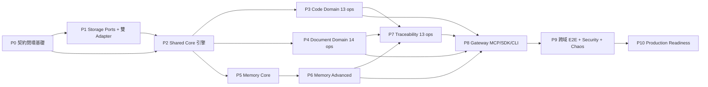

# UKMA v1.2.3 — 完整實作計畫（Implementation Plan）

**規格來源（唯一權威）**：`docs/UKMA_v1.2.3_Full_Spec.md`（v1.2.3，2050+ 行 / §0–§43）
**計畫版本**：plan-1.0（2026-10-25）
**追蹤檔**：`docs/implementation-status.yaml`（機器可讀進度；本文件所有 WP ID 與該檔一對一）
**實作語言**：Rust（Python 僅得存在於 `scripts/`、`tests/*.py` 之 legacy 驗證碼，不得成為 Runtime；見 P0-WP7）

---

## 0. 如何使用本計畫

1. **單一進度來源**：進度只寫在 `docs/implementation-status.yaml`。本文件的勾選框僅為人類可讀鏡像，兩者不一致時以 YAML 為準，且必須修正本文件。
2. **一個 WP 一個 PR**：每個 Work Package（WP）對應一個可獨立審查的 PR；PR 描述必須包含規格 §39.2 要求的六項：`(upstream SHA, moved symbols, changed behavior, schema diff, migration implications, Golden/Contract/Integration test results)`。
3. **狀態定義**（每個 WP 只允許其中之一）：

| 狀態 | 意義 | 必要證據 |
|---|---|---|
| `not_started` | 未開始 | 無 |
| `in_progress` | 進行中 | 分支/PR 連結 |
| `blocked` | 受阻 | 阻擋原因 + 需誰決策（`blocked_reason`） |
| `done` | 完成 | 驗收指令實際輸出（貼於 PR）+ 測試 ID 全綠 |
| `deferred` | 經 ADR 核准延後 | ADR 編號 + 影響的 release gate |

4. **禁止事項**：不得因 WP `done` 就宣稱能力完成；能力階級見 §2。
5. **每次更新追蹤檔必須同時**：更新 `last_updated`、該 WP 的 `evidence`、以及受影響 gate 的狀態。

---

## 1. 現況基線（Baseline，已驗證）

以下為**實際存在且已執行驗證**的資產，非宣稱：

| 資產 | 位置 | 實測證據 |
|---|---|---|
| CodeGraph 上游 mirror + 唯讀 checkout | `f:\codegraph-workspace`（repo 外） | SHA `590c2ca7dd7b37bd1d41caf45fac535b6522f969`；官方 `cargo test --workspace` 299 測試：297 pass / 1 ignored / 1 fail（`test_header_type_resolution` 硬編 `/tmp/`，上游 Windows 可攜性缺陷） |
| S0 交付物 | `docs/migration/*`、`docs/migration/ledger/*` | upstream-lock / source-map / license-audit / dependency-graph / baseline-report 齊備 |
| S1 Graph Engine 垂直切片 | `crates/graph-engine` | 53 契約測試（ids 7 / crud 11 / traversal 9 / tenant 8 / versioning 8 / persistence 10）全綠 |
| Wire 契約型別（部分） | `crates/ukma-contracts` | `RequestEnvelope`/`ResponseEnvelope`/`ErrorDetail`/`ScopeRef`/`ValidityVector`/`OperationOutcome` 等 4 個單元測試 |
| Phase 5/6 legacy runtime | `crates/ukma-code-runtime` | 9 測試（in-memory + JSON adapter） |
| Operation Registry（65 筆） | `contracts/api/operation-registry.yaml` | 65 筆登錄但 `closure_status: provisional`，`status: PHASE4_CODE_TYPED_CANDIDATES_NOT_RUNTIME_CLOSED` |
| Operation Schema（130 檔 + shared） | `contracts/schema/v1/` | 65 × (request+response) 存在但**欄位/約束尚未依 §41.2 閉合** |
| Event registry / envelope | `contracts/events/` | 僅 3 個 code 事件 payload schema（規格需四域全家族） |
| Contract matrix | `contracts/matrices/api-contract-matrix.yaml` | 多數欄位為 `UNRESOLVED_OPERATION_SPECIFIC` |
| 全套 Rust 門禁 | workspace | `cargo fmt --check` / `check --workspace --all-targets` / `clippy -D warnings` / `test --workspace --all-targets` = 66/66 pass（exit 0） |
| CI | `.github/workflows/{rust,s1-merge-gate,upstream-baseline}.yml` | 存在；branch protection 因免費方案 BLOCKED（已記錄） |

### 1.1 已知基線缺陷（必須先修，屬 P0）

| ID | 缺陷 | 影響 |
|---|---|---|
| B-01 | `operation-registry.yaml` 的 `source_file` 指向不存在的舊檔名（`UKMA_v1.2.3_Interface_Runtime_Contract_Specification_...md`） | 來源不可追溯（違反 §41.1 可追溯性） |
| B-02 | `operation-registry.yaml` / `api-contract-matrix.yaml` 內含 Mojibake 亂碼（權限/事件欄位中文） | 契約文字不可審查 |
| B-03 | 缺 `system.*` 4 個 operation 與其 8 份 schema | 無法通過 SCHEMA-01 與 SYS-01..04 |
| B-04 | repo ADR-031 = 「s1-graph-contract-decisions」，與規格 §39 的 ADR-031「Schema-as-Code and Contract Test Gate」**編號衝突** | **RESOLVED**（ADR-046：repo 版重編為 ADR-031a） |
| B-05 | `docs/adr/` 僅有 ADR-031 一檔；規格要求 ADR-021…ADR-040 個別檔案 | **RESOLVED**（ADR-021…ADR-046 共 27 檔 + `docs/adr/README.md` 索引） |
| B-06 | legacy Python harness（`scripts/*.py`、`tests/*.py`）仍可被誤認為驗證來源 | 規格要求 Rust Runtime；退役排程見 P0-WP7 |
| B-07 | `ukma-contracts` 無 domain request/response 型別；`crates/` 缺 12 個目標 crate | 部分 **RESOLVED**（22 個 crate 骨架已建立，型別待 P0-WP4） |
| B-08 | Crate 命名與規格 §3.1/§39.2 不一致（原 `ukma-graph-engine`、缺 `ukma-domain-*` 對應） | **RESOLVED**（ADR-045：採 §3.1 命名，`crates/ukma-graph-engine` → `crates/graph-engine`） |
| B-09 | `contracts/schema/v1/shared.schema.json` **完全沒有 `$defs`**，但 138 份 schema 共 342 次 `ID`、65 次 `RequestContext`/`ErrorDetail`/`PartialReason` 等 21 個型別引用全部指向它 | **RESOLVED（結構）**：已補 45 個 `$defs`，138 份 schema 0 懸空引用；型別內容待逐項對照 §31.3 複核 |
| B-10 | 4 個 `system.*` operation 的 wire 形狀規格未定義；已以 ADR-047 暫行定義 | **PROVISIONAL**：待 owner 核准後轉 ACCEPTED |

---

## 2. 能力階級（不得跳級宣稱）

規格 §31.1 / §40.1(ADR-040) / §42 明定四個階級，本計畫以此定義「完成」：

| 階級 | 條件 | 目前 |
|---|---|---|
| **L1 Catalog-Defined** | 65 Domain + 4 System operation 在 §32–§35 / §36.4 唯一登記 | ✅ 已達（69 筆 registry，id 唯一） |
| **L2 Schema-Closed** | 69 operation 全部具 machine-readable request/response JSON Schema Draft 2020-12（封閉 enum、`additionalProperties:false`、`$id`、`$defs`、limits、正反例 fixtures）且 CI `schema-validate` 通過 | ✅ **已達**（138 schemas + 414 fixtures + `ukma-contract-check` 4745 項檢查全通過） |
| **L3 Implementation-Compliant** | 69 operation × 8 子案例測試實際執行通過；PROP-01..10、E2E-API-01..12 通過 | ❌ **未達**（domain 實作尚未開始；僅 graph-engine 切片） |
| **L4 Production-Ready** | R1–R8 全滿足；≥2 個 production-capable backend profile 通過 Port Tests（且一個完全不載入 RocksDB）；效能基準與災難復原證據齊備 | ❌ **未達** |

> **永久禁令**：在 L2 未完成前，不得聲稱「65/65 契約閉環」；在 L3 未完成前，不得聲稱任何 domain「已實作」；在 L4 未完成前，不得聲稱「production-ready / DB-portable」。
>
> **M1 里程碑已達成（2026-10-25）**：L2 Schema-Closed。可宣稱的措辭是「**69 個 operation 的機器可驗證契約已閉環（Schema-Closed）**」；**不可**宣稱任何 domain 已實作或 API 已可用。

---

## 3. 缺口分析（Baseline → 目標）

| 規格要求 | 現況 | 缺口 | 對應 WP |
|---|---|---|---|
| §3.1 Rust workspace（18 crates + apps + 6 test 類型） | 3 crates | 缺 12+ crate、apps、fixtures、schemas 目錄結構 | P0-WP8, P1, P2..P7 |
| §31.3.1 / §41.2 op-level JSON Schema | 130 檔 provisional | 約束閉合、system 8 檔、正反例、drift CI | P0-WP3/4/5 |
| §35 / §40.6 error & event & scope registry | error registry 不存在、event 3 家族、scope registry 不存在 | 封閉 ErrorCode（39 值）、事件 11 欄位 × 全家族、scope 清單 | P0-WP2 |
| §6.2 六個 Storage Port | 僅 `GraphStore`（S1，非 §6.2 完整簽名） | Vector/FTS/Metadata/Artifact/Outbox 全缺 | P1 |
| §6.3 capability negotiation 17 欄位 | 僅 `StoreCapabilities{persistent, atomic_batches}` | 完整 capability set + router + fail-fast | P1 |
| §7 Shared Core Ports（6） | 無 | Parser/Graph/Retrieval/Embedding/Indexing/Context | P2 |
| §32 Code 13 ops | 無 | 全缺 | P3 |
| §33 Document 14 ops | 無 | 全缺 | P4 |
| §34 Memory 25 ops | 無 | 全缺 | P5, P6 |
| §35 Trace 13 ops | 無 | 全缺 | P7 |
| §36.4 MCP 65+4 tools | 無 | 全缺 | P8 |
| §38.1 12 E2E、§38.2 10 PROP | 無 | 全缺 | P9 |
| §17.1 29 類強制測試、§29.4 40 項 | 僅 S1 graph 部分 | 全缺 | 各階段 + P9 |
| §43 10 個 release gate | G0 部分、G1 已達、G2 部分 | 其餘全缺 | P0..P10 |
| §4.3 migration ledger 每 slice | S0/S1 有 | S2..S7 缺 | 各階段 |

---

## 4. 階段總覽與依賴



| 階段 | 名稱 | 對應 spec Gate | 產出能力階級 | 依賴 | 規模 |
|---|---|---|---|---|---|
| P0 | 契約閉環基礎與治理 | G0 + DOC-01..04, SCHEMA-01/02 | L2（Schema-Closed） | — | L |
| P1 | Storage Ports + 兩個 Adapter | G2 + DB-001/002/003/007/008 | L3（storage 切片） | P0 | L |
| P2 | Shared Core 引擎 | §7 全 Port | L3（core 切片） | P0, P1 | L || P3 | Code Intelligence（13 ops） | G3 + CODE-001/002 | L3（code） | P1, P2 | XL |
| P4 | Document Intelligence（14 ops） | G4 + DOC-001/002 | L3（document） | P1, P2 | L |
| P5 | Memory Domain Core | G5（部分）+ MEM-001..004 | L3（memory，core） | P1, P2 | XL |
| P6 | Memory Advanced | G5 + MEM-005/006 + §29.4 memory 群 | L3（memory，full） | P5 | XL |
| P7 | Traceability（13 ops） | TRACE-001 | L3（trace） | P3, P4, P6 | M |
| P8 | Gateway（MCP/REST/SDK/CLI/Server） | G6 + MCP-001 + SYS-01..04 | L3（API 全量） | P3..P7 | L |
| P9 | 跨域 E2E + Security + Chaos | G6 + R3 + SEC-001 + OPS-001 | L3（整合） | P8 | L |
| P10 | Production Readiness | G7 + R1..R8 | L4 | P9 | L |

規模說明：S≈1–3 人日、M≈4–10、L≈11–30、XL≈31–60、XXL≈61+（**估算，非承諾**；須以實測修正）。ADR-048 決策後，P1（三 adapter）、P3（38 語言）、P10（三 profile）規模已上調。

---

## 5. 階段與 Work Package 細節

### P0 — 契約閉環基礎與治理

**目標**：把「文件層閉合」轉為「機器可驗證閉合」，並修正 B-01…B-08。此階段不寫 domain 邏輯。

| WP | 目標 | 交付物 | 驗收（可執行） | 依賴 | 規模 |
|---|---|---|---|---|---|
| **P0-WP1** | Registry 升級為 §41.1 15 欄位 | `contracts/api/operation-registry.yaml`（65 筆全欄位：`api_major, request_schema, response_schema, required_scopes, preconditions, state_machine, consistency_modes, idempotency, concurrency, error_codes, events, storage_ports, tests, source_section`）；新增 `system` 4 筆 | 每筆 15 欄位齊備；缺一 → CI fail；`closure_status` 由 `provisional` 改為 `schema_closed` 僅在 P0-WP3 通過後 | — | M |
| **P0-WP2** | 封閉錯誤/事件/scope registry | `contracts/api/error-registry.yaml`（§31.3 的 39 個 ErrorCode，含 retry 語意）、`contracts/api/event-registry.yaml`（11 欄位 × 全家族）、`contracts/api/scope-registry.yaml`（`code:index/read/index_admin`… 等） | 所有 registry 引用的 code/event/scope 必屬封閉集合（DOC-02） | — | M |
| **P0-WP3** | Schema 閉合 | 重寫/補齊 `contracts/schema/v1/*.schema.json`：69 × (request+response) + `shared.schema.json`；各檔須有 `$schema/$id/title/$defs/required/additionalProperties:false`、封閉 enum、字串 byte 上限、數字上下界、`maxItems`、RFC3339、`oneOf/if-then`；`contracts/fixtures/v1/<op>/{valid,invalid}/*.json` 正反例 | `scripts`/CI `schema-validate`：每 op valid 例通過、invalid 例被拒；`additionalProperties` 溢出被拒 | P0-WP1 | L |
| **P0-WP4** | Codegen 單一來源 | schema → Rust request/response 型別（`crates/ukma-contracts/src/{core,code,document,memory,traceability,system}.rs` 或 `ukma-domain-*`）、TS/SDK、MCP `inputSchema`；`drift` 測試 | 雙向 drift test：schema↔Rust↔MCP manifest 任一不同步 → fail（PROP-10） | P0-WP3 | L |
| **P0-WP5** | CI 契約閉環 gate | `.github/workflows/contract-closure.yml`：DOC-01..04、SCHEMA-01/02、drift、registry↔schema↔test ID 交叉檢 | 故意破壞任一項 → CI 紅燈（需以負向測試證明） | P0-WP2..4 | M |
| **P0-WP6** | ADR 正規化 | `docs/adr/ADR-021.md … ADR-040.md`（個別檔案，狀態與 §18/§39/§40.1 一致）；新增 `ADR-041`：**crate 命名與 §3.1 對照**（B-08 決策，需使用者核准）；`ADR-042`：repo ADR-031 重新編號為 `ADR-031a`（S1 graph 決策） | 編號唯一、無衝突；`docs/adr/README.md` 索引 | — | S |
| **P0-WP7** | 退役 legacy Python 驗證 | `scripts/*.py`、`tests/*.py` 標記 `LEGACY-NON-RUNTIME` 說明；同等驗證改以 Rust（`cargo test` + schema-validate）承擔；`docs/migration/legacy-python-retirement.md` | 無任何 release gate 依賴 Python；CI 不執行 Python 測試 | P0-WP5 | S |
| **P0-WP8** | 目錄骨架（空殼可編譯） | 依 §3.1 建 `crates/{ukma-types,ukma-storage-ports,ukma-storage-adapters,ukma-domain-code,ukma-domain-document,ukma-domain-memory,ukma-domain-traceability,ukma-mcp-gateway}`、`apps/ukma-server`、`fixtures/{code,documents,multilingual,expected_graphs}`；workspace members 更新 | `cargo check --workspace --all-targets` 通過；每 crate 一個 doc test | P0-WP6 | M |
| **P0-WP9** | 基線缺陷修正 | B-01（source_file 指向 `docs/UKMA_v1.2.3_Full_Spec.md` + sha256）、B-02（亂碼清除）、B-03（system schemas） | 檔案無 Mojibake；source 指向實際檔案 | — | S |

**P0 出口條件**：`SCHEMA-01`、`SCHEMA-02`、`DOC-01..04` 全綠；L2 達成；`cargo fmt/check/clippy/test` 仍全綠。
**風險**：schema 閉合工作量集中（69×2）；建議先做 `shared.schema.json` 與 1 個完整範式 op（`code.get_symbol`），再批次產生，避免 130 檔各自漂移。

---

### P1 — Storage Ports 與兩個 Adapter

| WP | 目標 | 交付物 | 驗收 | 規模 |
|---|---|---|---|---|
| **P1-WP1** | 六個 Port 契約（§6.2） | `crates/ukma-storage-ports/src/{graph,vector,fulltext,metadata,artifact,outbox}.rs`：`upsert/get/delete/bounded traverse`、`search/filter`、`index/fielded search`、`CAS/list/manifest`、`put immutable/hash/retention`、`enqueue/ack/replay/dead-letter` | 每 port 之 trait object 可被至少一個 in-memory 實作滿足；無 DB SDK import（ARC-001） | L |
| **P1-WP2** | Capability set（§6.3 17 欄位） | `capabilities.rs`：`adapter_id, adapter_version, backend_kind, logical_contract_version, adapter_schema_version, supported_ports, transaction_scope, atomic_batch, compare_and_swap, snapshot_reads, acl_filtering, stable_cursor, native_graph_traversal, vector_filters, fulltext_analyzers, durable_outbox, backup_restore, max_batch_size` + `fail_on_missing_required` 啟動檢查 | DB-007：缺必要能力 → 啟動失敗 `CAPABILITY_UNAVAILABLE`（負向測試） | M |
| **P1-WP3** | Adapter A：embedded（**ADR-048 O-03**） | `crates/adapters/filesystem`（Artifact/Metadata）+ `crates/adapters/sqlite`（Graph/FTS/Outbox）；沿用 S1 `FileGraphStore` 經驗 | 通過 P1-WP5 全套 Port Tests；單獨可滿足 DB-008（無 RocksDB E2E） | L |
| **P1-WP4** | Adapter B/C：sql + hybrid（**ADR-048 O-03**） | `crates/adapters/postgres`（Metadata/Graph/FTS/Outbox）+ hybrid profile 的 Qdrant（vector）與 Neo4j（graph）adapter | DB-002 三方等價（A↔B↔C）；兩 profile 皆不得載入 RocksDB | XL |
| **P1-WP5** | Port Contract Tests | `tests/contract/storage/*.rs`：CRUD、bounded traversal、ACL 過濾、CAS、cursor、outbox 重播（at-least-once + 去重） | DB-001、DB-002、DB-003（切換後 IDs/ACL/provenance/revision 不變）、DB-006 | L |
| **P1-WP6** | Outbox + generation publish | `ukma-storage-ports/outbox` 實作 + `index_generation` 原子指標（§36.3 `atomic_manifest_pointer`） | DB-006；`strict_generation` 超時回 `INDEX_NOT_READY` | M |
| **P1-WP7** | Router + 降級政策 | `ukma-storage-router`：依 workload 選 port；不支援能力不得宣稱成功 | 啟動 fail-fast + `partial` 標示 | M |

**P1 出口條件**：G2 達成；DB-009（ACL 防跨租戶，對兩個 Adapter）與 DB-010（fencing cutover 骨架）排入 P10 完整驗收。

---

### P2 — Shared Core 引擎（§7）

| WP | 目標 | 關鍵規格值 | 交付物 | 驗收 | 規模 |
|---|---|---|---|---|---|
| **P2-WP1** | Graph 引擎強化 | §7.2：`upsert_batch/get_entity/get_relation/traverse_bounded/find_paths/query_relations`，每 hop ACL、`visited_count` 只揭授權資料 | 擴充 `crates/graph-engine`（保留 S1 53 測試） | PROP-03（循環/跨專案邊界/過大 traversal 必終止）、DB-003 | M |
| **P2-WP2** | Full-text / BM25 | `k1=1.5, b=0.75`；analyzer 版本化 | `crates/retrieval-engine` FTS 通道 | RE-002（數學一致性）、ML-002（CJK analyzer 可重現） | L |
| **P2-WP3** | Vector | profile 隔離：`model/revision/dimension/normalization/metric/tokenizer/calibration`；HNSW `M=16, ef_construction=200, ef_search=64` | vector port + 索引實現 | DB-004（維度/metric 混用遭拒）、PROP-07、ML-003（截斷維度→新 generation） | L |
| **P2-WP4** | 融合排序 | RRF `k=60`、PPR `a=0.6 / max_iter=200 / L1<1e-6 / not_converged`、hub 抑制 `min(1,50/max(1,degree))`、recency `exp(-0.05*Δdays)`；最終 `score = RRF * importance^1.0 * recency^0.5 * trust^0.8 * novelty^0.2 * lang^0.6` | `retrieval-engine/fusion.rs` | RE-001（可單獨/部分/合併且報 partial）、RE-002、RE-003（raw RRF ≠ calibrated similarity） | L |
| **P2-WP5** | Embedding / Reranker Port | profile registry；BGE-M3 1024d 為候選；降級不可偽裝 | `crates/embedding-engine` | 模型不可用 → `partial` 且保留 source refs | M |
| **P2-WP6** | Indexing 作業 FSM | §7.5 `QUEUED→PARSING→EXTRACTING→RESOLVING→STAGING→COMMITTING→INDEXING→READY` + `FAILED/CANCELLED/STALE` | `crates/indexing-engine` | PROP-09（cancel/timeout 不刪已提交）、DB-006 | L |
| **P2-WP7** | Context Assembly | §22.1 budget、§22.2 folding、§22.3 eviction、§22.4 paging；`B_eff(d)=min(C_usable, max(4096, floor(min(C_usable,131072)/4^d)))`；`C_usable<4096 → INSUFFICIENT_CONTEXT_BUDGET` | `crates/context-engine` | CT-001..004、FO-001..005、§40.2 六組 golden vectors（65536/d0→65536、d1→16384、d2→4096；131072/d1→32768；32768/d3→4096；4095→error）**全部通過（25 tests）** | ✅ done |

**P2 出口條件**：§7 六個 Port 全可呼叫；`graph-engine` S1 測試不得回歸。

---

### P3 — Code Intelligence（13 ops，§32）

| WP | 目標 | 交付物 | 驗收 | 規模 |
|---|---|---|---|---|
| ~~**P3-WP1**~~ ✅ | ParserPort + 語言集（**ADR-048 O-01：38 語言**） | 一套通用 tree-sitter 引擎 `parsers/engine.rs` ＋每語言宣告式 spec `parsers/spec.rs`（form heads、operator forms、descendant naming＋skip、declaration child marker、parent exclusion） | **38/38** 語言 golden parity 通過：`tests/s2_languages.rs` 8 個共用測試 × 每語言 fixture；30 個用鎖定基線語法版本，7 個（cobol, dart, dockerfile, perl, r, tcl, zig）無基線語法，改用 pinned 且 ABI 相容的 crate 並記錄為 deviation（ADR-049 O-08）；kotlin 因 ABI 用 ng fork | XXL |
| **P3-WP2** | Symbol/Edge 模型 | `Symbol`、`CodeEdge`（`resolution: static_exact \| static_possible \| unresolved`）、`CodeAnalysisManifest` | 動態呼叫不得偽稱 complete；`completeness: partial` 正確 | L |
| ~~**P3-WP3**~~ ✅ | Ingestion 管線 | `crates/code-intelligence/src/service.rs`：`submit_analysis`（accept + dedup）／`run_analysis`（Parse → Resolve → Commit → Publish）／`build_revision` + `index_parsed`（§32.3 version-scoped id）；job FSM 沿用 `indexing-engine`（§40.4 三段正交、commit 後不可取消、generation 指標含保留） | `tests/wp3_ingestion.rs` 6 tests：queued→ready 後才出現 manifest、skipped → `partial`、include/exclude glob、每 revision 獨立 generation、`required_generation` 嚴格讀取、跨 service 實例 id 穩定 | L |
| ~~**P3-WP4**~~ ✅ | 13 ops 實作 | `CodeIntelligencePort`（§37 `async` 簽名）+ 同步核心 `CodeIntelligenceService`；`domain.rs` §32.1 canonical 請求/結果型別；`CodeAuthorizer`（scope + per-resource ACL） | `tests/capi_matrix.rs` 25 tests 覆蓋 CAPI-01..13：valid、invalid_schema、FORBIDDEN、CROSS_SCOPE_DENIED、IDEMPOTENCY_CONFLICT、CAPABILITY_UNAVAILABLE、SOURCE_UNAVAILABLE（含 dirty policy）、JOB_NOT_FOUND／JOB_NOT_CANCELLABLE、CURSOR_EXPIRED、RESOURCE_LIMIT、INDEX_STALE、ETAG_MISMATCH、CONTEXT_BUDGET_EXCEEDED、SOURCE_REVISION_MISMATCH、pagination；§37 async port 亦以 `block_on` 實測 | XL |
| ~~**P3-WP5**~~ ✅ | Impact / EditContext | `analyze_impact`（有界反向 BFS、`paths`、`test_candidates`、`unresolved_dynamic_calls`、possible 動態呼叫 → `partial`）、`get_edit_context`（`truncation`、`omitted_refs`、4 char/token 估算、per-path ACL） | `capi10_*`／`capi11_*` tests：impact 不宣稱 complete、`SOURCE_REVISION_MISMATCH`、`CONTEXT_BUDGET_EXCEEDED` 負向、ACL 拒絕不洩漏內容 | L |
| ~~**P3-WP6**~~ ✅ | Golden parity | 每語言 `tests/golden/s2-<lang>/` fixture ＋ `tests/s2_languages.rs` hand-written 期望表（38/38）；`tests/s2_coverage.rs` 擋下任何無 fixture/test 的 `Ported` 宣稱 | CODE-001（symbols/spans/containment/import/call 之 kind 與 resolution；跨檔解析不在範圍） | M |

---

### P4 — Document Intelligence（14 ops，§33）

| WP | 目標 | 交付物 | 驗收 | 規模 |
|---|---|---|---|---|
| ~~**P4-WP1**~~ ✅ | Markdown Parser | `crates/document-intelligence/src/parsers/markdown.rs`：heading（ATX + setext）、fenced code、table/cell、list、image、link、anchor、1-based line + byte span；位置不遺失 | `tests/p4_markdown.rs` 10 tests（hand-written 期望 + `tests/golden/s3-markdown/spec.md`） | L |
| ~~**P4-WP2**~~ ✅ | PDF / DOCX（無 OCR） | `parsers/pdf.rs`（lopdf 文字層）＋ `parsers/docx.rs`（zip + quick-xml：heading/list/table/cell/image）；影像 → `unparsed` + `OCR_NOT_IMPLEMENTED` + `partial`，純影像頁 `PAGE_WITHOUT_TEXT` | `tests/p4_pdf_docx.rs` 7 tests（真實 PDF/DOCX 於測試中生成） | XL |
| ~~**P4-WP3**~~ ✅ | Requirement / Relation 抽取 | `service.rs`：rule-based profile `normative-keyword/1`（must/shall、should、may）、`RequirementCandidate`（一律 `candidate`/`unverified`、`req:v1:` id、沿用 block 內的 REQ-id）、`ExtractedRelation` | `dapi07_*`／`dapi08_*`；未知 profile → `MODEL_UNAVAILABLE` | L |
| ~~**P4-WP4**~~ ✅ | Review 流程 | `review_requirement`：只有 `candidate` 可轉 approved/rejected；`EVIDENCE_REQUIRED`、`ETAG_MISMATCH`、approved 再審 → `LINK_STATE_CONFLICT` | `dapi09_*`／`dapi10_*` | M |
| ~~**P4-WP5**~~ ✅ | Consistency / Compare / Span | `verify_consistency`（missing_reference/unverified/ambiguity/contradiction、`max_findings` → `RESOURCE_LIMIT`、`compare_code` → skipped + partial）、`compare_revisions`（added/removed/modified/moved）、`get_source_span`（policy 或 `max_bytes` → `redacted` + text null） | `dapi11_*`／`dapi12_*`／`dapi14_*` | L |
| ~~**P4-WP6**~~ ✅ | 14 ops 全量 | `DocumentService` 實作 DAPI-01..14 ＋ §37 `async` port；job lifecycle 沿用 `indexing-engine`（commit 前可取消、manifest 經 result_ref） | `tests/dapi_matrix.rs` 19 tests 覆蓋 DAPI-01..14 × 子案例 | L |

---

### P5 — Memory Domain Core（§10, §21–§23, §34 之 core ops）

| WP | 目標 | 關鍵規格值 | 交付物 | 驗收 | 規模 |
|---|---|---|---|---|---|
| ~~**P5-WP1**~~ ✅ | 型別與 envelope | §10.3/§21：MemoryBlock、Episode、SemanticFact、Procedure、FoldedResult、PageRecord、ReconsolidationWindow、EmbeddingProfile、DeletionReceipt、AgentScopeGrant | `memory-domain/src/domain.rs`：§34.1 wire 型別全到齊＋25 個 §34.2 請求型別＋單一 `MemoryError`（註冊碼）；`MemoryKind` 採 §34.1 小寫（ADR-051 D-01）；`EmbeddingProfile` 沿用 `embedding-engine::ModelProfile` | `domain::tests` 6 tests；wire form／錯誤碼／page 驗證 | L |
| ~~**P5-WP2**~~ ✅ | WM 與 budget | `B_eff(d)` 唯一公式（與 P2-WP7 同一實作，不得二套）；配額 60/25/15 等、`floor(B_eff*share)`、餘數入 ring、三者和 = `B_eff`；壓縮序列五級 | reuse `context-engine::budget`；`put/list/remove_working_block`＋per-turn 自動塊上限 5＋turn-based 到期＋`get_budget` | `mapi03_*`／`mapi04_*`／`mapi25_*`；`p5_contracts` §40.2 向量、配額和、五級序列 | L |
| ~~**P5-WP3**~~ ✅ | EM lifecycle + FSRS + TTL | `R(t)=[1+(19/9)(t/S)]^-1`、`S0=2d`、`D0=5(1..10)`、`S_new=min(S*(1+0.5*(11-D)*(e^{1.5(1-R)}-1)),3650)`、失敗 `S*0.5`、`S_min=0.1d`、`T_active(d)=max(1h,72h/2^d)`、`R<0.3/0.3–0.7/≥0.7` 三閘 | `memory-domain/src/fsrs.rs`（含真實 gzip 熵比率、RFC 3339 時間與負區間拒絕）＋`episodic.rs` 生命週期與 sweep | `fsrs::tests` 10、`episodic::tests` 11、`p5_contracts ttl_sweep_*` | L |
| ~~**P5-WP4**~~ ✅ | Folding 三級 + 安全規則 | `PRESERVE s>0.7`、`SUMMARIZE 0.3<s≤0.7`、`FOLD s≤0.3`；R1–R8 不可犧牲規則；`T_fold=T_orig*e^{-0.15*fold_level}`；22 維特徵固定順序 + missing mask | reuse `context-engine::folding`；`fold` 為抽取式（本 build 無摘要模型），safety 命中 → `forced_preserve` 無損，超 `max_tokens` → `POLICY_DENIED` 不截斷 | `mapi13_*`；`p5_contracts` folding 邊界與證據保全 | L |
| ~~**P5-WP5**~~ ✅ | Eviction 雙策略 | `DeterministicPolicy`（REQUIRED）hard filter + 排序、不足則 `CONTEXT_OVERFLOW_SAFE_FAILURE`；`RLEvictionPolicy`（REQUIRED-CONFIGURABLE）shadow-first + `fallback/disable/explain` | reuse `context-engine::eviction`；`evaluate_eviction`（`memory:manage`、plan/apply、未知 policy → `INVALID_ARGUMENT`、decision_reason 帶壓縮階段） | `mapi24_*`；`p5_contracts` eviction 硬保護 | M |
| ~~**P5-WP6**~~ ✅ | Paging + Reconsolidation | `page_out` 原子 PageRecord+checksum+refcount；`page_in` 二次 ACL + hash + revision 檢查；window `labile_until=retrieval+4h(1–12h)`、`strength_decay=0.8`、不可變 `MemoryRevision` + logical head | reuse `context-engine::paging`；`memory-domain/src/reconsolidation.rs`（不可變 revision、head、rollback、CAS、evidence 必要） | `mapi14/15/16/17`；`reconsolidation::tests` 10；`p5_contracts` paging 與 CAS 不覆寫 | L |
| ~~**P5-WP7**~~ ✅ | Agent 碎形隔離 | `max_depth=3`、`max_concurrent=10`、`subagent_timeout=300s`、狀態 `STARTING→RUNNING↔WAITING→COMPLETED \| PARTIAL \| FAILED \| CANCELLED \| TIMED_OUT→FOLDING→SEALED→CLEANUP_ELIGIBLE`；隔離單位 `agent_instance_id+task_id+tenant_id` | `memory-domain/src/scope.rs`＋service 端 sandbox 可見性；`close_agent_scope` 只回 `FoldedResult`＋evidence refs＋status | `scope::tests` 9、`mapi01_*`／`mapi02_*`；`p5_contracts` 父子與跨 session 隔離 | L |
| ~~**P5-WP8**~~ ✅ | Forget + DeletionReceipt | tombstone + 每投影撤銷 + cache 失效狀態；不得刪 Source Artifact / accepted TraceLink；備份到期與 legal hold 明示 | `memory-domain/src/deletion.rs`：`PROJECTIONS`、`NEVER_REVOKED`、guards、tombstone tag；accepted trace link 只標 stale | `deletion::tests` 4、`mapi23_*`；`p5_contracts` 投影與權威分離 | M |
| ~~**P5-WP9**~~ ✅ | Core ops 實作 | MAPI-01..09、13..17、23..25 | `FractalMemoryPort`（§37，25 方法；P6 的 8 個回 `CAPABILITY_UNAVAILABLE`）＋sync `MemoryService` core | `tests/mapi_matrix.rs` 41 tests（正向／負向／授權／跨 scope／版本／idempotency／能力缺口）＋`tests/p5_contracts.rs` 21＋單元 70 | L |

---

### P6 — Memory Advanced（§24–§27, §29）

| WP | 目標 | 關鍵規格值 | 驗收 | 規模 |
|---|---|---|---|---|
| ~~**P6-WP1**~~ ✅ | 九階段 Consolidation DAG | 次序唯一：`Cluster→ExtractFacts→Align→DetectContradictions→Calibrate→Promote→WarmCache→OptimizeGraph→Rescore`；Promotion 僅收非衝突通過 gate 候選；每步 idempotent + checkpoint | `consolidation.rs`：只有 `Promote` 寫 canonical SM、`Promote` 後 `WarmCache` 失敗 → `FAILED_RETRYABLE` 不回滾、重放同 `input_hash` 冪等、`checkpoint_uri`/`audit_ref`、`Quarantined`/`FailedFinal` 凍結 | `consolidation::tests` 8、`p6_matrix mapi18_*` | XL |
| ~~**P6-WP2**~~ ✅ | Fact 提案與驗證 | `propose_fact`（evidence required）→ `verify_fact`（獨立證據）；`CONFLICTING_EVIDENCE` 保留雙方 | `facts.rs`：`Unverified→Verified/Rejected` 單向、重複審查 `LINK_STATE_CONFLICT`、被矛盾事實不可 verify、`find_conflicts` 以 subject+predicate 判衝突 | `facts::tests` 9、`p6_matrix mapi10_*/mapi11_*/mapi12_*` | L |
| ~~**P6-WP3**~~ ✅ | Trust 數學 | `Beta(2,2)`、`E[T]=α/(α+β)`；Kalman `Q=0.05, R=0.1`、`T_rank=0.7*BetaMean+0.3*KalmanMean ∈[0,1]`；深度折扣 `e^{-0.2d}`、折疊折扣 `e^{-0.15f}`；四欄分離（source_reliability / claim_confidence / extractor_confidence / verification_state）+ `authz_decision` 非分數 | `trust.rs`：來源群組去重（重複轉述不計）、cold-start 回 Beta 並記錄、折扣只作用於排序 | `trust::tests` 7 | L |
| ~~**P6-WP4**~~ ✅ | Poisoning / Injection 防護 | 來源突變、異常頻率、矛盾群暴增、`trust_delta_z<-2`、譯文夾帶指令 → `QUARANTINED` 並凍結 Promotion | `poisoning.rs`＋service `quarantine_source`/`restore_source`；注入文字仍分類為 `Data`；恢復需 reviewer＋理由＋snapshot | `poisoning::tests` 7、`p6_matrix mapi18_a_quarantined_source_freezes_promotion` | M |
| ~~**P6-WP5**~~ ✅ | 多語言（**ADR-048 O-04：BGE-M3 1024d**） | 片段級語言辨識；ICU/jieba/Kuromoji/Snowball 可插；`theta_align=.85`、`theta_cross=.75`、`lang_match 1.0/0.85/0.425`、`omega_source=.95`、`omega_trans=.90`、`translation_cache_TTL=24h`、`language_prior=1.0`；`SM=1024/EM=512/WM=256` 截斷**須經 ML-003 + 本地 recall/MRR 測試核准**，未通過即用 1024 維 | `language.rs`：script 級切段保留 byte offsets、混合腳本偵測、script 候選標籤、跨語合併 gate、cache key 含 acl_scope、Laplace prior（明示優先）、embedding generation 切換與截斷狀態 | `language::tests` 7；**僅到 script 層，無 ICU/jieba、無翻譯器、無跨語向量校準**（ADR-052 缺口 3） | XL |
| ~~**P6-WP6**~~ ✅ | Procedure 生命週期 | `LEARN→CONSOLIDATE→APPLY→REFINE` + `DISABLE/REVOKE`；`calls>=3 & success>=0.65` 才 consolidate；`calls>=5 or success<=0.50` 觸發 refine；Beta 有界信心 | `procedures.rs`：候選期可試跑（否則 gate 不可達）、`consolidation_ready` 純檢查避免 revision 漂移、ACTIVE 不授予工具 | `procedures::tests` 6、`p6_matrix mapi20_*/mapi21_*/mapi22_*` | L |
| ~~**P6-WP7**~~ ✅ | 背景維護 jobs | `ttl_sweep, fsrs_refresh, entropy_candidate_scan, consolidation, reconsolidation_close, translation_cache_warm, index_rebuild, stale_knowledge_ref_scan, procedure_review`；FSRS sweep 每 1h；lease/fencing/DLQ/checkpoint | `jobs.rs`：9 kind、tenant 分割、冪等提交、fencing token、指數 backoff→DLQ（5 次）、`resume_checkpoint`、1h 週期 | `jobs::tests` 6；**未啟動背景 worker loop**（ADR-052 缺口 1） | L |
| ~~**P6-WP8**~~ ✅ | 熵整理 | `gzip_ratio<0.4` 且 `0.3≤R<0.7` → 摘要候選；`raw_bytes_len=0 → SKIPPED_EMPTY`；壓縮後 token 增加或關鍵內容遺失須 rollback | `entropy.rs`：`decide`/`verify`，rollback 覆蓋 token 未減少、關鍵內容遺失、引用遺失 | `entropy::tests` 3＋`fsrs` gzip 比率測試；掃描 job 尚未驅動改寫（缺口 9） | M |
| ~~**P6-WP9**~~ ✅ | Advanced ops | MAPI-10..12、18..22 全量 | 25 個 §37 operation **全部**為真實行為，`FractalMemoryPort` 不再有任何 `CAPABILITY_UNAVAILABLE`（ADR-052 supersedes ADR-051 D-09） | `tests/p6_matrix.rs` 13＋`mapi_matrix` port 委派測試 | L |

---

### P7 — Traceability（13 ops，§35）

| WP | 目標 | 交付物 | 驗收 | 規模 |
|---|---|---|---|---|
| ~~**P7-WP1**~~ ✅ | TraceLink 狀態機 | `proposed→validated→accepted`；`proposed/validated→rejected`；`validated/accepted→stale`（來源改版）；`stale→validated`（重驗）；`→revoked`；`rejected/revoked` terminal 不可復活 | `link.rs`：完整轉移矩陣（11 允許 / 8 拒絕）、accepted 後 evidence immutable、重複 evidence id 收斂 | `link::tests` 6；`tapi02`/`tapi03`/`tapi04`；`LINK_STATE_CONFLICT` 負向 | M |
| ~~**P7-WP2**~~ ✅ | 三維有效性 | `ValidityVector{historical_validity, current_applicability, index_freshness, asserted_source_revision, observed_head_revision, assessed_at, evidence_refs}`；歷史 valid 不因新版本變 invalid | `link::assess`：新 head → `requires_revalidation` 但歷史仍 `valid`；revoke 亦不改歷史；`observe_endpoint` 觸發 stale 並重算 | TRACE-001、PROP-06、`tapi07` | L |
| ~~**P7-WP3**~~ ✅ | Coverage 語意 | denominator = 已授權 in-scope Requirements；`denominator=0 → ratio=null`（禁 100%）；`unknown` 不算 covered；不足則 `coverage_incomplete=true` | `analysis::coverage`：只有 applicable＋索引可用＋validated/accepted 才 covered；excluded/unknown → incomplete | `analysis::tests` coverage 4；`tapi07_*`（含無假 100%） | M |
| ~~**P7-WP4**~~ ✅ | Impact / Gap / Explain | `TraceImpact{impacted, links, paths, unknown_due_to_stale, completeness}`、`GapReport`、`EvidenceReport{conclusion: supported \| contradicted \| insufficient}` | `analysis::impact`（BFS 有界 1..=10、5000 候選上限 → `RESOURCE_LIMIT`、stale 邊不展開）、`gaps`、`explain`（contradicted 優先、`omitted_due_to_access`、`CONTEXT_BUDGET_EXCEEDED`） | `analysis::tests` 5；`tapi08`/`tapi09`/`tapi11` | L |
| ~~**P7-WP5**~~ ✅ | 13 ops 全量 | `TraceabilityPort`（§37） | `TraceabilityService` 實作 TAPI-01..13 ＋ §37 async port；`compare_revisions` 用 `record_snapshot`（未知快照 → `SOURCE_UNAVAILABLE`）、`revalidate_stale` 只在斷言 revision == 觀測 head 時回 validated（否則保留 stale，永不自動 accept） | `tests/tapi_matrix.rs` 18 tests 覆蓋 TAPI-01..13；**無持久化 adapter、revalidation 同步執行**（ADR-053 缺口 1–2） | L |

---

### P8 — Gateway（MCP / REST / SDK / CLI / Server）

| WP | 目標 | 交付物 | 驗收 | 規模 |
|---|---|---|---|---|
| ~~**P8-WP1**~~ ✅ | Operation dispatch 核心 | `ukma-mcp`：Registry 驅動（無第三份來源）；envelope 驗證、`idempotency_key`、`expected_etag`、limits、deadline | MCP-001、PROP-10 無 drift | `gateway.rs` 7 unit ＋`gateway_matrix` 全 69 op 派送、deadline/limit/idempotency/etag/snapshot 前置條件（ADR-054） | L |
| ~~**P8-WP2**~~ ✅ | AuthZ 注入 | `OpContext` 由 Gateway 於 host 提供之 `ScopeResolver` 認證後注入；client 自報僅為期望 scope | SEC-001、DB-009、`NOT_FOUND` vs `FORBIDDEN` 規則（§40.7） | `context.rs`：deny-by-default `require`、期望 scope 僅產生 warning、偽造 scope → `FORBIDDEN`；跨 tenant 讀 → `NOT_FOUND`（3 tests） | L |
| ~~**P8-WP3**~~ ✅ | MCP tools | 65 × `ukma_<domain>_<operation>_v1` + 4 system；`tool-manifest.json` 與 registry 同源 | SYS-01..04；漂移即 fail | `manifest.rs` 69 tools／`drift()` 空；`handlers.rs` 69/69 已註冊（`unhandled()` 空）；`JobIndex` tenant+project 隔離（8 tests） | L |
| ~~**P8-WP4**~~ ✅ | REST / SDK / CLI | `/api/v1/{domain}/{operation}` POST（讀操作亦 POST；GET 僅 job/health）；typed SDK；`ukma` CLI；`ukma-server` HTTP listener | SDK 與 schema 型別一致 | `rest.rs`＋`sdk.rs`（`Transport`/`InProcess`/`Client::typed`）＋`apps/ukma-server`（10 tests，live curl 200/404）＋`crates/ukma-cli`（12 tests） | M |
| ~~**P8-WP5**~~ ✅ | Legacy alias 層 | CodeGraph MCP alias 僅在具鎖定 SHA 實測 manifest + parity tests 後啟用 | 差異矩陣文件（不得宣稱全相容） | `alias.rs`：預設 0 alias、`enable()` 需 pinned `590c2ca…`＋parity test＋已註冊目標；`difference_matrix_json()` 記載 `compatibility_claim` 不成立 | M |

---

### P9 — 跨域整合、安全與 Chaos

| WP | 目標 | 驗收 | 規模 |
|---|---|---|---|
| ~~**P9-WP1**~~ ✅ | 12 個 E2E | E2E-API-01..12（§38.1）全通過 | `ukma-integration/tests/e2e_api.rs` 13 tests：全走 public API（envelope → gateway → envelope）；E2E-API-08/09/10/11 為 adapter-level（無 wire operation），其餘為 API-level | L |
| ~~**P9-WP2**~~ ✅ | 10 個 Property 測試 | PROP-01..10（§38.2）全通過 | `ukma-integration/tests/property_matrix.rs` 10 tests：存在性不洩漏、身分穩定、bounded 終止、重放收斂、preserve gate、版本失效、profile 不可比、分頁穩定、cancel 不刪資料、單一 registry | L |
| ~~**P9-WP3**~~ ✅ | §17.1 全表 | REP-001..003、ARC-001/002、DB-001..010、CODE-001/002、DOC-001/002、TRACE-001、MEM-001..006、MCP-001、SEC-001、OPS-001 | `contracts/testing/test-coverage.json`＋`docs/testing/coverage-matrix.md`：29 項 25 covered / 2 partial / 2 gap（REP-003、OPS-001）；矩陣由 `coverage_matrix.rs` 驗證，引用不存在的測試即 fail | L |
| ~~**P9-WP4**~~ ✅ | §29.4 40 項 | FM/FO/RE/CT/AG/TR/CO/LC/PM/ML/SR 全綠；`coverage_matrix=100% disposition` | 40 項 100% 已分類：34 covered / 3 partial（FO-005、ML-002、SR-001）/ 3 gap（FM-006、FM-010、SR-004）；**未宣稱全綠**，缺口與未覆蓋面逐項記錄（ADR-055 D-10） | L |
| ~~**P9-WP5**~~ ✅ | Chaos / 崩潰重播 | 崩潰於 canonical commit 後、index publish 前 → outbox replay → 唯一 READY generation，無幽靈記錄（E2E-API-06/09/12） | `ukma-integration/tests/chaos.rs` 3 tests：commit 後 publish 前崩潰 → 重播得單一 READY generation 且 retained 為空；半套 projection 不宣稱 current；commit 前 cancel 不留 canonical 資料 | M |

---

### P10 — Production Readiness

| WP | 目標 | 驗收 |
|---|---|---|
| **P10-WP1** | 三 profile Port parity（**ADR-048 O-03**） | embedded（FS+SQLite）、sql（PostgreSQL）、hybrid（PostgreSQL+Qdrant+Neo4j）皆通過同一組 Port Tests；DB-008 至少一 profile 完全不載入 RocksDB（三 profile 均不得載入） | R4、DB-002（三方等價）/DB-008 |
| **P10-WP2** | Cutover 演練 | `PLANNED→SNAPSHOT→EXPORT→IMPORT→VERIFY→SHADOW_READ→CUTOVER→MONITOR→COMPLETE`；fencing token、rollback/replay（DB-010、E2E-API-11） |
| **P10-WP3** | 效能基準 | 記錄 P50/P95/P99、RAM/VRAM、索引大小、吞吐、失敗率（指定資料規模/語言/backend/hardware/embedding version）；1M episode 基準（FM-010） |
| **P10-WP4** | 災難復原 | OPS-001（backup/restore、re-index、rollback 演練） |
| **P10-WP5** | 授權與 release evidence | REP-003 license audit 最終版；R8 CI 證據包 |

---

## 6. 測試矩陣總表（追蹤維度）

| 類別 | 數量 | ID 範圍 | 主要階段 |
|---|---:|---|---|
| Operation 契約測試 | 65 | CAPI-01..13 / DAPI-01..14 / MAPI-01..25 / TAPI-01..13 | P3–P7 |
| System API 測試 | 4 | SYS-01..04 | P8 |
| 每 op 子案例 | 8 × 69 ≈ 552 | `valid, invalid_schema, cross_scope, revision_conflict, idempotent_retry, capability_missing, generation_staleness, pagination`（不適用需 `not_applicable_reason` + CI 審查） | P3–P8 |
| 規格 §17.1 強制矩陣 | 29 | REP/ARC/DB/CODE/DOC/TRACE/MEM/MCP/SEC/OPS | P9 |
| 規格 §29.4 FMA 覆蓋 | 40 | FM/FO/RE/CT/AG/TR/CO/LC/PM/ML/SR | P2, P5, P6, P9 |
| Property 測試 | 10 | PROP-01..10 | P9 |
| 跨域 E2E | 12 | E2E-API-01..12 | P9 |
| **合計獨立測試 ID** | **160** | — | — |

追蹤粒度要求：`docs/implementation-status.yaml` 必須為**每個 operation** 記錄 `schema / rust_types / impl / tests` 四個獨立欄位，避免以「domain 完成」掩蓋單一 op 缺漏。

---

## 7. Release Gates 與驗證指令

### 7.1 Gate 對照

| Gate | 必要條件 | 負責階段 | 目前 |
|---|---|---|---|
| G0 Specification | contracts、schema、ADR、fixtures 完備 | P0 | 🟢 **已達**（69×2 schemas、35 event payloads、414 fixtures、ADR-021…048、CI gate） |
| G1 Upstream baseline | 可重現編譯、測試、source lock | S0（已達） | 🟢 |
| G2 Core | Graph/Storage Ports + capability + 2 adapters contract | P1, P2 | 🟡 **部分達標**（六 port + 能力協商 + 兩個 adapter + fail-closed router；HNSW/embedding port 未完成） |
| G3 Code | Symbol/CallGraph/Retrieval parity | P3 | 🟡 **部分達標**（13 ops + ingestion + impact/edit-context 已實作並測試；parity 僅 `rust` 1/38 語言，其餘 37 語言未移植） |
| G4 Document | MD + PDF/DOCX 指定範圍 + evidence parity | P4 | 🔴 |
| G5 Memory | WM/EM/SM/PM、Folding、Consolidation、ACL | P5, P6 | 🔴 |
| G6 Integration | Traceability/MCP/DSH plugin-only/E2E | P7, P8, P9 | 🔴 |
| G7 Production | Security、Perf、DR、license audit | P10 | 🔴 |
| DOC-01..04 | 65 ops 唯一、ErrorCode 封閉、單一 budget 演算法、狀態分離 | P0 | 🟢 **已達**（checker 實際執行驗證） |
| SCHEMA-01/02 | 69×2 schemas + 事件 envelope/payload | P0 | 🟢 **已達**（138 + 35 payload schemas） |
| TEST-01 | CAPI/DAPI/MAPI/TAPI/SYS 實際通過 | P3–P8 | 🔴 |
| DB-01 | ≥2 production backend（禁只用 in-memory） | P10 | 🔴 |
| MIG-01 | 上游 SHA + golden fixtures + ledger | S0/S1 已達；S2..S7 缺 | 🟡 |
| SECURITY-01 | ACL/Deletion/Isolation/Folding/injection 負向 | P9 | 🔴 |

### 7.2 每個 WP 必跑的驗收指令

```powershell
cargo fmt --all -- --check
cargo check --workspace --all-targets
cargo clippy --workspace --all-targets -- -D warnings
cargo test --workspace --all-targets
```

P0 之後追加（每階段都必須綠）：

```powershell
# 契約閉環（P0-WP5 建立後生效）
cargo run -p ukma-contract-check -- --registry contracts/api/operation-registry.yaml --schemas contracts/schema/v1 --fixtures contracts/fixtures
```

> 說明：`ukma-contract-check` 為 P0-WP5 交付的 Rust 驗證器（取代 legacy Python `verify_contracts.py`），職責：registry↔schema↔fixture↔Rust 型別↔MCP manifest 交叉驗證。

---

## 8. 進度追蹤機制

### 8.1 `docs/implementation-status.yaml` 結構

```yaml
meta: {plan_version, spec_version, api_major, last_updated}
claim_level: {catalog_defined: true, schema_closed: false, implementation_compliant: false, production_ready: false}
gates: {G0: ..., G1: ..., DOC-01: ..., SCHEMA-01: ...}
phases:
  - id: P0
    status: in_progress
    work_packages:
      - {id: P0-WP1, status: in_progress, evidence: "PR #12", blocked_reason: null}
operations:            # 69 筆，每筆一列
  - {id: code.analyze_repository, test_id: CAPI-01, domain: code, schema: provisional, rust_types: absent, impl: absent, tests: absent}
tests:
  properties: {PROP-01: not_started, ...}
  e2e: {E2E-API-01: not_started, ...}
  spec_17_1: {REP-001: not_started, ...}
  fma_29_4: {FM-001: not_started, ...}
```

### 8.2 更新流程

1. 開工：把 WP 設 `in_progress` 並填 PR 連結。
2. 完成：貼上實際指令輸出到 PR；把 WP 設 `done`；同步該 WP 影響的 `operations` 與 `tests` 欄位（不得跳過）。
3. 受阻：設 `blocked` + `blocked_reason`（需誰決策）。
4. 每個 release gate 只在**其所有依賴 WP 為 `done` 且證據在 PR 中**時才可標 `passed`。

### 8.3 里程碑建議（以可驗收的 Gate 為里程碑，不以日期）

| 里程碑 | 判定 | 對外可宣稱 |
|---|---|---|
| M1 = P0 完成 | SCHEMA-01/02 + DOC-01..04 綠 | 「Schema-Closed（L2）」 |
| M2 = P1+P2 完成 | G2 + DB-001/002/003/007/008 | 「Storage 可攜性骨架完成」 |
| M3 = P3+P4 完成 | G3 + G4 | 「Code/Document domain 實作符合契約（L3 局部）」 |
| M4 = P5+P6 完成 | G5 + MEM-001..006 + §29.4 memory 群 | 「Memory domain 全能力符合契約」 |
| M5 = P7+P8 完成 | G6 + MCP-001 + SYS-01..04 | 「四域 API 全量可呼叫（L3）」 |
| M6 = P9 完成 | R2/R3 + SEC-001 + OPS-001 | 「Integration-Compliant」 |
| M7 = P10 完成 | G7 + R1..R8 | 「Production-Ready（L4）」 |

---

## 9. 風險與未決事項

### 9.1 決策記錄（已全部定案，2026-10-25）

| 編號 | 決策 | 狀態 | 決議（ADR） |
|---|---|---|---|
| O-01 | 首發語言集（Code Parser） | ✅ **resolved** | ADR-048：**全 38 個上游 parser**（bash…zig）；`CODE-001` 判定集合為 38 語言 |
| O-02 | 首發 PDF/OCR 覆蓋率 | ✅ **resolved** | ADR-048：Markdown 完整 + PDF 文字層 + DOCX；**OCR 標 NOT_IMPLEMENTED**並以 `partial`+`diagnostics` 誠實反映 |
| O-03 | 第一組 DB Adapter | ✅ **resolved** | ADR-048：**hybrid** — A=filesystem+SQLite(embedded)、B=PostgreSQL(sql)、C=Qdrant+Neo4j(hybrid) |
| O-04 | Embedding profile 與 SLA | ✅ **resolved** | ADR-048：**BGE-M3 1024d**；`SM=1024/EM=512/WM=256` 截斷須經 ML-003 與本地品質測試核准 |
| O-05 | Crate 命名對照 | ✅ **resolved** | ADR-045：採 §3.1 命名（`crates/ukma-graph-engine` → `crates/graph-engine`） |
| O-06 | repo ADR-031 與規格 ADR-031 衝突 | ✅ **resolved** | ADR-046：repo 版重編為 ADR-031a |
| O-07 | legacy `ukma-code-runtime` | ✅ **resolved** | ADR-048：標 `deprecated`，P3 完成後移除；其測試不得作為 gate 證據 |
| O-08 | 4 個 `system.*` operation 的 wire 形狀（規格未定義） | ✅ **resolved** | ADR-047：`capabilities / get_operation / get_job / cancel_job` 形狀已核准 |

> 所有 §18 `OPEN` 項與本計畫新增決策均已定案；後續變更 MUST 走 Superseding ADR（ADR-046 程序）。

### 9.2 主要風險

| 風險 | 影響 | 緩解 |
|---|---|---|
| Schema 閉合工作量被低估（69×2 且要逐欄位約束） | M1 延遲，阻塞全部 | 先建立 shared + 1 個範式 op，再用 generator 批次產出並以負向 fixture 驗證 |
| 每個 op 8 子案例 → ≈552 案例 | 測試維護成本高 | 以資料驅動測試表 + 共用 fixture 產生器，避免手寫重複 |
| 記憶數學（FSRS/PPR/trust/RRF）易出現 0^0/NaN/overflow | FM-007 失敗、行為不確定 | 全部數值入口先過 domain guard（有界非負、時間 skew、除零），以 property 測試覆蓋 |
| 多語言（CJK tokenizer）不可重現 | ML-002/ML-003 失敗 | analyzer 版本寫入 profile 與 index generation，切換即新 generation |
| 兩個 backend parity 不完整 | DB-01 阻擋 release | P1 即以同一組 Port Tests 驅動兩個 adapter，不等到 P10 |
| 「先做功能後補契約」的壓力 | 回到 provisional 狀態 | P0 出口即 CI 強制：registry/schema/drift 任一缺 → 紅燈，無豁免 |
| 上游 `/tmp/` 缺陷與 toolchain pin | G1 重驗 | 已記錄為 accepted known defect；CI 以 windows-latest 誠實偵測；merge 前重驗 pin |
| **【ADR-048】38 語言全覆蓋** | P3-WP1/WP6 規模放大一個數量級：需 38 份 parser ledger + 38 份 golden parity 報告；`CODE-001` 任一語言缺報告即 FAIL | 內部順序仍為「先建共用 ParserPort + 5 語言標竿，再批次擴充」，但**驗收範圍不縮減**；每語言以固定 fixture 與自動化 parity 報告降低人工作業 |
| **【ADR-048】hybrid 三 adapter** | P1 需 3 組 adapter（embedded/sql/hybrid）與跨 vendor projection lag 語意；`DB-002` 由 2 方等價升為 3 方等價；P10 規模顯著增加 | P1 先完成 A（embedded）使 `DB-008` 可獨立達成，B/C 以同一組 Port Tests 平行推進；不得假設跨 vendor global ACID（§28.2） |
| **【ADR-048】BGE-M3 截斷不可用** | `EM-512/WM-256` 若品質測試未過，只能維持 1024 維，向量儲存成本上升 | 以 `ML-003` 與本地 recall/MRR 先行驗證；未通過即記錄 `truncation: unapproved`，不強行啟用 |
| **【ADR-048】legacy runtime 移除風險** | P3 後刪除 `ukma-code-runtime` 可能影響既有 9 測試代表的相容行為 | 移除前確認無 gate 證據依賴，並將仍有價值的行為（JSON snapshot 格式）移轉至 `storage-adapters` |

---

## 10. 不可宣稱清單（Compliance Guardrails）

1. 未通過 SCHEMA-01 前：不得稱「API 契約已閉環」或「65/65 完成」。
2. 未通過 TEST-01 前：不得稱任何 domain「已實作」。
3. 未通過 DB-01/DB-008 前：不得稱「database-agnostic / DB-portable 已驗證」（S1 僅證明 Domain 無 DB 依賴，不等於兩 backend 可攜）。
4. 未通過 FM-010/P10-WP3 前：不得引用任何延遲/容量數字為 SLA。
5. 未通過 MIG-01 前：不得稱移植完成；每 slice 仍需 ledger。
6. 未通過 SECURITY-01 前：不得稱「多租戶安全」。
7. `partial`、`coverage_incomplete`、`freshness` 必須出現在回應中，不得以空結果冒充「不存在」。

---

## 11. 立即可執行的前 6 個 WP（建議順序）

1. **P0-WP9** 基線缺陷修正（B-01/B-02/B-03）— 解鎖可審查性
2. **P0-WP1** Registry 15 欄位升級（含 system 4 筆）
3. **P0-WP2** error/event/scope registry 封閉化
4. **P0-WP3** Schema 閉合（先 shared + `code.get_symbol` 範式）
5. **P0-WP5** `ukma-contract-check` + CI gate（自此不再有「口頭閉環」）
6. **P0-WP4** Codegen（schema → Rust/TS/SDK/MCP，drift 測試）

> **已核准（2026-10-25）**：O-01…O-08 全部定案（ADR-045/046/047/048）。P0-WP6（ADR 正規化）、P0-WP8（22 crate + `apps/ukma-server` 骨架）、P0-WP9（基線缺陷）已完成；O-05/O-06/O-07 一併決議。
>
> **決定後的範圍**：Code 語言 = 38 種全覆蓋；Document = MD + PDF 文字層 + DOCX（無 OCR）；Storage = hybrid 三 adapter；Embedding = BGE-M3 1024d；legacy `ukma-code-runtime` 標 deprecated 並於 P3 後移除。
